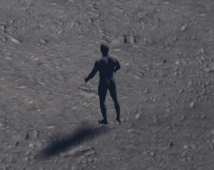

# UE5 Day 1 — 빈 바닥 한 장 (2026-11-05, Mac)

**엔진 전환 결정이 아니다.** 사용자 지시 "아무것도 없는 빈 바닥이라도 시작하는 거야. 조잡하게 아무거나 만들지 말고."와 "33도 정도로 화면을 한번 해 보고"를 따랐다. 고목·탄막은 캐릭터 우선순위 때문에 뒤로 미뤘다. 판정은 사용자 몫이다.

## C1 캐릭터를 바닥 위에 세움 (11-05) — 바닥 관문: 부분 통과(안개 기울기 미달)

| 화면 | 파일 |
|---|---|
| Lumen 끔 1920 | [ue-hero-off-1920](img/ue-hero-off-1920.png) |
| Lumen 켬 1920 | [ue-hero-lumen-1920](img/ue-hero-lumen-1920.png) |
| 영웅 1x |  |
| 영웅 3x (최근접) | [ue-hero-3x](img/ue-hero-3x.png) |

- C1 14파트 FBX를 스켈레탈 메시로 가져와 idle 시험 포즈로 세웠다. 임포트는 파이썬 무창으로 통과했고, 발이 바닥에 닿고 그림자가 붙는다.
- 영웅은 회색 맨몸이고 **역광이라 거의 실루엣이며 등을 보인다.** 최종 재질이 아니다.
- 픽셀 렌더 합성(K7)은 아직이다. 일반 3D 렌더다.
- 성능 수치는 비교에 쓰지 않는다.

### 안개 지정값 시도 1회 — 미달, 멈춤

CTO 지정: 은회색, 밀도 2~3배, 감쇠 낮춤. 결과: [ue-fog-specified-attempt](img/ue-fog-specified-attempt.png).

| 값 | 측정 |
|---|---|
| 밀도 .30, 감쇠 .08, 색 (1.7,1.8,1.95), 노출 -2.4 | 평균 휘도 위 102 / 가운데 118 / 아래 140, 그림자 하위 1% 87 |

화면 전체가 뿌옇게 올라갔고 먼 쪽이 여전히 어둡다. 그림자 하한도 목표(18~28)를 크게 넘었다. **안개 기울기 미달. 원인 후보: 카메라 높이 대비 안개 높이 상한, ExponentialHeightFog 위치 Z.** 지시대로 더 만지지 않았다. 색 값은 노출 -2.4에서 화면 150~170이 나오도록 크게 잡았고, 화면에서 실제로 맞았는지는 재지 않았다.

**영웅 화면은 이 값이 아니다.** 안개를 2차 값(밀도 .12, 감쇠 .12)으로 돌렸다. 그리고 영웅이 까맣게 죽어 **Sky를 .05에서 .22로 올렸다.** "Sky를 올리지 말라"는 지시는 안개 시도에 대한 것으로 이해했지만, 그림자 하한 조건에는 불리하다. 측정: 하위 1% 59.4, 중앙 90.7, 위 78.6 / 가운데 90.3 / 아래 102.8. **그림자 하한과 안개 기울기 모두 미달이다.**

### 황천 규칙 1대로 안개 1회 — 미달, 멈춤

CTO가 앞선 지시(위로 갈수록 뚜렷)가 규칙 1과 반대였다고 정정했다. 지면에 고인 층으로 한 번 더 시험했다. 주광 42°/방위 140°, Sky .05, 노출 -2.4.

| 화면 | 설정 | 하위 1% | 중앙 | 위 / 가운데 / 아래 |
|---|---|---|---|---|
| [안개 있음](img/ue-rule1-fog.png) | 밀도 .84, 감쇠 12, 색 (.9,1.05,1.3) | **86.6** | 114.9 | 100 / 114 / 132 |
| [안개 없음](img/ue-rule1-nofog.png) | 밀도 0 | **48.3** | 79.7 | 70 / 81 / 89 |

- 감쇠 12는 추정값이다. UE의 감쇠 단위를 cm 기준으로 계산해 게임 축척의 1.2~4m에 맞췄고, 안개 높이를 실제로 재지 않았다.
- **그림자 하한(18~28) 미달.** 안개가 전혀 없어도 하위 1%가 48이다. **원인 후보:** 안개가 아니라 노출, 바닥 반사율, 주광 세기 조합이다. 또 이 값은 바닥 전체의 어두운 픽셀이지 실제 그림자 영역만 잰 값이 아니다.
- **위 1/4 차폐 ≤ 35%:** 직접 재지 않았다. 안개 유무의 위쪽 휘도 차이는 30이다.
- 지시대로 여기서 멈췄다. 영웅이 까매지는 문제는 남아 있다. 림·필 라이트는 쓰지 않았다.

### 황천 규칙과의 차이

값 출처를 `claude/unity-cloud-yellowsky-study-20261105` `3cba6afbc`의 `GAME_STUDY/downfall_of_yellowsky.md` §0으로 바꿨다. 이 규칙들은 대부분 [기준]·[추정]이며 게임 실측이 아니다.

| 규칙 | 값 | 이 장면 | 비고 |
|---|---|---|---|
| 3 주광 | 고도 35~50°, 카메라 기준 방위 120~160° | 고도 42°, 방위 140° (pitch -42, yaw 220) | **CTO 지시 고도 20~30°와 다름, 규칙을 따름** |
| 3 주광:환경광 | 휘도비 3:1~5:1 | 미측정 | |
| 1 안개 | 지면 위 0~1.2m 진하게, 1.2~4m에서 0으로, 화면 위 1/4 차폐 ≤ 35%, 거리 안개 금지 | 시작 거리 0, 감쇠 낮음 | **규칙은 낮게 고인 층이다. "위로 갈수록 뚜렷"과 감쇠를 낮추는 지정값은 이 규칙과 어긋난다.** 낮은 층(감쇠 높임)은 시험하지 않았다 |
| 5 그림자 | 최저 휘도 18~28, 순흑 ≤ 3% | 미달 | SSAO 값 미적용 |

## 2차 빛·안개 (CTO 지적 반영) — 관문 일부 미달

CTO 판단: 1차는 재질은 성립했지만 빛 방향과 안개 기울기가 없는 평면이다. 2차는 같은 33°로 다시 찍었다.

| 화면 | 파일 |
|---|---|
| 1920 기준 | [ue-floor2-off-1920](img/ue-floor2-off-1920.png) |
| 1920 Lumen | [ue-floor2-lumen-1920](img/ue-floor2-lumen-1920.png) |
| 3840 기준 | [ue-floor2-off-3840](img/ue-floor2-off-3840.png) |
| 3배 크롭 (최근접) | [ue-floor2-crop-3x](img/ue-floor2-crop-3x.png) |

| 기준 | 목표 | 측정 (sRGB 0~255, 1920 기준) | 판정 |
|---|---|---|---|
| 주광 | 역광, 고도 20~30° | pitch -22, yaw 198 | 충족 |
| 자동 노출 | 끔 | Manual, bias -2.4 | 충족 |
| 안개 | 높이 안개만, 거리 안개 없음 | Exponential Height Fog, 시작 거리 0, 밀도 .12, 감쇠 .12 | 충족 |
| **그림자 최저 휘도** | **18~28** | 하위 1% **34.1**, 하위 5% 44.3, 중앙 67.6 | **미달** |
| **먼 쪽 안개 기울기** | 위로 갈수록 뚜렷 | 평균 휘도 위 53.4 / 가운데 68.1 / 아래 92.4 | **미달: 먼 쪽이 오히려 어둡다** |
| 톤매핑 | 기록 | 엔진 기본 필름 톤매퍼, `r.Tonemapper.Quality` 5 | 기록 |
| 타일 반복·점 | 없음 | 3배 크롭 눈 확인 | 반복은 안 보임, 점은 미측정 |

**값을 조정한 횟수:** 다섯 번(v2a~v2d, 최종). 노출을 낮추면 안개도 같이 낮아져 기울기가 살아나지 않았고, 안개를 높이면 앞쪽도 함께 뿌옇게 올라갔다. 빈 평면에서 값만 만져서는 두 목표를 함께 맞추지 못했다. 다음 시도는 안개 높이를 지면 가까이 낮추는 쪽이다. 시험하지 않았다.

Lumen 끔과 켬의 휘도 차이는 없다(중앙 67.6 대 67.6). 빈 바닥에는 빛을 받을 물체가 없다.

성능 수치는 빈 바닥 조건이라 **성능 비교에 쓰지 않는다.** [측정 원본](ue5-floor2-perf-20261105.json.txt).

## 1차 결과

**왼쪽 UE, 오른쪽 Unity:** [K1 비교판](img/k1-board-ue-left-unity-right.png)

| 화면 | 파일 |
|---|---|
| UE 1920×1080, 33° | [ue-floor-1920](img/ue-floor-1920.png) |
| UE 3840×1080, 33° | [ue-floor-3840](img/ue-floor-3840.png) |
| UE 1920×1080, Lumen 켬 | [ue-floor-lumen-1920](img/ue-floor-lumen-1920.png) |
| Unity 1-1 같은 카메라 33° (3450:7900) | [unity-33-field](img/unity-33-field.png) |

**비교판은 조건 불일치다.** 같은 카메라 값일 뿐 같은 장면이 아니다. Unity는 나무·물·소품·HUD·영웅이 있는 실제 1-1이고, UE는 빈 바닥이다. 그림의 우열을 가르는 비교가 아니고 Unity 쪽은 빈 바닥으로 만들지 않았다. Unity 33°는 커밋하지 않은 로컬 코드로 카메라만 옮겨 찍었다.

## 환경

| 항목 | 값 |
|---|---|
| 엔진 | UE 5.8.4 (58902052) |
| 도구 | Xcode 27.2 + Metal Toolchain 27B47 |
| 장비 | M5 Pro, 메모리 24GB (UE 권장 32GB 미만) |
| 프로젝트 | TP_BlankBP 설정 복사, Starter Content 없음, Git 밖 `~/EXODUSER-Storage/ue5-trial/EXO_UE5_Trial` |
| 재현 | [`tools/ue5_trial/`](../../../tools/ue5_trial/) |

**Xcode 27.2는 Epic 공식 범위 밖**(계획 문서 인용: 권장 26.1.1, 26.4 비호환)이지만, 셰이더 컴파일과 실행은 통과했다. 패키징은 시험하지 않았다. `-game` 실행 결과이므로 계획 §9 기준으로는 **`부분 확인`** 이다.

## 카메라

Unity 1u = 100cm 기하 환산, 피치 **33°(사용자 지시, 계획의 34°와 다름)**, 거리 1650cm, 세로 FOV 46.9453°.

| 해상도 | 가로 FOV | 카메라 비율 |
|---|---|---|
| 1920×1080 | 75.3356° | 1.7778 |
| 3840×1080 | 114.1397° | 3.5556 |

게임 u는 실제 미터가 아니다. 현재 게임의 영웅 약 88px을 키 1.85m로 보면 1u는 약 1.54m이다. 지면 스캔(실제 3.15m)을 **205cm**마다 반복하도록 잡은 근거이다. 추정값이고 Core 수치를 근거로 정한 값은 아니다.

## 바닥

| 항목 | 값 |
|---|---|
| 재질 | Poly Haven `forest_ground_04` 4K, CC0 |
| 메시 | 480×480 격자, 노이즈 높이 ±약 19cm, 460,800△, 가로세로 3배 확대 배치 |
| 반복 숨김 | 회전·축척이 다른 3겹(1 / 1.37 / .83배)을 절차 노이즈 마스크 2개로 섞음. 큰 명암 변화는 별도 노이즈 |
| 색 | 채도 62% 낮춤, 어두운 회색 틴트 |
| 임시물 | 큐브·기본 재질·Starter Content 0, 기본 폰(회색 구체)은 숨김 |

첫 시도는 같은 돌기가 격자로 반복돼 바로 버렸고 올리지 않았다. 멀리 낮은 물결 무늬가 약하게 남았다.

## 빛·안개·노출

| 항목 | 값 |
|---|---|
| 주광 | 역광 방향 pitch -24, yaw 205, 색 (.74,.82,1), 세기 9 |
| 환경광 | SkyAtmosphere + 실시간 SkyLight .55 |
| 안개 | 시작 1400cm, 밀도 .07, 감쇠 .35, 색 (.06,.085,.11) |
| 노출 | Manual, bias .25, 블룸·비네트·모션 블러·그레인 끔 |

## Lumen

**Blank 템플릿의 기본값은 Lumen이 아니었다.** 지시와 체크리스트의 "Lumen 기본값"과 다르다.

| 설정 | GI | 반사 | VSM |
|---|---|---|---|
| 템플릿 기본 | 0 (없음) | 2 (화면 공간) | 켬 |
| 기준 화면 | 0 | 0 | 끔 |
| Lumen 켠 화면 | 1 | 1 | 켬 |

안개 기본값: 밀도 .02, 감쇠 .2, 시작 0, 차단 0, 최대 불투명 1.

**빈 바닥에서는 Lumen 차이가 거의 안 보인다.** 받아서 튕길 물체가 없다. 거리장도 켜지 않았으므로 Lumen 품질 판정이 아니다.

## 성능·메모리

| 구성 | FPS | p95 | 최대 메모리(RSS) |
|---|---|---|---|
| 1920×1080 기준 | **120 (상한으로 보임)** | 8.9ms | 2,364MB |
| 1920×1080 Lumen | **120 (상한으로 보임)** | 8.8ms | 2,344MB |
| 3840×1080 기준 | 106 | 9.6ms | 2,381MB |
| 에디터 (창 없이 약 90초) | 미측정 | | 2,415MB |

- 세 수치는 `-RenderOffScreen`, 예열 15초, 10초 구간, 빈 바닥뿐이다. `t.MaxFPS=0`을 줘도 120에 머물러 1080p의 실제 여력은 모른다. 장면이 차면 달라지고 게임 성능 비교가 아니다.
- 에디터 RSS는 90초 안의 최고값이고, 레벨 조작 부하를 넣지 않았다.
- 첫 셰이더 컴파일은 약 **25분**, 그 뒤 실행은 약 40초다.
- `-RenderOffScreen`에서 정상 캡처됐다. Metal 무창 경로는 이 조건에서 동작했다.

## 실패 기록

| 실패 | 원인 | 처리 |
|---|---|---|
| 첫 실행 즉시 종료 | Metal Toolchain 없음 | 사용자 승인 후 설치 |
| 재질 스크립트 오류 | 파이썬 속성 접근 불가 | `set_editor_property`로 변경 |
| 캡처 안 됨 (25분 컴파일 뒤) | `-game`에 에디터 서브시스템 없음 | 월드 찾는 방식 변경 |
| 커맨드라인 빌드 끝나고 프로세스 남음 | 원인 미조사 | 완료 로그 확인 후 종료 |
| 첫 3840 구도 어긋남 | 카메라 비율 미지정 + 바닥 크기 부족 | 둘 다 수정 |

## 안 한 것

고목 반입, 탄막 패턴, Megascans(자산 없음), 패키징, 10초 영상, Unity 빈 바닥 대조, 재질 품질의 사용자 판정.
