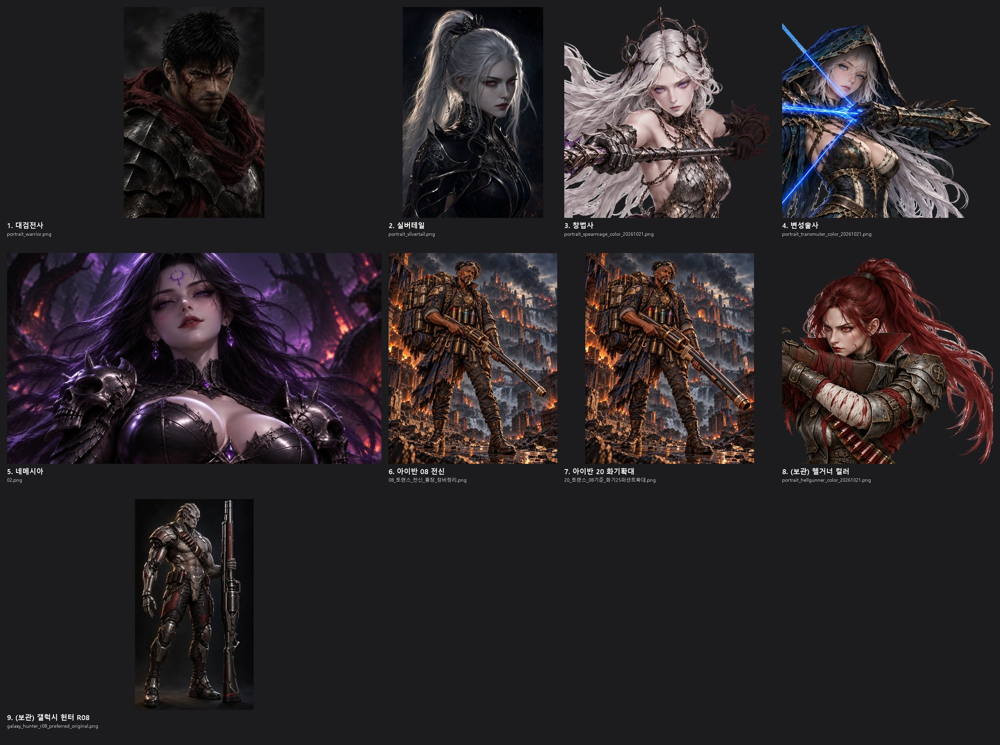

# EXODUSER 통합 디자인 컨셉 v1 — 하나의 지옥, 하나의 흐름

작성·소유: **디자인총괄(PC Claude, local_eb8a8577)**. 게임 전체 시각·청각 톤의 상위 기준이다. 분야별 세부 기준(맵 바이블, UI 기반, 캐릭터 DESIGN LOCK)은 이 문서 아래에 있다.

- 상태: v1. **1·2·4·5장 작성**했다(사용자 지시 2026-10-26 "캐릭터들은 멀티유니버스에서 오니까 다를 수는 있어도 전체 톤은 하나로 흐름을 가지고 가야지").
- 3·6~10장은 장 구성과 원천만 적어 두었다. 구 디자인 세션 인계 메모(`E:/exoduser-wt/_out/design-reconcile/HANDOFF.md` §4)를 따른다.
- 형식: 장마다 핵심 원칙 → 세부 규칙 표 → 예시 이미지 → 금지 순서로 쓴다.

---

## 1장. 정서 — 한 줄 정의

> **음습하고 아름다운 지옥.** 어둠은 넓고 탁하게, 빛은 작고 아름답게, 살은 붉고 젖어 있게.

| 축 | 정의 | 근거 |
|---|---|---|
| 세계 | 모든 시대·종족·행성·평행 현실의 악의가 흘러드는 **단 하나의 지옥** | 세계관 v2 [1]·법칙 1 수렴 |
| 정서 | 공포가 아니라 **매혹적인 어둠**. 눈을 끄는 빛, 아름다운 악역 | 사용자 키워드(2026-10-26), 메모리 "악역도 매력적으로" |
| 작화 | **Berserk 잉크 밀도 + FromSoftware 재질·조형**. 전 캐릭터 예외 없음 | 세계관 v2 [19] |
| 환경 | 손으로 칠한 빛 + 고유 손그림 바닥 + 3D 공간의 그림 레이어(Moon Studios 제작 방식만 차용) | 3D 맵 기획서 §4.6 |

---

## 2장. 공통 시각 언어 (모든 작업물에 공통)

| # | 규칙 | 세부 |
|---|---|---|
| S1 | **컬러 축** | 빨강(진홍·옥스블러드) · 검정(흑철) · 황금(탁한 황동·상아) · 보라(네메시아 계열 전용). 분야별 그레이딩은 이 네 색의 비율 조정으로만 한다(세계관 v2 [19]) |
| S2 | **명도 구조** | 넓은 어둠 + 작은 밝음. 밝은 면은 얼굴·무기 날·뼈 끝·젖은 반사·발광 코어처럼 **작고 의미 있는 곳**에만 둔다 |
| S3 | **하이라이트는 빛의 색** | 흰색·중성 회색 광택 금지. 반사는 근처 광원 색(진홍·독액 황록·고유색)을 띤다 |
| S4 | **잔류 표식** | 지옥에 있는 모든 것에는 그을음·마모·마른 피·찢김 같은 "지옥이 스며든 흔적"이 있다(세계관 v2 법칙 3 잔류) |
| S5 | 점 금지 | 잔점·점묘·디더링·반짝이 점 0(CLAUDE.md 퀄리티 8항, 맵 G5) |
| S6 | 서사의 메타버스는 그림에 드러내지 않는다 | 디지털·글리치·홀로그램·SF 비주얼을 직접 보여 주지 않는다. 평행 현실은 서사 배경으로만(세계관 v2 [19]) |

---

## 3장. 환경·맵 → [MAP_ART_BIBLE_v2_20261026.md](../4.1맵디자인+설정/MAP_ART_BIBLE_v2_20261026.md)

맵의 팔레트·명도(CIE L\*)·재질·형태·조명·독액·생동감·판정은 통합 맵 아트 바이블이 정본이다. 이 문서 2장과 충돌하지 않는다.

---

## 4장. 캐릭터 — "출신은 달라도, 지옥이 칠한다"

### 4.1 핵심 원칙

1. **캐릭터는 서로 다른 세계·시대에서 떨어졌다**(수렴 법칙). 그래서 실루엣·체형·의상 문화·무기 구조·고유색은 달라도 된다. 오히려 달라야 한다.
2. **그러나 모두 같은 지옥에 있다**(잔류 법칙). 지옥의 빛·공기·악의가 모든 캐릭터를 같은 붓으로 다시 칠한다. 렌더 언어·명도 구조·조명·재질 마감·팔레트 바탕은 하나다.
3. 판정 질문: **"이 캐릭터를 전사·실버테일 옆에 세웠을 때 같은 게임의 같은 지옥에 서 있는가?"**

### 4.2 두 층 규칙

**출신 층 — 달라도 되는 것 (캐릭터 개성)**

| 항목 | 허용 범위 | 예 |
|---|---|---|
| 실루엣·체형 | 자유. 한 화면에서 서로 구분되는 큰 실루엣일수록 좋다 | 대검 + 망토 / 등 회전대검 + 포니테일 / 거대 화기 + 배낭 |
| 의상 문화·시대 | 중세·고대·근현대 모두 가능. 시대 차이는 **장비·부패도·언어**로 표현한다(세계관 v2 [19]) | 아이반의 근현대 전술 조끼·배낭 |
| 무기 구조 | 자유. 단 기술·광선 무기는 금지(S6) | 리볼버형 거대 화기는 기계 구조, 발광 없음 |
| 얼굴·인종·나이 | 자유. 매력적으로(뭉개기·문양 남발 금지) | 중년 흑인 남성 아이반, 은발 실버테일 |
| **고유색 1개** | 캐릭터당 하나. 몸 면적 15% 이하, 발광은 무기·코어·눈에만 | 4.4 표 |

**지옥 층 — 반드시 같아야 하는 것 (게임 톤)**

| # | 항목 | 기준 | 앵커(전사·실버테일) 실측 |
|---|---|---|---|
| T1 | 렌더 언어 | **반실사 회화**: Berserk 잉크 밀도 + FromSoftware 재질. 2~3톤 명암, 두꺼운 그늘 덩어리, 손으로 칠한 질감 | 둘 다 회화 질감, 잉크 같은 그늘 |
| T2 | 명도 구조 | 몸의 대부분은 어두운 덩어리. 얼굴·무기 날·테두리만 밝다. 피부나 흰 천이 화면에서 가장 넓은 밝은 면이 되면 안 된다 | 어두운 배경 원화 luma p50 18~22, p95 56~125 |
| T3 | 조명 | 정면 평광 금지. **어두운 위쪽 약한 키라이트 + 측후면 테두리광**. 테두리광은 지옥 진홍 또는 고유색 | 전사: 위쪽 약광 + 붉은 스카프 반사. 실버테일: 측후면 은빛 테두리 |
| T4 | 채도 | 바탕(갑옷·천·피부)은 저채도. 채도 높은 색은 고유색 하나뿐 | HSV 평균 채도 66~75/255 |
| T5 | 재질 마감 | 무광 흑철·가죽·천이 기본. 광택은 칼날·젖은 피·옻칠(네메시아)의 **선 하이라이트**만. 크롬·네온·홀로그램·플라스틱 광택 금지 | 둘 다 무광 판금, 선 하이라이트 |
| T6 | 팔레트 바탕 | 검정·흑철 회색·탁한 적갈 + 탁한 황동/상아(황금 축) + 고유색 1개 | 전사 대표색 `#060403`·`#110d0c`·`#1d1817`·`#342927`·`#645751` |
| T7 | 잔류 표식 | 그을린 끝·마른 피·찢긴 천·긁힌 금속 중 **2곳 이상**. 지옥에 오래 있었을수록 많다 | 전사: 얼굴 피·찢긴 스카프·긁힌 판금 |
| T8 | 키아트 포맷 | 흰 배경 전신 누끼 → 투명 컷 + 가슴 위 초상(NEW_HEROES 공통 포맷). 배경 있는 원화는 콘셉트 단계에서만 쓴다 | 전사·실버테일 공식 키아트 |

### 4.3 현재 캐릭터 판정 (2026-10-26, 라인업 시트 직접 판정)

라인업 원본: `E:/exoduser-wt/_out/char-tone-lineup/lineup_key.jpg`, 톤 측정 `lineup_tone.jpg`·`measure.json`. 투명 PNG(창법사·변성술사·헬거너)는 알파 0 픽셀을 빼고 쟀다. 배경 있는 원화(전사·실버테일·네메시아·아이반)는 배경이 섞인 값이다. 수치는 필요조건이고 판정은 눈으로 한다.

| # | 캐릭터 | luma p5 / p50 / p95 | HSV 평균 채도 | 비고 |
|---|---|---|---|---|
| 1 | 대검전사 | 2 / 18 / 56 | 66 | 배경 포함 |
| 2 | 실버테일 | 3 / 22 / 125 | 75 | 배경 포함 |
| 3 | 창법사 | 22 / **126** / 212 | 46 | **캐릭터만** — 앵커보다 중앙 명도가 6배 밝다(T2 위반) |
| 4 | 변성술사 | 11 / **59** / 188 | 76 | 캐릭터만 — 앵커의 약 3배 |
| 5 | 네메시아 | 5 / 30 / 117 | **100** | 배경 포함, 보라 채도 |
| 6·7 | 아이반 V09·V29 | 9 / 54 / 131 | **99~103** | 배경 포함 — 주황 불바다 배경이 채도·명도를 올림 |
| 8 | (보관) 헬거너 | 8 / 45 / 170 | **137** | 캐릭터만 — 적색 채도 과다 |
| 9 | (보관) R08 | 7 / 20 / 96 | 51 | 배경 포함 — 명도·채도는 낮지만 렌더 언어(3D CG)·재질(크롬)이 이탈 |

| 캐릭터 | 판정 | 맞는 점 | 고칠 점 |
|---|---|---|---|
| 대검전사 | **톤 앵커** | T1~T8 전부. 이 게임 톤의 기준 | — |
| 실버테일 | **톤 앵커** | 어두운 회화체, 은빛 테두리광, 무광 흑철 | — |
| 검은 연기 아이반 (V09 / V29) | **디자인 채택, 톤 RETOUCH** | 회화체, 근현대 장비를 낡은 가죽·황동으로 번역, 거대 화기 실루엣, 잔류 표식(그을음·마모) 충분 | ① 배경 주황 불바다·청회색 하늘 → 진홍·검정 그레이딩 ② 화기·장비의 반짝이는 황동 → 탁한 황동 ③ 키아트는 흰 배경 전신 누끼(T8)로 다시 뽑기 |
| 창법사 | **톤 RETOUCH (화풍 이탈)** | 은발·가시관·사슬 비늘 갑옷의 실루엣과 문화는 좋다 | 애니·가챠 렌더(T1), 밝은 피부가 가장 넓은 밝은 면(T2), 평광(T3), 노출 과다. 그늘을 키운 회화체로 리마스터. **고유색 "공허 보라"가 네메시아 보라와 겹침 — 4.5 질문** |
| 변성술사 | **톤 RETOUCH (화풍 이탈)** | 후드·발톱 장갑·청염 활의 정체성은 좋다 | 애니 렌더(T1), 청염 네온이 화면을 지배(T4·T5, LOCK에도 "전신 네온 블루 금지"), 청록 의상 채도. 청염은 활·코어에만 남기고 나머지는 흑철·검정으로 |
| 네메시아 | **악역 예외 유지** | 보라는 그녀의 고유색이자 "네메시아가 세계를 물들이는" 연출 색. 아름다운 악역(사용자 승인 LOCK) | 컷신 바깥(로비·UI·맵)에서는 보라를 눈·문신·보석·마법에만 쓴다. 화풍이 애니 쪽이지만 LOCK 승인본이라 새 컷을 만들 때만 T1을 적용한다 |
| (보관) 헬거너 컬러 | 이력 | 적갈 머리·흑철 — 팔레트는 맞음 | 애니 렌더 |
| (보관) 갤럭시 헌터 R08 | **톤 반례** | — | 3D CG 렌더(T1), 크롬 사이버 신체(T5·S6). 세계관 v2 [15]·[19] 정면 위반. 보관 결정이 맞다 |

### 4.4 고유색 표 (캐릭터당 1개)

| 캐릭터 | 고유색 | 쓰는 곳 | 상태 |
|---|---|---|---|
| 대검전사 | 암적(찢긴 스카프·망토), **발광 없음**. 눈 보라 금지 | 천 | LOCK |
| 실버테일 | 은(머리·회전대검 날의 차가운 테두리광) | 머리, 칼날 | LOCK v1.2 |
| 검은 연기 아이반 | **탁한 황동 + 연기 회흑**(제안) | 화기 금속부, 탄피, 연막 | 제안 — 원화 RETOUCH 때 확정 |
| 변성술사 | 청염 | 활·코어에만 | LOCK |
| 창법사 | 공허 보라 → **충돌** | — | 4.5 질문 |
| 네메시아 | 보라 | 눈·문신·보석·마법 + 컷신 조명 | LOCK |

### 4.5 사용자 결정이 필요한 것

| # | 질문 | 선택지 |
|---|---|---|
| CQ1 | 창법사 고유색 "공허 보라"가 네메시아 보라와 겹친다. 전사 LOCK도 "보라 = 네메시아·디로이·실버테일 색"이라고 적고 있다 | ① 창법사 고유색을 다른 색으로 변경(후보: 창백한 상아금 / 핏빛 진홍과 구분되는 녹슨 청동) ② 보라 유지, 네메시아는 선명한 보라·창법사는 탁한 회보라로 채도 구분 |

### 4.6 금지

1. 애니·가챠 셀 렌더, 3D CG 렌더, 사진풍
2. 크롬 신체·사이버 의수 네온·홀로그램·광선 무기(SF 비주얼)
3. 정면 평광, 피부·흰 천이 가장 넓은 밝은 면
4. 고유색 2개 이상, 고유색이 몸 면적 15% 초과, 발광이 무기·코어·눈 밖으로 번짐
5. 전형 판타지(뿔 악마·흰 날개 천사·갑옷 해골)
6. 실존 인물·타사 IP 캐릭터 닮은꼴(마블·프레데터·솔로몬 케인 등은 분위기 참고까지만)
7. 점·디더링·반짝이 입자

### 4.7 판정 절차

새 캐릭터 원화는 다음 순서로 판정한다.
1. 해당 DESIGN LOCK과 대조한다.
2. **전사·실버테일 원화와 같은 높이로 나란히** 붙인 시트를 만든다(구현 세션).
3. 디자인총괄이 T1~T8을 1x로 판정한다(PASS / RETOUCH / FAIL).
4. 채택한 원화만 로비·게임에 반영한다.
5. 원화 이력은 [ART_TEAM_MASTER](../17게임아트팀/ART_TEAM_MASTER.md)에 기록한다.

---

## 5장. UI·HUD — "흑철 위의 뼈색 글자"

세부 수치·컴포넌트 계약은 [UI_FOUNDATION_20260924.md](../3.1%20ui%20hud%20디자인/UI_FOUNDATION_20260924.md)(공통 언어)와 [UI_COMPOSITION_20260925.md](../3.1%20ui%20hud%20디자인/UI_COMPOSITION_20260925.md)(현행 절: 2026-09-25 디테일 마감, 2026-10-02 명패 S/M/L, 2026-10-10 Skill Forge)에 있다. 이 장은 그 위의 원칙과, 새 UI가 "같은 게임"인지 판정하는 기준만 둔다.

### 5.1 핵심 원칙

1. **UI도 지옥의 물건이다.** 패널은 화면 위에 뜬 창이 아니라 그을린 흑철판이고, 글자는 그 위에 새긴 뼈색 각인이다. 2장 S1~S4(컬러 축·명도·빛의 색·잔류 표식)는 UI에도 똑같이 적용된다.
2. **전투가 주인공이다.** 월드 위 HUD·안내는 전투 화면을 가리지 않는다. 넓은 면은 어둡고 반투명하게, 강조는 작게 둔다(S2를 UI에 옮긴 것).
3. **Unity 이식은 웹 그대로다.** 배치·구성·컴포넌트는 웹 원본과 같게 옮긴다(사용자 확정 2026-10-26 "UI는 일단 그대로 이식"). 개선은 웹에서 먼저 하고 이식은 그 뒤에 따라간다.

### 5.2 세부 규칙

| # | 항목 | 규칙 | 근거·현행 값 |
|---|---|---|---|
| U1 | 표면 | 흑철 질감(`iron.png` 반복) + 검정 감광. 원색 단색 면, 유리·블러 면 금지 | FOUNDATION 공통 계약, COMPOSITION 디테일 마감 "외곽" |
| U2 | 테두리·장식 | 얇은 금속 마감: 금빛 헤어라인 `rgba(164,147,115,.5)` 계열, 흑철 이중 레일, 악마 뿔·날개·해골 문장(`crest.png`·`header.png`). 장식은 레이어(`pointer-events:none`)이고 글자·버튼은 DOM | FOUNDATION 에셋 표, COMPOSITION 명패 |
| U3 | 글자색 | 본문 뼈색 `#dfd6c2`~`#e8d9c6`, 제목 `#e6d6b9`~`#ebdaba`, 보조 `#b6a58f`~`#c2b6a9`. 순백 `#fff` 넓은 면, 원색 초록·노랑 글자 금지 | COMPOSITION 디테일 마감 |
| U4 | 강조색 | 선택·주요 행동 = 진홍 지옥불(`#57170c`→`#260907` 판 + 황동 선 `#ac7953`). 위험 = 탁한 적갈(`#4b211c`→`#210e0b`). 의미 색(희귀도·마법/물리 게이지·완료)은 유지하되 채도는 화면 톤 안에서 | COMPOSITION 위험 버튼·Forge 탭 |
| U5 | 폰트 | 본문·표기 `var(--font-hell)`(나눔명조 계열), 제목·숫자·영문 `var(--font-hell-title)`(Cinzel Decorative), 강조 `var(--font-display)`. 시스템 폰트·`Noto Sans KR` 단독으로 새 UI를 만들지 않는다 | game.html `:root` 116~118행, CLAUDE.md 퀄리티 2항 |
| U6 | 아이콘 | 벡터·에셋 아이콘 또는 글자 장식. 이모지(⏱⭐🏆🔒 등) 대용 금지 | CLAUDE.md 퀄리티 3항 |
| U7 | 캔버스 글자 | GPU 프록시에서 `strokeText`는 fill을 덮는다 → 외곽선은 fillText 오프셋으로 | CLAUDE.md 퀄리티 4항 |
| U8 | 월드 위 안내 | 반투명 + 클릭 통과(예: `#systemLesson` 배경 약 50~55%, 버튼만 입력). `backdrop-filter` 금지(매 프레임 비용) | FOUNDATION 2026-09-30 |
| U9 | 구획 | 제목 / 분류 / 본문 / 행동 4구획, 일정한 행·슬롯 정렬, 저대비 재질, 중요도 순 강조(Diablo IV·POE2 실제 화면에서 배운 구획 규칙, 외부 이미지 복제 없음) | COMPOSITION "적용 기준" |
| U10 | 다국어 | 제목판은 번역 글자 폭으로 S/M/L(360/520/680px)을 고른다. 새 UI 글자는 반드시 번역 목록에 등록 | COMPOSITION 명패, CLAUDE.md 번역 규칙 |
| U11 | 동작 | 색·테두리·그림자 전환 120ms 수준, 위치 이동 호버 없음, reduced-motion이면 전환 없음 | COMPOSITION 디테일 마감 "반응" |
| U12 | 새 화면 기준 | 새 요소는 같은 화면에 이미 있는 비슷한 요소의 CSS를 그대로 출발점으로 삼는다(예: 구역 제목 `#areaTitle`, 스테이지 클리어 패널, 레벨업 연출) | CLAUDE.md 퀄리티 1항 |

### 5.3 Unity 이식 규칙

| 항목 | 규칙 |
|---|---|
| 기준 | 웹 원본 배치 그대로(HUD·인벤토리·스킬·설정·탭바·첫 실습). 10-24 Codex "디아블로식 중앙 HUD·양측 인벤토리"안(`UNITY_UI_COMPOSITION_20261024`)은 사용자 지시로 대체됨 |
| 차이 목록 | `docs/engine/UNITY_PC_WIN_PARITY_20261026.md` U-01~U-08이 작업 목록(커밋 27d766dae, `claude/unity-pc-*` 브랜치에만 있고 main에는 아직 없음) |
| 판정 | 웹·Unity 같은 장면을 나란히 1x 캡처해 눈으로 본다. 테스트 PASS·수치 일치는 필요조건일 뿐이다 |
| 폰트·에셋 | 웹과 같은 글꼴 파일·같은 PNG를 쓴다. Unity 기본 폰트(LiberationSans 등)·기본 UI 스킨이 화면에 남으면 FAIL |

### 5.4 예시

- 기준: 현행 웹 인벤토리·설정·Skill Forge·튜토리얼 패널(1600×900 캡처). 승인 시안 `img/ui/hell_gothic/concept.png`.
- 반례: 기본 알림 스타일 재사용, 원색 초록 "완료" 글자, 산세리프 단독 패널, 이모지 아이콘.
- 예시 이미지는 단순작업 세션이 현행 웹 캡처로 `design_concept_v1/`에 넣는다(배정 예정).

### 5.5 금지

- 원색 단색 패널·유리 블러·네온 테두리·둥근 모바일식 카드
- 이모지 아이콘, 시스템 폰트 단독 패널
- 부모 컨테이너 `textContent`/`innerHTML` 교체(CLAUDE.md DOM 안전 규칙)
- Unity에서 웹에 없는 배치를 새로 만드는 것(웹에서 먼저 바꾼다)

### 5.6 확인된 부채 (판정 결과, 수정 배정 전)

| # | 내용 | 위치 | 판정 |
|---|---|---|---|
| UD1 | 대장간 재료 문구가 `font:600 14px/1.5 'Noto Sans KR',sans-serif`로 고정돼 U5 위반 | `ui-refinement.css` 630행 `#forge.panel .pbox #forgeMats`(코드 확인), 문서 UI_COMPOSITION 2026-09-26 "스타일 수치 원본" | RETOUCH 후보 |
| UD2 | game.html에 `Noto Sans KR`이 86곳 남아 있다. 폴백 위치(`var(--font-hell)` 뒤)인지 단독 지정인지, 이모지 아이콘이 남았는지는 아직 전수 조사하지 않았다 | game.html·index.html·ui-*.css | 조사 배정 예정 |

---

## 6~10장 (작성 예정)

| 장 | 내용 | 주 원천 |
|---|---|---|
| 6 | VFX — 원소별 색(독 88~120° 등 실측), 빛 리듬, 가독성 | `5.1임펙트디자인/`, game.html 실측 |
| 7 | 사운드·음악 톤 | `6사운드디자인/` |
| 8 | 아이템 아트 — 소재 색 다양·보라 제한·지옥감은 그을림/마모/명암, 효과 무작위 | `7아이템디자인/` |
| 9 | 시네마틱 — 피 톤(어둡고 탁한 적갈), 네메시아 보라 연출 규칙 | `cutscene`, ART_TEAM_MASTER |
| 10 | 일관성 판정표 — 모든 팀 자가 점검 + 디자인총괄 최종 판정 | 맵 K1~K7 + 캐릭터 T1~T8 일반화 |

## 결정 기록

| 날짜 | 내용 | 주체 |
|---|---|---|
| 2026-10-26 | v1 작성(1·2·4장). 캐릭터 두 층 규칙(출신 층 / 지옥 층 T1~T8), 앵커 = 전사·실버테일 | 디자인총괄 |
| 2026-10-26 | 아이반 원화 **디자인 채택 = V29**(V09 디자인 + V05 화기 비례, 파일 `20_토랜스_08기준_화기25퍼센트확대.png`). 로비 카드(STY-10)는 T8 포맷으로 다시 뽑은 키아트로 교체한다 | 디자인총괄 |
| 2026-10-26 | 5장 UI·HUD 작성(U1~U12, Unity 웹 그대로, 부채 UD1 대장간 산세리프·UD2 Noto Sans KR 86곳 조사 필요). 아이반 T8 키아트 r3 조건부 채택(잔점 제거 후 확정) | 디자인총괄 |
