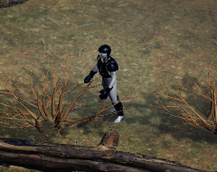
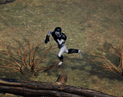
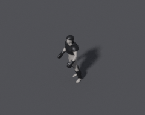

# 캐릭터 C2 ① — 구조 검증용 장비 A' (2026-11-05, Mac)

**구조 검증용, 최종 조형 아님.** 웨이트 전사, 바디 마스크, 조립이 동작하는지만 본다. 전사 LOCK의 갑옷과 무관한 단순 형태이고 맨발에 살이 드러난다. 게임 코드와 자산은 바꾸지 않았다.

## 결과

웨이트 전사와 바디 마스크로 조립한 장비가 **Unity 실제 빌드에서 몸을 따라 움직인다.** 뚫림 측정은 아래 "측정 정정"으로 다시 했고 **실제 뚫림은 stress 포즈의 왼쪽 각반 2정점**이다. 아래 표와 그림은 첫 구조본(60,292△)이고, 1만△ 판은 Unity에서 확인하지 않았다.

| 그림 | Unity 1x | Unity 6x 정면 | Unity 6x 60° | Blender 5x |
|---|---|---|---|---|
| idle |  | [보기](unity-idle-y000-6x.png) | [보기](unity-idle-y060-6x.png) | [보기](blender-idle-y060-5x.png) |
| stress |  | [보기](unity-stress-y000-6x.png) | [보기](unity-stress-y060-6x.png) | [보기](blender-stress-y060-5x.png) |

몸통과 허벅지의 짙은 영역은 흉갑이 드리운 그림자로 판단했다. 재질 오류가 아닌지 수치로 확인하지는 않았다.

## 비용

| 항목 | C1 맨몸 | C2 장비 포함 |
|---|---|---|
| 스킨 렌더러 | 16 | **22** |
| 삼각형 | 23,336 | **60,292** |
| 정점 | 16,297 | 34,463 |

- **드로우콜은 프로파일러로 재지 않았다.** 렌더러마다 재질 1개이므로 메인 패스 약 22개, 그림자 패스에서 다시 그만큼으로 추정한다.
- **장비 44,660△은 복셀 껍질 때문에 과하다.** 최종 자산에서는 줄여야 한다. 첫 방식(몸 면 복사)은 18,864△였다.
- 바디 마스크로 몸 면 36.4%(3,852/10,590)를 숨겼다. 손은 전부 가려져 몸 파트가 비어 렌더러가 2개 줄었다.

## 절차

재현: [`tools/character/c2_structure.py`](../../../../../tools/character/c2_structure.py). 결과값: [`c2-results-20261105.json`](c2-results-20261105.json), [수입 기록](unity-import-20261105.txt). 원본은 Git 밖 `~/EXODUSER-Storage/character/c2/`.

1. 몸 전체를 법선 방향으로 부풀려 복셀(1.4cm)로 다시 만든다. 주름과 손가락 틈이 사라진 매끈한 껍질이 된다.
2. 각 장비가 덮을 몸 면 근처만 잘라 낸다: 투구, 흉갑, 견갑 2, 장갑 2, 각반 2. 8조각.
3. 두께 6mm를 준다.
4. **웨이트는 Data Transfer로만 옮긴다.** 파트마다 칠하지 않았다. 미가중 정점 0.
5. 덮인 몸 면을 숨긴다. 가장자리 한 줄은 남겨 틈을 막는다.

## 첫 뚫림 측정 (잘못된 기준, 정정됨)

방법: 덮인 몸 정점에서 법선 방향으로 25cm 광선을 쏴서, 장비에 안 맞으면 뚫림으로 센다.

| 조각 | rest 뚫림 / 마스크 뒤 | stress 뚫림 / 마스크 뒤 |
|---|---|---|
| 투구 | 123 / 50 | 135 / 59 |
| 흉갑 | 77 / 42 | 81 / 45 |
| 견갑 L, R | 0 / 0, 0 / 0 | 7 / 5, 0 / 0 |
| 장갑 L, R | 0 / 0, 0 / 0 | 0 / 0, 0 / 0 |
| 각반 L, R | 15 / 13, 13 / 11 | 24 / 21, 16 / 14 |

이 표는 "뚫림"이 아니라 **"장비가 덮지 못한 곳"을 센 것이다.** 아래 정정 참고.

## 측정 정정: 뚫림이 아니라 덮개 누락

광선이 빗나간 곳에 표시를 찍었다(몸 표면에서 5cm 띄움, 노랑=빗나감, 빨강=장비 밖으로 판정): [뒤](pierce-y180.png), [60°](pierce-y060.png), [수치](c2-pierce-20261105.json).

- **표시는 뒤통수와 목 뒤, 목둘레, 겨드랑이에 모여 있다.** 뒤통수에서 투구 끝(y .05)이 머리 끝(y .061)보다 앞에 있어 장비가 머리를 덮지 못했다.
- **첫 구조본의 진짜 결함은 살이 뚫린 것이 아니다.** 장비가 안 덮은 몸까지 마스크로 숨겨 뒤통수·목 뒤에 구멍이 있었고, 까맣게 보인 것은 투구 안쪽이었다. 6배 그림에서 놓쳤다.
- **수정:** 몸 면은 모든 정점 바로 위에 장비가 있을 때만 숨긴다. 덮이지 않은 정점 비율: 투구 12.6%, 흉갑 12.0%, 각반 3.9~4.1%, 견갑·장갑 0%.
- **투구는 뒤통수를 다 덮도록 형태를 고쳐야 한다.** 지금은 숨기지 않고 살이 보이게 둘 뿐이다.

| 포즈 | 실제 뚫림 (숨기지 않은 몸 정점이 장비 밖으로) |
|---|---|
| rest | 0 |
| idle | 0 |
| stress | **왼쪽 각반 2정점**, 나머지 0 |

실제 뚫림 기준: 숨기지 않은 내부 정점 중 장비에서 1.2cm 안에 있고 몸 법선 방향으로 장비보다 바깥인 정점. 근사 판정이다.

## 1만△로 줄이기

복셀 껍질 → Decimate(비율 .1932) → 원래 껍질에 Shrinkwrap → 두께 6mm.

| 항목 | 값 |
|---|---|
| 장비 전체 | 44,660 → **10,128△ (목표 10k를 128 초과)** |
| 조각별 | 흉갑 2,960, 각반 1,352·1,356, 투구 1,272, 장갑 924·908, 견갑 680·676 |
| 그림 | [idle](reduced-idle-y060-5x.png), [stress](reduced-stress-y060-5x.png) |

가장자리가 거칠어졌다. 허벅지 옆에 가는 띠가 조금 보이는데 원인을 확인하지 않았다. Unity에서는 확인하지 않았다.

**쿼드 리토폴로지 필요 여부(판단, 시험 안 함):** 흉갑·견갑·투구처럼 단단히 붙어 움직이는 판은 불필요. 장갑의 손가락과 각반의 무릎 쪽은 접히므로 모캡 뒤 다시 본다.

## C2 ② LOCK 조형 1회 시도 — 미달, 중단

**스크립트만으로는 LOCK 수준이 나오지 않았다. 재시도하지 않고 사람 판단으로 올린다.**

흉갑과 견갑만, 흑철 재질 하나. 흉갑 판 6장 + 견갑 4장씩, 위 판이 아래 판을 덮게 겹쳤다. 14판 36,390△ (조형 시도라 감량 안 함). 투구·장갑·각반은 위 구조본 그대로이다.

| 그림 | |
|---|---|
| 33° 1x |  |
| 33° 3x (최근접) | [보기](lock-idle-y060-3x.png) |
| 5x 실제 확대 | [60°](lock-idle-y060-5x.png), [정면](lock-idle-y000-5x.png), [뒤](lock-idle-y180-5x.png), [stress](lock-stress-y060-5x.png) |

| LOCK 항목 | 결과 |
|---|---|
| 겹친 둥근 견갑 | 5x에서 층은 읽힘. **3x에서는 뭉쳐 층이 거의 안 보임.** 판 끝이 톱니처럼 거칠어 "매끈한 곡면 + 얇은 테두리"와 다르다 |
| 마디형 흑철 판금 | 흉갑 마디가 거의 안 보이는 검은 덩어리 |
| 재질 | 단색. 기준 그림의 낡은 철 표면, 금, 테두리 없음 |
| 찢어진 망토, 머리, 대검 | 없음 (이번 범위 밖) |
| 뚫림 | 이 메시로 재지 않았다 |

**판단:** 기준 이미지(`assets/warrior_identity_ref.png`) 옆에 둘 수준이 아니다. 조잡으로 판정한다. 렌더 설정 오류로 같은 조형을 한 번 다시 렌더했고, 조형 자체는 한 번만 했다.

**다음 판단은 사용자 몫이다: 손 조형 또는 외주.** 넘길 파일은 Git 밖에 있다.

| 파일 | 내용 |
|---|---|
| `~/EXODUSER-Storage/character/c2/EXO_Warrior_C2_lock_attempt.blend` | 이번 시도 전체 |
| `~/EXODUSER-Storage/character/c2/EXO_Warrior_C2_reduced.blend` | 1만△ 구조본 |
| `~/EXODUSER-Storage/character/c1/EXO_Warrior_C1.blend` | 맨몸 + 리그 |

재현: [`tools/character/c2_v2.py`](../../../../../tools/character/c2_v2.py), [`c2_pierce.py`](../../../../../tools/character/c2_pierce.py). 결과값: [`c2-v2-results-20261105.json`](c2-v2-results-20261105.json).

## 실패 기록

| 시도 | 결과 | 원인 | 처리 |
|---|---|---|---|
| 1. 몸 면 복사 + 법선 밀기 | **FAIL.** 살이 뚫고 나옴, 표면 울퉁불퉁, 가장자리 들쭉날쭉 | 접히는 곳에서 면이 뒤집히고 밀기 두께가 부족 | 방법 변경 |
| 2. 복셀 껍질 | 손에서 엉덩이로 **가는 막대** 결함 | 장갑 정점이 가까운 허벅지 웨이트를 받음 | 전사 원본을 그 장비가 덮는 면으로 제한 |
| 3. 전사 원본 제한 | 막대 사라짐 | | 현재 |

**배운 점:** 웨이트 전사 원본을 몸 전체로 두면 가까운 다른 부위의 웨이트가 섞인다. 장비별로 덮는 면만 원본으로 쓴다.

## 아직 안 한 것

갈아입기(C3), 소켓, 신발, Humanoid 매핑, rigpixel 경로, 프로파일러 드로우콜, 1만△ 판의 Unity 확인.
