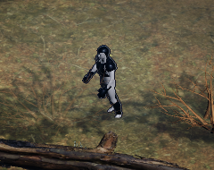
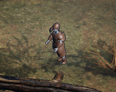

# 캐릭터 C3 — 갈아입기 구조 검증 (2026-11-05, Mac)

**구조 검증용, 최종 조형 아님.** 장비와 무기는 단순 형태이고 재질은 단색이다. 게임 코드와 게임 자산은 바꾸지 않았다. 확인에 쓴 Unity 코드는 커밋하지 않은 로컬 파일이고 사본만 `tools/character/local_c3_*.txt`에 있다.

## 결론

| 항목 | 결과 |
|---|---|
| A↔B 전체 교체 | **동작.** 켜고 끄기 약 0.05ms, 같은 프레임에 그려짐 |
| 투구만 교체 | **동작** ([A 몸 + B 투구](lit-idle-A-body-B-helm-6x.png)) |
| 무기 소켓 교체 (대검↔도끼) | **동작.** 손 본을 따라감 ([대검](lit-idle-A-sword-6x.png), [도끼](lit-idle-B-axe-6x.png), [stress 대검](lit-stress-A-sword-6x.png), [stress 도끼](lit-stress-B-axe-6x.png)) |
| 다른 파일 장비의 본 재매핑 | **동작.** B 렌더러 20개, 빠진 본 0, 약 2.5ms. 애니메이터는 A 하나 |
| rigpixel 1x에서 A·B 구분 | **구분됨** (아래 표) |
| Humanoid 매핑 | **실패.** 원인 아래 |
| 캐릭터만의 드로우콜 | **못 잼.** 프레임 전체 값만 있음 |

자세한 수치: [일반 렌더](unity-lit-20261105.txt), [rigpixel](unity-rigpixel-20261105.txt), [Blender](c3-results-20261105.json). 영상은 찍지 않았고 정지 화면과 로그로 확인했다.

## rigpixel에서 A·B

| | A | B |
|---|---|---|
| 1x |  |  |
| 3x | [보기](rig-A-3x.png) | [보기](rig-B-3x.png) |
| 무기 3x | [A 대검](rig-As-3x.png) | [B 도끼](rig-Ba-3x.png) |

실루엣과 색이 함께 달라 1x에서 구분된다. **색 차이가 크게 섞여 있어** 같은 색 장비끼리의 실루엣 구분은 아직 안 봤다. 프리뷰 진입 경로이고, rigpixel 전용 표면 정리(`CleanMaterialRegions`)는 시험 메시에 적용되지 않았다.

| 세트 | 일반 렌더 6x |
|---|---|
| A: 투구, 흉갑, 견갑, 장갑, 각반 | [보기](lit-idle-A-full-6x.png) |
| B: 높은 투구, 긴 코트, 넓은 어깨, 팔보호대, 장화 | [보기](lit-idle-B-full-6x.png) |

## 구조

1. 세트마다 FBX 하나. 같은 스켈레톤 이름, 장비 조각과 그 세트용으로 가린 몸 파트가 들어 있다.
2. 기준 세트를 띄우고 다른 세트의 스킨 렌더러는 `bones`를 이름으로 기준 스켈레톤에 다시 연결한다.
3. 슬롯별로 렌더러를 켜고 끈다. 투구 슬롯은 투구 + 머리 파트가 한 묶음이다. 머리 가림이 투구마다 다르기 때문이다.
4. 무기는 스킨 없이 `DEF-hand.R`의 자식으로 둔다.

**파일 크기 관찰:** 지금 구조는 가려진 몸 파트를 세트마다 따로 갖는다. 장비 조합이 늘면 조합마다 만들 수 없으니, 슬롯별 몸 파트 분리나 셰이더 마스크가 필요하다. 시험하지 않았다.

## 드로우콜·비용

| 값 | 일반 | rigpixel |
|---|---|---|
| 켜진 스킨 렌더러 (세트 A) | 22 | 22 |
| 캐릭터 삼각형 A / B | 27,116 / 27,628 | 같음 |
| 프레임 전체 드로우콜 | 약 2,280 | 약 1,020 |
| SetPass | 약 436 | 약 310 |

- `ProfilerRecorder`가 릴리스 빌드에서도 값을 주었다. **장면 전체 값이고, 값이 한 프레임씩 늦게 찍힌다.** 일반과 rigpixel 차이는 영웅 화면 위치 등 조건이 달라 비용 차이로 읽으면 안 된다.
- 무기를 켰을 때 약 8콜 늘었다(메인·그림자·깊이 합으로 추정). 렌더러 22개면 메인 패스 22콜 이상으로 추정한다.
- 세트 A 장비 10,336△, B 13,424△. **B는 1만△ 목표를 넘는다.**

## 잔여 3건 판정

| 잔여 | 결과 |
|---|---|
| 엉덩이 코렉티브 | 안 다룸. 모캡 뒤 |
| Humanoid | **실패, 원인 확인.** Unity 자동 매핑은 "Required human bone 'Head' not found". 이름을 직접 지정한 런타임 시도는 "Transform 'DEF-spine' is not an ancestor of 'DEF-thigh.L'". Rigify의 변형 본만 내보내면 계층이 끊긴다. **Humanoid를 쓰려면 변형 본을 하나의 계층으로 다시 잇는 내보내기 단계가 필요하다.** 시험하지 않았다 |
| rigpixel 경로 | 위 표대로 동작. 시험 수준 |
| 드로우콜 | 프레임 전체만 측정. 캐릭터 단독은 미측정 |

## 지난 항목 확인

- **투구 뒤통수:** 잘라 내는 기준을 기하 조건으로 바꿔 덮었다([뒤쪽](../C2_STRUCTURE/lock-idle-y180-5x.png)는 이전 판). 다만 덮이지 않은 정점 비율 투구 26.7%, 흉갑 23.6%는 오히려 늘었다. 그 면은 숨기지 않으므로 구멍은 아니지만, **장비 아래로 몸이 그대로 남아 비용을 쓴다.** 이 수치가 늘어난 이유는 확인하지 않았다.
- **허벅지 띠:** 장비 그림자를 끈 렌더에서 크게 줄어 **대부분 장갑의 그림자로 판단한다.** 완전히 사라졌는지는 확정하지 못했다.
- **가장자리:** 감량 뒤 가장자리 다듬기를 추가했지만 여전히 거칠다. B의 목둘레와 어깨에 틈과 찢긴 가장자리가 보인다. 최종 조형에서 해결할 일이다.

## 실패 기록

| 실패 | 원인 | 처리 |
|---|---|---|
| Blender 스크립트 중단 | 면 마스크로 정점 배열을 건드림 | 수정 |
| Unity 컴파일 실패 | `Debug` 이름 충돌 | 수정 |
| 무기가 안 보임 | FBX 단위 때문에 크기가 약 1/100 | 크기를 실측해 맞춤 |
| B가 까맣게 보임 | 금속 재질 + 어두운 장면 | 색과 금속성 조정 |

## 안 한 것

모캡 재생 중 교체, 등급 틴트·망토(C4), Core 장착 이벤트 연결(C5), UE 조립, 장비 조합 폭증 대책, 뚫림의 stress 재측정(세트 B).
