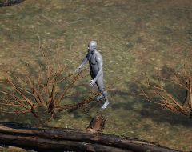
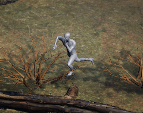

# 캐릭터 C1 — 베이스 바디, 임시 14파트, 공용 리그 (2026-11-05, Mac)

브리프: `docs/0마스터플랜/worklog/cloud-lanes/BRIEF_CHARACTER_DEEP_20261105.md` §2 C1. `CHARACTER_PIPELINE_20261105.md` §7로 합칠 실습 기록이다. **게임 코드와 게임 자산은 바꾸지 않았다.** 확인에 쓴 Unity 코드는 커밋하지 않은 로컬 파일이다.

## 판정 요약 (CTO 판정 대기)

CTO 조건부 합격의 조건 3개를 처리한 결과다.

| 조건 | 결과 |
|---|---|
| ① 엔진 확인 | **Unity 실제 빌드에서 무릎 셰이딩 경계 안 보임.** 33° 1x·3x·6x, idle·stress |
| ② 엉덩이 접힘 | 트위스트 3단으로 재생성해도 **남음. "코렉티브 필요"로 기록.** 극단 포즈는 모캡 뒤 다시 본다 |
| ③ 라이선스 | blender.org 표기대로 CC0로 기록, 잔재 문구 인용 (아래) |

**아직 아닌 것:** 맨몸 메시만 확인했다. 전사 LOCK의 얼굴 문양·머리·갑옷·망토·대검은 없다. 비율은 키 1.85m만 맞췄고 LOCK 체형은 맞추지 않았다. rigpixel 경로가 아닌 일반 3D 렌더로 확인했다. 파트 분할은 **임시**이고 CH 조사의 1안이 오면 바꾼다.

## 재료

| 항목 | 값 |
|---|---|
| 베이스 | Blender Human Base Meshes v1.4.1, `Body Male - Realistic` |
| 출처 | https://www.blender.org/download/demo-files/ |
| 메시 | 10,590면, 21,160△, 경계·비다양체 간선 0, Multires는 제거하고 기본 단계 사용 |
| 키 | 1.690m → 1.85m (×1.0947). `UNITY_CHARACTER_BOARD`의 전사 R7 키 기준 |

**라이선스:** blender.org 목록과 번들 README는 CC0이다. 번들 파일 안의 `License` 텍스트 블록에는 "The Rain Rig is released under the Creative Commons Attribution 4.0 license."가 남아 있다. README가 아니라 별도 블록이고 다른 자산(Rain 리그)을 가리키는 잔재로 보인다. Rain 리그는 쓰지 않았다. CTO 판단: 사용 가능.

## 절차

1. 번들 자체의 면 세트 103개를 14파트로 묶었다: 머리, 몸통, 상완×2, 전완×2, 손×2, 대퇴×2, 하퇴×2, 발×2. **임시 분할**이다.
2. 파트 경계 정점의 중심을 관절 위치로 써서 Rigify 메타리그에 맞췄다. 얼굴·손가락·손바닥 본은 지웠다.
3. 상완·대퇴 트위스트 3단으로 생성: 전체 본 236개, 변형 본 39개.
4. **몸 전체에 한 번만** 자동 웨이트(Bone Heat). 미가중 정점 0.
5. 웨이트가 끝난 몸을 14파트로 나눠 파트마다 다시 칠하지 않았다. 경계 정점에는 몸 전체의 법선을 넣었다.
6. FBX: 파트 14 + 눈 2, 변형 본만, 시험 포즈 3프레임.

재현: [`tools/character/c1_build.py`](../../../../tools/character/c1_build.py). 결과값: [`c1-results-20261105.json`](c1-results-20261105.json). 블렌드와 FBX는 Git 밖 `~/EXODUSER-Storage/character/c1/`이고, 손 조형을 맡길 때 이 파일을 넘긴다.

**시험 포즈는 애니메이션이 아니다.** 변형 확인용 정지 자세이고 게임에 쓰지 않는다. idle 동작은 모캡 출처 결정(D-MO-1) 뒤에 넣는다.

## 측정

| 포즈 | 공유 정점 틈 | 비인접 파트 겹침 | 인접 파트 겹침 삼각형 쌍 |
|---|---|---|---|
| rest | 0.0mm | 0 | 31 |
| idle | 0.0mm | 0 | 42 |
| stress | 0.0mm | 전완·손↔몸통, 손↔반대 상완 | 254 |

- 공유 정점 338개: 위치 차이 0, 웨이트 차이 0.
- **rest의 겹침 31쌍은 모두 분할선 근처이다.** 발목 z .065~.089m, 손목 .968~.977, 팔꿈치 1.169~1.213, 엉덩이 .828~.855, 겨드랑이 1.372~1.501, 목 1.517~1.708. 공유 간선이 겹침으로 세어진 것이 포함된다.
- stress의 비인접 겹침은 손을 가슴 쪽으로 넘긴 포즈 자체의 영향으로 본다. 포즈를 바꿔 다시 재지는 않았다.

## 이음새: Blender 렌더와 엔진이 다르다

| 렌더 | 무릎 | 그림 |
|---|---|---|
| Blender, 파트별 법선 재계산 | **경계 보임** | [분할 그대로](img/cmp-split-normals.png) |
| Blender, 몸 전체 법선 전달 | 안 보임 | [전체 법선](img/cmp-whole-normals.png) |
| **Unity 실제 빌드** | **안 보임** | [stress 6배](img/unity-stress-y060-6x.png) |

Blender가 변형 뒤 파트별로 법선을 다시 계산해서 생기는 경계였다. 엔진은 정점에 저장된 법선을 스키닝하므로 나타나지 않았다.

**Blender에서 C2 이후 확인할 때는 몸 전체 법선 전달을 켠다.** [`c1_seamfix.py`](../../../../tools/character/c1_seamfix.py)

## 엔진 확인 (Unity)

`unity/main` `9b2fcf5e0` + 로컬 코드, 프리뷰 진입, 1-1 3450:7900, 피치 33°, 거리 16.5u, FOV 46.9453°, 소리 끔, 창 뜸. 영웅 높이 88px 기준으로 축소, 원래 영웅 스프라이트는 화면 밖으로 치움. 회색 재질은 확인용이고 최종 재질이 아니다.

| 포즈 | 1x | 3x (최근접) | 6x (실제 확대 렌더) |
|---|---|---|---|
| idle |  | [3x](img/unity-idle-y060-3x.png) | [6x](img/unity-idle-y060-6x.png) |
| stress |  | [3x](img/unity-stress-y060-3x.png) | [6x](img/unity-stress-y060-6x.png) |

| 항목 | 값 |
|---|---|
| 스킨 렌더러 | 16개 (파트 14 + 눈 2). **재질·드로우콜은 파트 수만큼 늘어난다.** 드로우콜·FPS 측정은 안 함 |
| 삼각형 / 정점 | 23,336 / 16,297 |
| 렌더러당 최대 본 | 56 |
| 저장 법선 | 전 파트 있음 |

[수입 기록](unity-import-20261105.txt). 임포트 설정은 [`local_c1_import.cs.txt`](../../../../tools/character/local_c1_import.cs.txt), 촬영 코드는 [`local_c1_probe.cs.txt`](../../../../tools/character/local_c1_probe.cs.txt)이다. 임시로 Legacy 애니메이션으로 가져왔고 Humanoid 매핑은 시험하지 않았다.

Blender 참고: [idle 5배](img/c1-idle-y060-5x.png), [stress 5배](img/c1-stress-y060-5x.png), [rest 정면](img/c1-rest-y000-5x.png).

## 실패 기록

| 실패 | 원인 | 처리 |
|---|---|---|
| 첫 스크립트 중단 | `Matrix.Identity` 호출 누락 | 수정 |
| 무릎 경계 | Blender의 파트별 법선 재계산 | 위 "이음새" |
| 엉덩이 접힘 | 트위스트 2단, 3단 모두 남음. 통짜 몸에서도 생김 | **코렉티브 필요** |
| Unity 첫 촬영에 스프라이트 겹침 | 원래 영웅이 그대로 그려짐 | 코어 위치를 화면 밖으로 옮겨 재촬영 |

## 다음 (C2)

CTO가 C1을 닫으면 장비 세트 A로 간다. 갑옷은 첫 시도가 3배 확대에서 조잡하면 재시도 없이 올리고, 사용자 손 조형 또는 외주 판단을 받는다. 파트 분할은 CH 조사의 1안이 오면 맞춘다.
