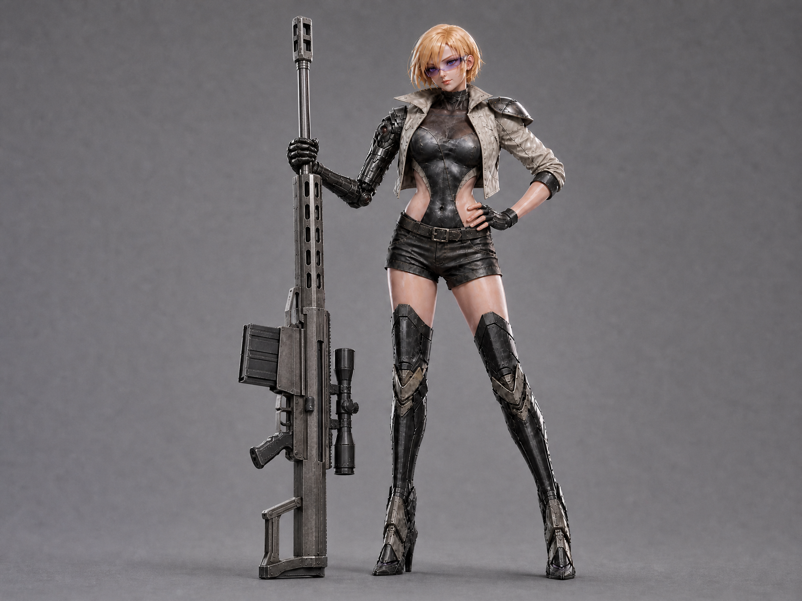
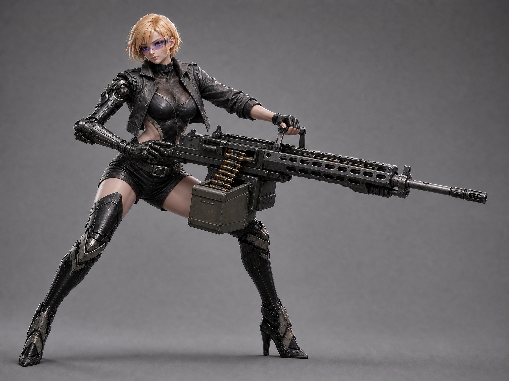
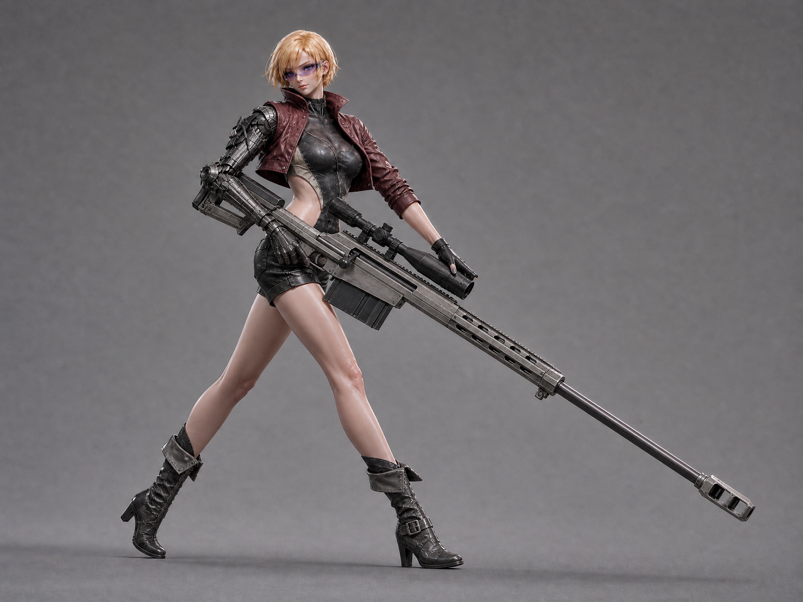

# 헬거너 — 포즈·의상 버전 비교 (2026-10-23)

**2026-10-23 사용자 재정정 — 현행 기준:** “모양은 쇠뇌가 아니고 거대총기”, “발사방식 소리같은게 쇠뇌식”, “철컥 하고 쏘는게”. 외형은 첨부된 거대 소총형 리볼버로 유지하며 쇠뇌 날개·활줄·화살은 넣지 않는다. 쇠뇌 비교는 철컥 장전/잠금 후 묵직한 단발을 쏘는 동작·소리에만 적용한다. H35/H36 쇠뇌 형태는 에이전트의 오해로 이전안 처리한다. [현행 거대총기 기준](HELLGUNNER_SINGLE_SHOT_GIANT_GUN_20261023.md)이 우선한다.

사용자 지시: “포즈 다양화랑 버전다양화좀 해봐”, “저게 뭐지 어정쩡한 포즈”, “장식도 이상해 바지”, “레퍼런스도 포즈 다양하게 줬는데”. 이어 “총도 좀 멋대가리가 없는데”, “사펑에서 저런총 안나와”, “총기는 그 맛이있어서 사펑에서도 전자총같은거 잘 안쓰는거야”. H24 자세/골반 장식/전자 발광 판상 병기를 수정한다. H22 긍정 얼굴/금발 단발·바디수트/가죽 반바지·오른팔 의수와 낡은 다크판타지 재질은 보존한다. 총기 질감은 사용자 선호를 따르는 디자인 기준이며 특정 게임의 실제 총기 전체에 대한 사실 주장이 아니다.

## 공통 수정 계약

| 항목 | 기준 | 검수 |
|---|---|---|
| 하의 | 겹골반 갑주·암적색 늘어진 천·체인/각인 제거. 한 개의 평평한 벨트와 간결한 가죽 반바지 | 바디수트 높은 골반선과 허리 컷아웃을 가리지 않음. 실제 출력의 제거 수준 확인 |
| 포즈 | 각기 다른 사용자 참조를 ref2로 직접 업로드. ref1 H24는 외형/재질만 유지하고 기존 자세는 해제 | 팔꿈치/손/그립·다리 무게중심·지지 방식이 세 안에서 실제로 달라야 함 |
| 매력/세계관 | H22 얼굴/금발 단발·눈 바이저 유지, 낡은 가죽/흑철과 소량의 견갑 | 실버테일 장식으로 다시 과밀해지지 않음. 전신/양발/무기 전체, 무작위 점도트 검사 |
| 총기 | 판상 레일건/전자 발광 폐기, 물리 총열/리시버/급탄·탄창/장전부/소염기·제퇴기와 손잡이를 구분 | A H31 실탄 소총 휴식, B H29 탄띠식 기관총, C H27 탄창식 대물소총. C 앞손 교정 H30/H32는 실패·환불하여 미해결. H28 드럼식 중화기도 실패·환불. 실물 제작/기능 검증 아닌 게임 원화 |
| 비용/절차 | MagicLight Sunburst·4:3·각1장·표시200pt. 최초3안 계획600pt 후 사용자 총기 정정/실패/파지 수정 반영 | 현재 접수8건·표시비용 합계1600pt, 화면상 환불4건. 계정 최종 잔액/다른 세션 사용과 구분. 실제 상태는 receipt |

## 실제 입력과 상태

입력1은 H25/H26/H27/H29에서 H24, H28/H31에서 H25 중간본, H30/H32에서 H27이다. H31 입력2는 성공한 H27 실탄 소총 원본이고 H30/H32는 H27 한 장으로 앞손만 교정한다. 사용자 사진/원화는 assets/character-concepts/references/20261022/hellgunner_h16/에 보존했다. H26에서만 입력3 user_06.jpg 총기 사진을 썼다. 입력 바이트/역할/프롬프트는 submission-receipt.json에 기록한다.

| 후보 | 버전 | 입력2 | 작업ID | 상태 | 원본 경로 |
|---|---|---|---|---|---|
| H25 | A — grounded vertical rest / aged ivory jacket | assets/character-concepts/references/20261022/hellgunner_h16/user_07.jpg | 7519086882239959040 | completed-downloaded | assets/character-concepts/20261023/hellgunner_pose_a_rest_h25.png |
| H26 | B — braced belt-fed ballistic machinegun / charcoal jacket | assets/character-concepts/references/20261022/hellgunner_h16/user_03.webp | 7519088076597387264 | failed | 산출 없음 |
| H27 | C — striding ballistic anti-materiel rifle / oxblood jacket | assets/character-concepts/references/20261022/hellgunner_h16/user_04.jpg | 7519089186129207296 | completed-downloaded | assets/character-concepts/20261023/hellgunner_pose_c_ballistic_rifle_h27.png |
| H28 | A revised — grounded drum-fed ballistic cannon / ivory jacket | assets/character-concepts/references/20261022/hellgunner_h16/user_04.jpg | 7519089931721318400 | failed | 산출 없음 |
| H29 | B retry — braced belt-fed ballistic machinegun / charcoal jacket | assets/character-concepts/references/20261022/hellgunner_h16/user_03.webp | 7519090730828505088 | completed-downloaded | assets/character-concepts/20261023/hellgunner_pose_b_ballistic_machinegun_h29.png |
| H30 | C corrected — walking rifle with fore-end support | 원본 한 장 교정 | 7519091499338182656 | failed | 산출 없음 |
| H31 | A rifle retry — upright physical rifle / ivory jacket | assets/character-concepts/20261023/hellgunner_pose_c_ballistic_rifle_h27.png | 7519092160482189312 | completed-downloaded | assets/character-concepts/20261023/hellgunner_pose_a_ballistic_rest_h31.png |
| H32 | C hand-support correction retry after temporary service error | 원본 한 장 교정 | 7519093640299708416 | failed | 산출 없음 |

A는 images (5).jpg 피규어의 편안한 체중 이동을 수직 접지로 재해석한 H25에서 시작했다. H28 총기 교체는 처리 불가·환불로 끝나 H31에서 이미 성공한 H27 물리 소총 구조를 참고했다. B는 사용자 징크스 원화의 넓은 지지/앞으로 기울인 몸통/양손 파지를 참고하며 H26 실패 후 H29로 한 번 수정했다. C는 images (2).jpg의 대각선 총기를 보행/양손 운반으로 재해석했다. H27 앞손이 스코프 위에 있어 H30에서 아래쪽 지지로 교정했으나 서비스 일시 오류·환불. Re-edit로 동일 프롬프트/원본 한 장을 복원해 H32를 한 번 재접수했다. 실패 원인이나 안전 필터 여부는 서비스가 명시하지 않아 단정하지 않는다. 참조 그대로 복제나 기능 검증을 주장하지 않는다.

## 원본 검수

- H25: Original inspected: clear vertical rest pose and hand-on-hip stance, hip ornaments removed, simple leather shorts. User's subsequent firearm correction requires replacing the old glowing slab. Current gun orientation reads muzzle down, not intended stock down. Intermediate pose study only; H28 will replace firearm.
- H26: 실패·환불 표시. The current prompt or reference image couldn't be processed. Please edit it and try again. Credits have been refunded.
- H27: Original inspected: distinct walking three-quarter pose, oxblood cropped jacket and plain cuffed shorts, old hip ornaments removed. Physical anti-materiel rifle has long steel barrel, muzzle brake, box magazine, bolt handle and scope; no energy rails. Forehand rests over scope rather than supporting underside, requiring H30 correction. Tall boots changed to shorter laced boots; record as outfit variation, not identical retained boots.
- H28: 실패·환불 표시. The current prompt or reference image couldn't be processed. Please edit it and try again. Credits have been refunded.
- H29: Original inspected: distinctly wide bent-knee braced pose, charcoal cropped jacket, simple leather shorts/belt, no hip plates or red hanging cloth. Large physical single-barrel machinegun with ventilated handguard, muzzle device, brass ammunition belt and attached ammo box. Natural left hand supports top carry handle; robot right hand rests/cradles rear receiver, so this is braced heavy-weapon carry, not verified trigger/foregrip firing posture. Positive H22 face/golden bob retained. No energy rails.
- H30: 실패·환불 표시. The generation service is temporarily unavailable. Please try again later. Credits have been refunded.
- H31: Original inspected: standing rest pose differs from H24; physical large rifle stands stock on floor, muzzle up, robot right hand stabilizes barrel/fore-end, natural hand on hip. Steel barrel, vented fore-end, large box magazine, receiver/bolt and scope are visible with no energy glow. Hip plates/hanging cloth removed; plain leather shorts and aged ivory jacket, positive blonde face retained. Robot grip is above receiver, acceptable for resting support but not a firing grip.
- H32: 실패·환불 표시. The current prompt or reference image couldn't be processed. Please edit it and try again. Credits have been refunded.

## 비교 후보 원본

### A (H31)

### B (H29)

### C (H27)

최종 사용자 오케이 미수신. **C H27의 자연 왼손은 스코프 위에 있어 전완 지지가 미완료**이며 H30/H32 교정은 두 번 실패·환불했다. B H29도 발사 그립이 아닌 상부 운반 손잡이로 무게를 지지한다. A/B/C 세 버전은 비교 후보이며 완성된 사격/인체공학 정본으로 세지 않는다. 게임 런타임 교체·3D 메시/리깅 제작·스팀 배포 없음. 복장에 일치하는 강화척추 후면은 별도 미완료다.

## 실제 프롬프트

### H25 (491자)

NEW POSE ref2; ignore ref1 stance. Keep ref1 adult blonde bob/face/clear visor, RIGHT robot arm, high-cut bodysuit, worn armor/boots, same huge slot gun. Relaxed weight on one straight leg, other knee easy. Gun VERTICAL beside her, butt grounded, muzzle up; robot hand mid grip, left hand at waist. Plain worn leather SHORTS, one flat belt. REMOVE hip tassets, red cloth, chains/engraving. A: aged ivory cropped jacket, small pauldron. Modern stylized 3D, full body/whole gun, gray. No dots.

### H26 (492자)

NEW braced pose ref2; ref3 gun mechanics. Keep ref1 blonde adult face/bob/visor, RIGHT robot arm, cutout bodysuit, worn boots. Wide staggered legs, bent knees, forward lean. TWO HANDS: right trigger grip, left foregrip. Huge BELT-FED MACHINE GUN: exposed steel barrel, vented shroud, flash hider, feed cover, ammo box, brass belt. Charcoal cropped jacket, plain leather shorts/one belt. REMOVE hip plates/hanging cloth. No glow/energy rails/minigun/dots. Full body/whole gun, gray, modern 3D.

### H27 (461자)

NEW striding SIDE pose ref2. Keep ref1 adult blonde face/bob/visor, RIGHT robot arm, cutout bodysuit, worn boots. Forward step, torso turns, BOTH hands carry rifle low, muzzle down-forward, bent elbows. Huge ANTI-MATERIEL RIFLE: long steel barrel/muzzle brake, box magazine, bolt handle, scope, angular stock. Oxblood cropped jacket, plain cuffed leather shorts/one belt. NO hip plates/hanging cloth/glow/energy rails/dots. Full body/whole gun, gray, modern 3D.

### H28 (498자)

Edit ref1 GUN ONLY; ref2 firearm mechanics. Keep girl face/blonde bob, visor, robot right arm, pose, plain leather shorts and worn ivory jacket. Replace slab with huge DRUM-FED AUTOMATIC CANNON: single steel barrel, perforated heat shield, blunt muzzle brake, ejection port, charging handle, rear stock, drum magazine. VERTICAL correct way up: stock on ground, barrel/muzzle toward sky. Robot hand holds receiver grip at waist. Matte black gunmetal. NO energy rails/glow. Full body/whole gun, gray.

### H29 (472자)

NEW braced pose ref2. Keep ref1 blonde adult face/bob/visor, RIGHT robot arm, cutout bodysuit, worn boots. Wide staggered legs, bent knees, forward lean. TWO HANDS: right trigger grip, left foregrip. Huge BELT-FED MACHINE GUN: exposed steel barrel, vented shroud, flash hider, feed cover, ammo box, brass belt. Charcoal cropped jacket, plain leather shorts/one belt. REMOVE hip plates/hanging cloth. No glow/energy rails/minigun/dots. Full body/whole gun, gray, modern 3D.

### H30 (473자)

Edit ONLY left arm/hand support in this adult character image. Keep face, blonde bob, outfit, stride, rifle design and framing unchanged. Natural LEFT hand must cradle the UNDERSIDE of fore-end just ahead of magazine; palm under weapon, fingers wrapping side, wrist straight, elbow visibly below rifle. Move hand away from scope; leave scope unobstructed. Robot RIGHT hand stays on pistol grip. Anatomical two-hand weight support. No extra hands, no gun glow, no particles.

### H31 (500자)

Keep ref1 ADULT woman face/blonde bob, visor, robotic right arm, standing pose and clothes. Replace old glowing slab with a huge PHYSICAL RIFLE based on ref2: steel barrel, perforated fore-end, receiver/ejection port, large box magazine, compact scope, muzzle brake and shoulder stock. Gun upright: STOCK touches floor, muzzle points UP. Robot right hand grips receiver at waist, natural left hand on hip. Worn black steel, no energy lights. Full body/whole gun in gray studio. Preserve plain shorts.

### H32 (473자)

Edit ONLY left arm/hand support in this adult character image. Keep face, blonde bob, outfit, stride, rifle design and framing unchanged. Natural LEFT hand must cradle the UNDERSIDE of fore-end just ahead of magazine; palm under weapon, fingers wrapping side, wrist straight, elbow visibly below rifle. Move hand away from scope; leave scope unobstructed. Robot RIGHT hand stays on pistol grip. Anatomical two-hand weight support. No extra hands, no gun glow, no particles.
