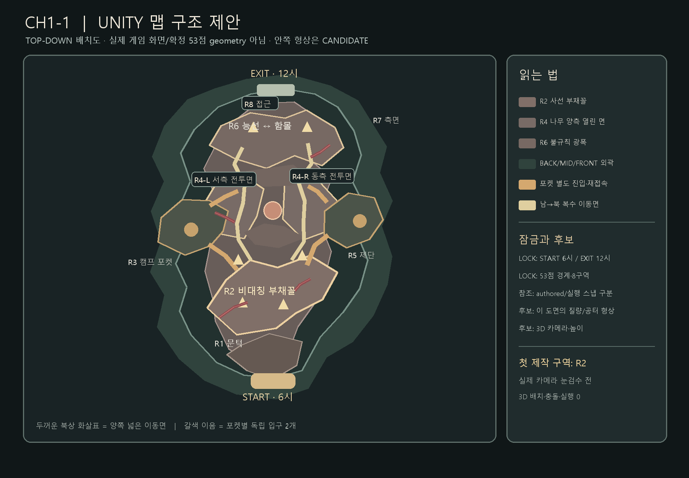
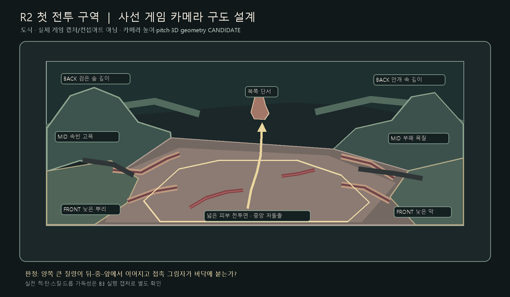

# CH1-1 Unity 고품질 맵 실행 보충안 — 2026-10-26

> 상위 기획: [Claude/PC Unity 3D 맵 제작 기획서](https://github.com/beearth/the-exoduser/blob/82e7a0b75881228faa658d614b9b6acdee8c062e/docs/4.1%EB%A7%B5%EB%94%94%EC%9E%90%EC%9D%B8%2B%EC%84%A4%EC%A0%95/UNITY_MAP_HQ_PRODUCTION_PLAN_20261026.md) (2026-10-26 확인 origin/main `82e7a0b75881228faa658d614b9b6acdee8c062e`, 문서 commit `0d6325d32`). 이 보충안은 그 기획의 **CH1-1 실행 보충안**이며 별도 SSOT가 아니다. 상태: **이 문서 작성 범위의 구현 0 / Unity 실창 검수 0**. PC MAP3D 슬라이스 `23451c97a`의 START v2는 별도 기존 작업이며 이 문서가 제작했다고 주장하지 않는다. 아래 도면은 실제 화면·확정 geometry가 아니다.

도면의 R2는 한쪽이 열린 사선 부채꼴, R4는 시체나무 **서·동 양쪽 큰 전투면**, R6는 북서 능선과 동쪽 함몰이 어긋난 불규칙 광폭이다. 굵은 복수 화살표는 연결된 북상 면을 나타내고 갈색 연결은 **각 포켓의 독립된 두 진입/재접속로**를 가리킨다. 원이나 타원으로 아레나 범위를 반복 표시하지 않았다. 형상은 후보이고 검증 기준의 현행 53점 경계·authored 좌표·실행 스냅 규칙을 바꾸지 않는다.

R2 보조 도식도 실제 렌더가 아니다. 한 카메라에서 좌·우 BACK 깊이→MID 부패 목질→FRONT 낮은 뿌리/막→접촉 그림자→넓은 피부 전투면이 이어지는지 제작자가 확인할 화면 설계다. 중앙은 적·탄·스킬·드롭을 위한 낮은 형태로 비운다. 북쪽 시체나무는 먼 목적지 단서이며 기존 앵커를 움직이지 않는다.

## 한눈에 보기

6시 START에서 넓은 피부 전투면을 따라 12시 EXIT로 북상한다. 서쪽 캠프, 중앙 시체나무, 동쪽 제단·독 구덩이를 비대칭 포켓으로 엮고, 부패한 생체나무·목질 외곽을 **한 장소의 연속된 덩어리**로 만든다. 상위 기획의 **음습하고 아름다운 지옥**, 기존 손작업 production_finish 바닥 청크와 전경/중경/후경 그림 레이어를 우선한다. 전체 구도를 먼저 확인하고 대표 R2 전투 구역 한 카메라를 외곽→접합→바닥→전투까지 완성한 후 확장한다. Meshy는 환경 모듈 후보 공급자이며 Unity가 조립·카메라·빛을 맡고 기존 맵 데이터가 이동·충돌의 기준이다.

## 차례

1. 승인 기준과 제안 경계 · 2. 전체 배치와 지역 리듬 · 3. 대표 슬라이스 제작 순서 · 4. 아트 바이블·8컷 · 5. 자산 발주와 Meshy · 6. 오늘 첫 작업 · 7. 이견·결정 제안 · 8. MAP PRODUCTION REPORT

## 1. 승인 기준과 새 제안의 경계

| 구분 | 기준 / 결정 | 적용 |
|---|---|---|
| 검증 기준의 웹 계약 | CH1-1 `si0`, 200×200 타일·T40, `layout.js`의 53점 외곽 polygon·제작용 8구역. START 방 **authored `(100,185)`**, 기본 셀 중심 `(100.5,185.5)`은 막힌 셀일 경우 근처 바닥으로 재탐색될 수 있다. 중앙 시체나무 **authored `(102,90)`**은 `_nearFloor` 스냅 뒤 중심으로 배치되므로 `(102.5,90.5)`는 원래 타일 유지 시에만 성립한다. 북 gate y5·exit y7(x99..101). 서측 캠프/동측 제단은 기존 참조 앵커로 사용 | Unity 변환표에 **authored 입력 / 런타임 스냅 결과 / 새 후보 배치**를 별도 열로 적는다. 세이브·진행·충돌 계약을 도면 좌표로 덮어쓰지 않는다. |
| 기존 진행 | 남→북 글로벌 방향, 서/동 우회, 북쪽 접근 `x88..112,y2..35`, 4분면 지역 클리어와 담당 앵글러 처치 후 게이트 개방 | 그림의 화살표는 공간 이해용. 실제 플레이 연결은 현행 RLE·진행 조건과 대조해야 한다. |
| 사용자 확정 미감 | 넓은 전투공간, 피부 같은 바닥, 꿈틀거리는 피하 동맥, 부패한 생체나무가 결합된 음침한 살아 있는 지옥 | 화창한 자연숲·정상 목질·무성한 잎·녹색 수풀 금지. 모션은 후속 구현·실행 검수 전까지 제안이다. |
| 제작 제안 | 높은 사선 ARPG 카메라에서 보이는 실제 3D 외곽 단면·플레이 바닥, Meshy 3D 모듈, Unity 조립 | 카메라 pitch·FOV·높이·월드 미터 환산·새 형상 좌표는 **미승인 후보**. 기존 LOCK과 충돌하면 LOCK을 보존한다. 웹 UI·UX는 그대로 Unity 이식 대상이며 이 문서는 HUD 재설계가 아니다. |
| 검토 증거 한계 | `I:/EXODUSER-Storage/qa/map-quality-20261026/visual-diagnosis.md`는 **10월 20일 Godot 이미지**의 START/부분 비교에서 RETOUCH | 10월 26일 현재 Unity 또는 웹 본편 화면의 진단으로 재사용하지 않는다. 현장 캡처를 새로 받아 기준 사진으로 삼는다. |

### 현행 Unity 렌더와 3D 후보 사이의 필수 bridge

[Unity 코드 정적 조사](unity-map-render-contract-20261026.md)에 따르면 **E:의 별도 실행본 기준선** `E:/exoduser-runtime/codex-ui-resume-20261026/unity`의 `NativeGame.cs`는 CH1 맵 청크·소품·캐릭터·적을 `SpriteRenderer`로, HUD를 IMGUI로 그린다. 그 실행본 카메라는 정사영 `orthographicSize=5.4`이며 조사한 경로에서 MeshRenderer를 확인하지 못했다. 이는 전체 프로젝트에 3D가 없다는 뜻이 아니다. **PC MAP3D START v2 `23451c97a` 후보**의 `NativePerspectiveWorld.cs`는 별도 원근 카메라(pitch .85 rad/distance1400), XZ 지면, 논리 px `(x,y)`→Unity `(x,height,-y)`, `MeshFilter`+`MeshRenderer` 지면을 구현한 것으로 정적 확인됐다. 상위 기획은 톤 RETOUCH와 Meshy 임포트 준비 단계로 기록한다. E: 실행본은 논리 `(x,y)`→Unity `(x/100,-y/100,0)` XY·1타일 0.4 Unity 단위의 **다른 변환 경로**다. B1은 두 경로의 adapter/카메라 선택을 명시해야 하며 어느 한쪽을 전체 프로젝트의 물리 미터 계약으로 단정하지 않는다.

| 단계 | 입력→출력 | 확인해야 할 계약 |
|---|---|
| B0 기준 보존 | 현행 Unity 소스 SHA·기본 START/전투 화면·`ch1_map.json`과 기존 충돌→읽기 전용 baseline | 별도 실행/캡처 전에는 현행 시각 품질 미검증. 세이브·런타임 변경 없이 baseline 확보 |
| B1 좌표/카메라 설계 | 웹 T40·E: XY/100·PC MAP3D XZ/px 변환과 8카메라 앵커→`logical tile ↔ Unity world` 경로별 표, Godot LOOK-001·PC 후보 카메라 투영 비교 | **PC의 XZ 원근은 후보 구현 존재**, E: XY 정사영은 별도 기준선. 어느 scene/patch를 대상으로 할지 명시하고 스프라이트·HUD·가림·sorting, 스폰/출구 스냅 일치 확인 |
| B2 격리 3D slice | 회색 R2 mass·피부 바닥 proxy·B1 변환표→**기존 Sprite 월드와 분리된** 후보 scene의 카메라 캡처 | 좌표 adapter로 START/R2/출구 앵커가 같은 논리값에 놓이는지 먼저 확인. SpriteRenderer 배경으로 굽는 경로와 실시간 MeshRenderer 경로 중 실제 화면·깊이·전투 가독성으로 선택. GLB/FBX 임포트·축·pivot·scale/UV/PBR 확인 |
| B3 실행 적응 | 선택한 3D 환경 scene + 원래 논리 좌표/`SourceMap` 충돌→실입력 R2 전투 장면 | visual mesh와 기존 collision/nav 분리, 2D 캐릭터/적/탄 sorting·occlusion, 카메라 추적·HUD 유지. 경로·진행 조건 회귀 없음 |

고품질 높은 사선 3D는 **목표 렌더 설계**이고 현행 Unity 구현 상태가 아니다. 게임 카메라 기준 G2 눈검수는 B2 후보 scene에서 수행하되, B3 실전투 검수 전에는 적용 PASS라고 부르지 않는다. `1 Unity unit=1m`와 캐릭터 실물 키는 이 프로젝트에서 미확정이다.

기존 참고: `docs/4.1맵디자인+설정/EXODUSER_MAP_PRODUCTION_GUIDELINE_v0.9.md`(전체 읽음), `_MAP_SSOT_INDEX.md`, `맵디테일.md`, `CH1_1_BLOCKOUT_MASTER.md`, `CH1_1_COMPOSE_초안.md`, `CH1_1_START_OUTER_MASS.md`, `CH1_1_PRODUCTION_FINISH_20260916.md`의 현행 우선 주석. 현행 production 이미지·런타임과 Unity 후보를 혼동하지 않는다. 구형 저품질 묘비·노출뿌리·나무·기둥 등은 `LOW_QUALITY_ASSET_RETIREMENT_20260927.md`의 폐기 목록을 확인한 뒤 사용 여부를 정한다.

**소스 대조 고정점:** 2026-10-26 조사 시 `git ls-remote origin refs/heads/main`과 `FETCH_HEAD`에서 함께 확인된 `dff48a5a0927fdf443bb9eb51f70a95045463e60`을 이 문서의 웹 소스 검증 기준으로 쓴다. 이후 원격 main이 이동할 수 있으므로 이 SHA를 현재 최신이라고 단정하지 않는다. 해당 기준의 `assets/map/ch1/production_finish/layout.js:3-11,29-39`는 53점/제작 8구역/200×200·T40, `maps_data.js:9-10`은 START authored, `game.html:31566-31568`은 기본 중심과 재탐색, `game.html:18147,26063-26072`는 나무 authored와 `_nearFloor` 스냅, `game.html:30023-30028,30442`는 gate/exit를 확인하는 위치다. `game.html:41875-41876`의 실행 클리어 지역은 **4분면**으로 제작 8구역과 다른 계층이다. 공유 G: WORK는 수정하지 않았다.

## 2. 전체 MASTER PLAN과 지역 리듬

배치도의 윤곽·접합 위치는 **candidate**다. 기존 53점 외곽 좌표를 다시 정의하지 않는다. 아래 8개는 제작을 위한 시각 지역이며 런타임 4분면 클리어 규칙을 8개 조건으로 바꾸지 않는다. 빈 공간은 전투·호흡·랜드마크 전경·이동·위협 중 역할을 명시한다.

| 지역 | 역할·기존 앵커 | 대형/중형/지면층 | 조명·안개 / 가독성 / 다음 연결 |
|---|---|---|---|
| R1 남측 문턱 | START·호흡. 넓은 첫 시야, 스폰 주변 안전 여백 | 좌우 낮은 괴사 목질 mass / 찢긴 막 접합 / 회자주 피부 시작 | 낮은 안개는 외곽 뒤에; 플레이어 실루엣과 북쪽 열린 면이 먼저 보임. R2로 북상 |
| R2 첫 전투 개활지 | LOWER 전투, 좌우 회피·몰이 | 서측 속빈 줄기와 동측 뿌리 능선 / 낮은 뿌리 bridge / 피부 바닥의 둔한 혈관 | 양옆 높이차·접촉 그림자, 중앙 바닥 대비 절제. **첫 vertical slice** |
| R3 서쪽 캠프 포켓 | 서측 선택 탐색·2입구, 캠프 앵커 | 무너진 고목·시체벽 / 캠프와 목질 연결 / 오염된 피부막 | 주 동선에서 포켓이 읽히되 불빛이 전투 신호를 덮지 않음. R2·R4 재연결 |
| R4 중앙 시체나무 양쪽 | PRIMARY 랜드마크·큰 전투 여백 | 거대 나무는 정해진 앵커에, 외곽 수관·뿌리 질량 / 길 어깨 힘줄 / 낮은 피부 | 두 우회면을 유지하고 줄기 그림자 때문에 투사체가 묻히지 않게. R5·R6 분기 |
| R5 동쪽 제단 포켓 | 제단·서쪽 경사로 선택 진입 | 비대칭 단구·괴사 절벽 / 램프 측면·뿌리 접합 / 젖은 조직 | 정상부 국소광, 기존 경사로·독액 도랑·진입 방향 보존. R4·R6 연결 |
| R6 상부 변주 전장 | 위쪽 COMBAT·THREAT, 좌우 폭 변화 | 북서 목질 능선과 동측 젖은 함몰 / 굽은 경계·수직 단면 / 얕은 균열 | 노출 면은 전투용, 독 구덩이는 측면 recessed. R7로 북상 |
| R7 북서/북동 측면 | 고치·독 구덩이·숨돌림, 선택 우회 | 한쪽은 빈 부패 줄기, 다른 쪽은 독성 공동 / 안개 속 연결 구조 / 낮은 침전물 | 3초 내 R6와 다른 실루엣·명도·오염 방향. 기존 4분면 클리어 탐색을 막지 않음 |
| R8 북측 압축 접근 | EXIT와 벌레굴 입구 실루엣. 압축 후 목적지 노출 | 양 어깨의 부패 질량 / 북문 막·낮은 갈비뼈 / 피부→문턱 접지 | 게이트 상태·출구가 보이게. 상단 접근과 로딩 경계 유지 |

**구도 원칙:** 넓은 R2/R4/R6는 같은 원형 arena가 아니다. R2는 좌우 경계가 다른 광폭 사선, R4는 시체나무 양측의 열린 두 면, R6는 북서 능선/동측 함몰로 폭과 높이가 어긋난다. 글로벌 북상과 캠프·제단·구덩이 우회를 함께 읽히게 한다. 포켓 2입구는 막힌 방/복도 반복을 피한다. 중앙에 대형 기둥이나 뿌리 섬을 추가하지 않는다.

### 화면 한 장의 통합 기준

대표 R2 카메라에서 먼저 **좌우 외곽의 BACK 어둠→MID 큰 윤곽→FRONT 찢긴 경계**가 화면 양끝에서 이어지고, 서로 다른 높이의 그림자가 넓은 피부 바닥에 닿아야 한다. 이어서 낮은 동맥이 R2에서 북쪽 방향 단서가 되되 전투 중앙에서는 시인성을 해치지 않아야 한다. 부패 목질·기생 힘줄·피부막·독성 오염은 나무에서 땅으로 끊기지 않는다. 검은 빈 틈은 의도된 recessed depth와 안개 계층으로 읽혀야 한다. 그림자나 안개로 연결 결함을 숨긴 경우 FAIL. Unity 게임 카메라 캡처와 적·탄·스킬이 겹치는 캡처를 따로 판정한다.

반복 모듈은 회전·반전만으로 해결하지 않는다. 큰 줄기 2종의 앞뒤 깊이/기울기/부분 가림을 바꾸고, 사이에 다른 중형 접합과 바닥 찢김을 끼워 **카메라 한 장에서 같은 전체 외곽선이 두 번 보이지 않게** 합성한다. 충돌은 장식 메시마다 두지 않고, 승인된 이동 경계·필요한 gameplay object에서 관리한다. 디자인 목표를 오브젝트 수나 보행률로 세우지 않는다.

## 3. 대표 vertical slice: R2 한 곳을 끝까지

| 순서 / gate | 제작 행동과 산출 | 눈검수·복귀 조건 |
|---|---|---|
| G1 MASTER | SHA 고정점의 현행 53점 경계·authored/스냅 앵커·출구·포켓 연결을 Unity 읽기 전용 overlay로 가져와 R2 카메라/전투 여백을 지정. 전체 도면 한 장과 R2 카메라 board 1장 | 전체 START→EXIT/좌우 우회가 보이고 원본/스냅/후보가 분리되면 진행. 어긋나면 G1 수정 |
| G2 LARGE OUTER | **기존 사용 가능 자산 우선**. 좌·우·남/북이 연결된 BACK/MID/FRONT 큰 부패 목질 질량을 회색 blockout으로 조립. R2 중심은 비움 | 실제 카메라 양끝에 고립된 나무 2개로 읽히거나 검은 빈 구멍이 있으면 G2 복귀. 작은 prop 금지 |
| G3 MEDIUM | 줄기 사이 수피·힘줄·뿌리 접합. 같은 모듈의 절단면을 노출하지 않음 | 에셋을 쉽게 셀 수 없고 외곽을 한 질량으로 추적할 수 있어야 함. 새 랜드마크 추가 금지 |
| G4 GROUND | 피부막·동맥·젖은 괴사·접촉 그림자와 수직 단면을 연결. 전투 중심은 낮은 형태 | sticker/급한 색 경계/떠 있는 그림자 있으면 G4 복귀. 표면 변형은 아직 애니메이션 완료로 표시하지 않음 |
| G5 PLAYABLE | 실제 이동·회피·적 무리·탄·스킬로 R2 횡단. 기존 LOCK의 통로·충돌 대조 | 막힘·시야가림·VFX 배경 혼동은 G5 수정; 원인이 대형 구조이면 G2로 복귀 |
| G6 LANDMARK | 시체나무가 멀리 목적지로 보이는 프레이밍과 R2 전경 여백 조정. 앵커 이동 금지 | 목적지가 너무 튀거나 전투를 가리면 G6 수정 |
| G7 DETAIL | 접합 결함을 가리지 않는 곳에만 뼈·막·독낭 같은 국소 이야기 | 작은 장식 없이도 G2~G6가 완성되어 있어야 함 |
| G8 CAMERA | START/대표 R2/캠프/중앙 양측/제단/상부/EXIT 8방향 board. R2는 밀집 전투까지 | 장면마다 다른 공간으로 읽히고 한 장소의 재질/빛 규칙은 유지. 테스트 통과만으로 시각 PASS 금지 |

R2가 G8 시각 **PASS** 및 별도 기능·성능 검수에 도달하기 전 다른 지역에 새 Meshy 양산 발주를 하지 않는다. G2 이후 결함을 작은 prop·검은 안개·색보정으로 덮지 말고 원인 gate로 돌아간다. 전체 맵은 R2에서 입증된 재질·피벗·접합 규칙을 R1/R3→R4/R5→R6/R7/R8로 확장한다.

## 4. 아트 바이블 v1과 카메라 QA 8컷 — 상위 기획 M0 보충

무드보드는 외부 게임 이미지를 복제하지 않고 **기존 웹 CH1 production_finish 원본 청크**, Godot LOOK-001 C/D 기준 캡처, PC MAP3D START v2와 wall_A/B 후보를 같은 카메라·크기로 놓아 만든다. 음습하고 아름다운 지옥: 어둠 속에서도 목질 단면·피부·독액이 각기 다른 질감과 선택적 빛을 가진다. 현재 START v2의 평균색이 Godot D와 맞아도 회갈색 진흙처럼 읽힌다는 PC 판정을 기록하고, 색 미세 조정보다 **손작업 바닥 청크 복원과 외곽 큰 형상**을 먼저 비교한다. 원본 청크는 지면 기본색, 반복 텍스처는 normal/미세 재질 보조, 얇은 그림 레이어는 전경·중경·후경의 공간 구성에 쓴다. 기존 Gamma/Built-in 경로의 수치와 새 PBR 후보는 실제 화면에서 다시 비교한다.

| 재질 가족 | sRGB 색 방향·명도 위계 **제안** | 표면·빛 / 금지 |
|---|---|---|
| 피부 바닥 | 상위 기획 기준 평균 RGB **83,68,64**를 첫 비교 기준으로, 넓은 전투면은 캐릭터보다 낮은 채도·대비 | 젖은 회갈·회자주, 큰 주름만 방향 단서. 콘셉트 청크의 지역차 보존; 타일 반복·검은 뭉침 금지 |
| 썩은 수피·뿌리 | 바닥보다 큰 형태의 명암과 속빈 단면, 밝은 외곽선은 국소적으로만 | 거친 수피판/부러진 섬유, 아래쪽은 피부막에 접지. 건강한 잎·동일 원뿔 실루엣 금지 |
| 힘줄·피하 동맥 | 어두운 적갈, 전투 중앙에서 저대비, 외곽 접점에서만 반사 강조 | 피부 아래 둔한 높이·비동기 국소 맥동. 위험 경고와 혼동되는 점멸 금지 |
| 뼈·마른 피 | 뼈는 낮은 채도 회백의 국소 포인트, 마른 피는 무광 암적색 | 대형 실루엣/접합 보조. 흰 뼈 반복·벽처럼 중앙 산포 금지 |
| 독액·젖은 막 | 탁한 황록·황갈의 작은 반사 웅덩이, 플레이어/탄보다 낮은 우선순위 | 물기·접촉 그림자와 국소 흐름. 균일 네온 녹색·화창한 광원 금지 |

재질별 정확한 albedo 범위·roughness·normal 강도는 원본 텍스처와 Unity 같은 조명 캡처에서 **M0 측정 후 채택**한다. 현재 임의 숫자를 제작 LOCK으로 부여하지 않는다. 화면 명도는 **넓은 바닥 < 큰 외곽 형태 < 국소 광원 포인트 < 캐릭터·적·탄·피격 경고**의 순서가 읽혀야 한다. 그늘을 까맣게 막아 모델 접합 결함을 숨기지 않는다. 상위 기획의 칠한 빛/동적 조명 70/30은 **기획 제안**으로, 실제 셰이더 구현·비율 달성은 아직 검수되지 않았다.

아래 좌표는 [과거 제작 카메라 표](G:/exoduser/docs/4.1맵디자인+설정/CH1_1_PRODUCTION_FINISH_20260916.md)와 CH1 구조 참조에서 고른 **타일 단위 QA 샘플 중심**이다. 스폰/시체나무 authored와 실행 스냅 규칙을 대체하지 않는다. 카메라의 실제 world 위치·pitch·FOV는 상위 기획의 Godot LOOK-001과 PC MAP3D 캡처를 대조해 기록한다.

| 컷 | QA 중심(tile) | 눈검수의 한 가지 핵심 / 제출 증거 |
|---|---|---|
| START | `(100,180)` | 6시 열린 시작 면과 남측 양 어깨 mass가 한 장소로 이어짐 / 같은 조명 기준 전후·Godot C/D |
| EARLY | `(100,157)` | R2로 들어갈 때 북상 방향과 서/동 깊이 변화가 3초 안에 구별 / 전후 |
| ARENA | `(100,120)` | 넓은 전투면에서 적 무리·탄·스킬이 피부 바닥 위로 읽힘 / 정지+밀집 전투 |
| ALTAR | `(147,97)` | 동측 제단·서쪽 램프·독액 도랑 접지, 메인 이동면 불가림 / 전후+충돌 overlay |
| SIDE L | `(49,151)` | 서쪽 포켓 2개 재접속과 캠프 방향, 본선과 다른 silhouette / 전후+동선 overlay |
| SIDE R | `(151,136)` | 동측 포켓·독성 함몰이 전투공간을 막지 않음 / 전후+동선 overlay |
| LATE | `(100,48)` | 북서 능선/동측 함몰의 비대칭 폭, 반복 에셋 은폐 / 전후 |
| EXIT | `(100,15)` | 12시 게이트가 어둠 속에서도 명확하고 상단 접근·개방 조건을 가리지 않음 / 전후+조건 확인 |

각 컷은 상위 기획대로 1920×1080·1x, Godot C/D 같은 좌표 비교, 필요 시 충돌 overlay와 30초 성능 로그를 요구한다. 이 문서 자체는 새 8컷을 **촬영하지 않았다**. 8컷이 모두 시각 PASS라는 뜻이 아니다.

## 5. 재사용 자산과 Meshy 첫 파일럿

**우선 입력:** 현행 production_finish의 외곽·피부·동맥·랜드마크 이미지와 배치 정보, 사용 가능한 고목/독 구덩이 원화, 폐기 목록. 이 자료는 색·형태·배치 참조이며 Unity 3D 메시가 이미 존재한다는 뜻이 아니다. Meshy는 **완성 플레이 맵 생성기**가 아니라 모듈·랜드마크 후보 공급자다. Unity 담당이 scale·pivot·재질·조합·충돌·카메라·빛을 최종 통제한다.

### 공통 발주 계약

- 한 모듈 단위의 분리 가능한 3D 메시와 PBR base color/normal/roughness/metallic(해당 시)/opacity(해당 시)를 요구한다. 월드 광원·AO·강한 하이라이트·cast shadow를 색 텍스처에 굽지 않는다. 중립 조명 회전 보기와 알파/텍스처 검사로 판단한다.
- Unity 기준 1 unit의 실제 길이는 **Unity 담당이 현행 T40→미터 변환표를 확정한 뒤** 명시한다. Meshy 입력과 수령 자산에 같은 단위를 붙인다. 임의로 타일 폭을 1m라고 단정하지 않는다.
- pivot은 지면 접촉 기준점, 전방 축·up 축과 원점 표시, bounding box·텍스처 목록·사용 라이선스/출처·생성 파라미터를 인계한다. root 접점은 좌우/뒤/바닥의 **접합 가능한 열린 절단면**으로 만들고 외부에서 읽히는 완전한 둥근 독립 덩어리를 피한다.
- 카메라 상단에서 실루엣과 단면이 읽혀야 한다. 전투 중앙을 가리는 높이·길쭉한 투영 그림자·지면에서 떠 있는 피벗·과도한 미세 노이즈는 반려한다. 전투면과 맞닿는 하부는 저대비/낮은 구조로 넘긴다.

| 발주 ID | 1차 후보 모듈 브리프 | 위치·접합/가림 조건 | 제출·반려 조건 |
|---|---|---|---|
| M1 속빈 부패 고목 외곽 | 건강한 잎 없는 속빈 줄기, 갈라진 수피판, 비대칭 부러진 가지. 바닥 아래로 찢긴 뿌리와 기생 힘줄 | R2 서측 MID/FRONT. 뒤쪽은 BACK 질량에 묻히고 하단은 M2/피부막으로 이어진다. 카메라 상단에서 속빈 단면이 읽히며 중앙 적·탄을 가리지 않음 | 3D 메시·PBR·pivot/scale·뒤/바닥 열린 접점·중립 턴테이블. 같은 실루엣이 복제 울타리처럼 보이면 반려 |
| M2 괴사 뿌리·피부 접합판 | 낮은 수피→힘줄→회자주 피부막의 단계적 전이, 피하 붉은 동맥은 표면 아래로 | R2 외곽 FRONT→전투 바닥. 단단한 collider가 아닌 저돌출 바닥 후보. M1의 절단면을 감추되 경계가 직선 타일처럼 보이지 않음 | 바닥에 뜨거나 sticker/고대비 혈관/빛 구움이면 반려. 애니메이션은 별도 후속 |
| M3 랜드마크 방향성 지지 덩어리 | 기존 시체나무/구덩이를 **이동·대체하지 않고**, 그 방향으로 이어지는 부패 목질·뿌리 깊이 덩어리. M1과 다른 크기·기울기·속빈 깊이 | R2 먼 북쪽 BACK/MID에서 중앙 주 랜드마크 쪽 시선을 잇는다. M1과 거울대칭 금지. R2 외곽 연결에 필요하다는 눈검수 후에만 발주 | 출구·적 시야를 가리거나 독립 나무 1개로만 읽히면 반려 |

**발주 절차:** 아래 M1~M3는 이 문서의 **자산 역할 분해 제안**이며 상위 기획 마일스톤 M1의 공식 3건 발주가 아니다. 상위 기획의 첫 실제 순서는 **PC 맵 세션 단독 wall_B 1건→카메라 판정→wall_A 1건**이다. Mac/Codex의 별도 유료 호출은 0으로 유지하고, PC의 `E:/exoduser-wt/_out/meshy/credits.log`에 작업 ID·모델·실제 크레딧을 공유한 뒤 중복 발주를 막는다. 발주 전 기존 자산 대조와 참고 이미지의 **원본 경로·출처·사용/외부 전송 권리·버전·색/형태 통일 기준**을 기록한다. 이 문서의 접합 M2 후보는 G2 이후, 랜드마크 M3 후보는 **G2 대형→G3 중형→G4 접지 뒤 G6**에서만 검토한다. CENTER FIRST 금지. 이번 문서 작성으로 호출/결제/모델 생성은 하지 않았다.

**Meshy 담당의 확인 자료 연동:** [기술·비용 계약](meshy-map-pipeline-20261026.md)(2026-10-26 22:01 KST)은 설치된 MCP 0.6.6의 로컬 `file_path` Image→3D, `meshy-7.1` standard, PBR·2K 텍스처, `auto_size:false`, `origin_at:bottom`, GLB/FBX 출력 후보를 기록한다. 공식 가격표 확인값은 Image→3D 7.1 standard+2K/4K 텍스처 **30크레딧/건**이다. 이 문서가 계산한 3개 역할 90+후처리 27+여유 3의 **120크레딧은 대안 제안 상한**이며 상위 기획의 **마일스톤 M1 4회/120크레딧과 별도로 합산하거나 추가 승인으로 해석하지 않는다**. 22:01 당시 잔액 4,440크레딧은 시점 관측이며 실시간 보장이 아니다. 결과 URL은 영구 자산이 아니므로 PC 성공 뒤 I: 원본·SHA 보존. GLB/FBX 수입·PBR 자동 연결·GPU 예산·실제 청구는 미검증이고 각 호출 전 가격/잔액/usage를 재확인한다. 시간 견적도 미확정이다.

## 6. 오늘 착수할 첫 작업과 품질 판정

| 작업 | 입력 | 출력 | 완료 조건 | 담당 |
|---|---|---|---|---|
| **오늘 첫 작업: B0/B1 후 R2 카메라 기준 대형 외곽 blockout** | 웹 기준 SHA `dff48a5a…`의 `layout.js` 53점·RLE, START `(100,185)` authored/재탐색·시체나무 `(102,90)` authored/`_nearFloor` 결과, production_finish 대표 화면, 폐기 에셋 목록, **E: 2D 별도 실행본과 PC MAP3D `23451c97a` 후보** | 두 Unity 경로의 SHA/기준 캡처, **authored↔실행 스냅↔E: XY 또는 PC XZ** 변환표, PC 후보의 원근 카메라 확인, 분리 후보 scene/overlay의 R2 전후 캡처, mass/가림/동선 표. 새 Meshy 생성 0 | 대상 scene/좌표 adapter를 먼저 고정하고 기존 진행·스폰·전투 여백을 가리지 않는 회색 대형 질량을 한 카메라로 검토. 양끝 연결·검정 공동/반복 실루엣을 적시. **G2 눈검수 판정 및 잔여 수정 목록**. B3 실전투는 별도 | 맵 아트/레벨: blockout·캡처; 기술: 원본/스냅/두 Unity 경로 bridge·충돌 대조; 아트 리드: 화면 판정; 총괄: 증거·범위 인수 |

| 판정 축 | 증거 | 통과 조건 / 실패 시 |
|---|---|---|
| 시각 G1~G4 | 전체 배치도 + 실제 높은 사선 게임 카메라 같은 위치 전후 캡처 + 회전/줌 검토 | 대형 외곽 연속, 깊이·접지·피부가 한 장소로 읽힘. 고립 에셋/스티커/자연숲이면 해당 gate RETOUCH |
| 기능 G5 | Unity 실제 입력 이동, START→EXIT·양쪽 포켓, 제단 램프, 게이트 조건, 적·탄·회피 | 기존 LOCK과 충돌 없음. 미실행은 미검증이며 설계 도면으로 PASS 주장 금지 |
| 시각 G8 | 8카메라 board, 대표 R2 밀집 전투·스킬/드롭 화면 | 주 랜드마크 계층과 region 변화, 전투 피사체 가독성. 캐릭터/탄을 가리는 그림자·안개는 RETOUCH |
| 기술/성능 | 충돌·seam·missing asset·load/error·GPU 메모리/프레임타임을 같은 기기/같은 입력에서 전후 비교 | 목표 수치는 Unity 기준선과 기기·해상도·전투조건을 기록한 뒤 설정. 웹/Godot 과거 FPS를 Unity 달성값으로 전용하지 않음. 성능 FAIL은 독립 수정 |

제작비는 PC 단독 호출의 실제 UI 견적·재생성 회수·공유 credits.log를 발주 직전 기록한다. Mac 호출 여부는 **M1까지 사용 안 함**으로 회신한다. 메모리/프레임 예산은 대상 PC MAP3D baseline 실측 후 제안·채택을 분리한다. 시간 견적과 성능 달성치를 임의 기입하지 않는다.

## 7. 총괄 기획과 이견·결정 제안

| 쟁점 | 이 실행 보충안의 제안 / 결재·검증 경계 |
|---|---|
| 기준 화면과 첫 구역 | 상위 기획 M2는 START 완성, 이 보충안은 R2 한 카메라를 첫 **구조 검증 컷**으로 제안한다. START v2를 버리거나 M2 범위를 바꾸지 않고 START↔R2 연속성을 G2에서 함께 눈검수한다. |
| 바닥/빛 | 상위 기획의 원본 손작업 청크 복원을 우선. 칠한 빛 70/동적 30은 **우리 목표 배분 제안**이지 Moon Studios의 검증된 정량 공식이나 현행 구현값이 아니다. 회화 톤·Gamma 경로는 같은 컷 비교로 채택한다. |
| Meshy 범위 | 상위 기획 wall_B→판정→wall_A 및 PC 단독 호출·공유 credits.log가 우선. 이 문서 M1~M3는 화면 역할 분해이고 공식 순서/예산을 늘리지 않는다. |
| 키 관리 | 상위 기획 §7의 `setx`/`.zshrc` 평문 등록 대신 이미 인증 확인된 **CurrentUser DPAPI secure launcher 유지 제안**. 비밀값을 Git·문서·로그에 적지 않는다. 사용자/PC 소유자의 운영 결정 전 새 키 등록은 하지 않는다. |
| 전투 충돌 | 상위 기획대로 웹/Godot canMv/isW가 기준. PC 3D는 표현/가림·접지, Unity 새 geometry가 이동·고지대 보행을 임의 추가하지 않는다. |

## 8. MAP PRODUCTION REPORT (§23, 기획 산출물)

| 항목 | 현 상태 |
|---|---|
| STAGE / MASTER | CH1-1 Unity **제안**. 8개 시각 지역·남북 메인·서/동 포켓 관계 도면화. 53점 LOCK 좌표 변경 0. |
| OUTER MASS / LARGE | 좌·우·북·남 부패 목질 질량의 역할·R2 우선 카메라 기준 정의. 실제 모델·배치·겹침 0, hole 실창 검사 0. |
| MEDIUM / GROUND | 줄기→힘줄→피부 접합과 접촉 그림자 규칙 명시. 제작·지면 셰이더·모션 0. |
| PLAYABLE | 넓은 R2/R4/R6 전투, 호흡·위협·이동 역할 제안. Unity 실입력/회피/탄 QA 0. |
| LANDMARK | 기존 시체나무 중심·캠프·제단·구덩이 앵커 유지 계획. 새 위치 채택 0. |
| CAMERA QA | START/EARLY/ARENA/SIDE L/SIDE R/LANDMARK/LATE/EXIT board **계획만**. 게임 카메라 캡처 0. |
| TECH QA | route/collision/error/404/seam/loading/performance 모두 Unity 미실행·미검증. |
| FILES / GIT | I:의 본 기획서·전체 배치도·R2 카메라 구도도만 작성. 공유 G:·INDEX·런타임·세이브 변경 0. stage/commit/push/deploy 0. |
| 기획 검토 판정 | **제작 착수안 준비**. 실제 자산·scene 인수, LOCK 대조, Meshy 운영 자료 반영 필요. |
| 실제 맵 VISUAL VERDICT | **미검증**. 이 배치도는 플레이 장면이 아니므로 PASS/RETOUCH/FAIL을 새로 부여할 수 없다. 10/20 Godot 사진 한정 RETOUCH는 별도 기록. |
| NEXT PASS | 현행 실행 scene 및 LOCK 오버레이 확보→R2 G1/G2 회색 blockout→게임 카메라 한 장 눈검수→M1~M3 필요성 결정. |
