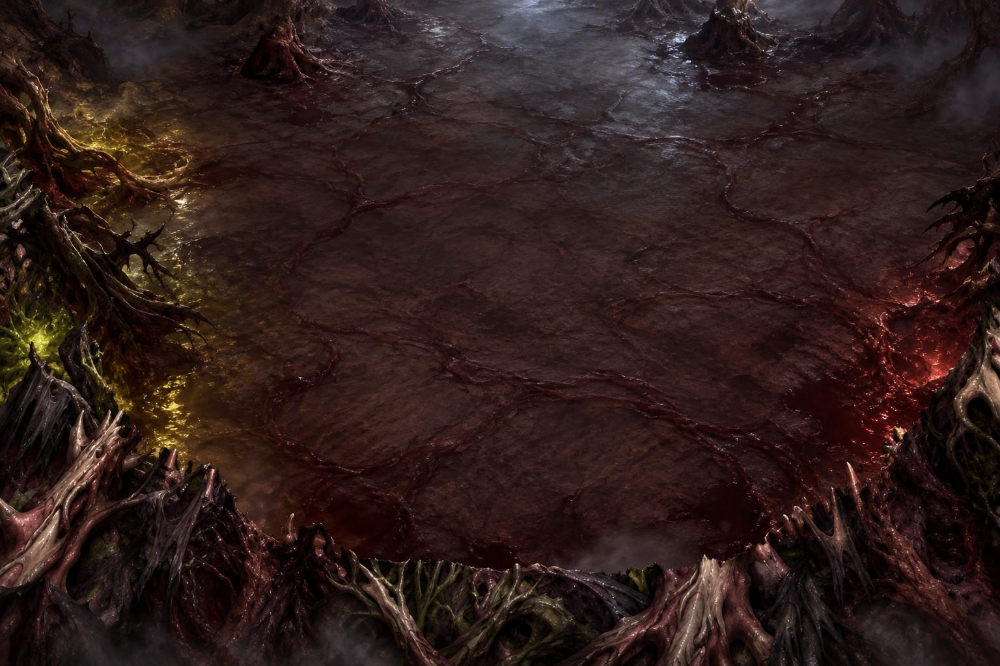
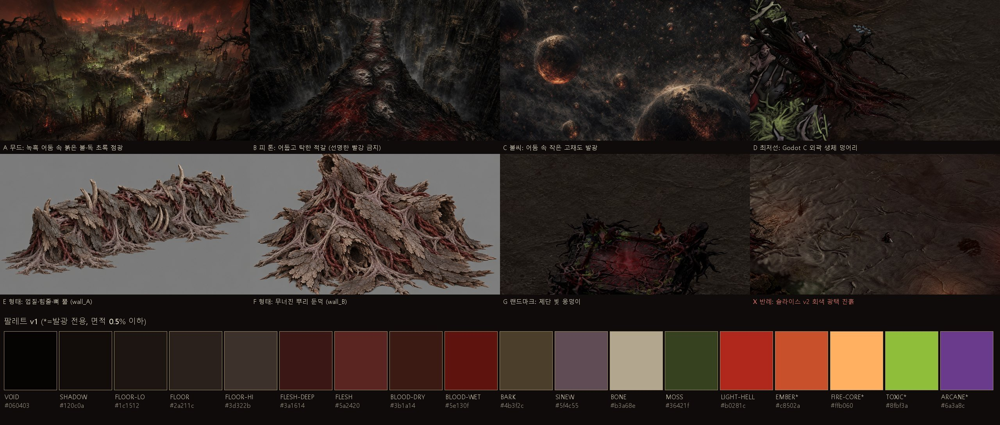

# 맵 아트 바이블 v2 (통합본) — "음습하고 아름다운 지옥" · CH1 생체지옥 3D

작성·소유: **디자인총괄(PC Claude, local_eb8a8577) — 유일한 디자인총괄**(2026-10-26 사용자 결정 "잘 통합해서 하나로"). 이 문서 하나가 3D 맵 시각 기준(무드보드·팔레트·명도·재질·형태·조명·독액·생동감·판정)이다.

이 문서는 두 초안을 합친 것이다. 아래 두 문서는 이력으로만 남긴다.
- [A] [UNITY_ART_BIBLE_V1_20261026.md](UNITY_ART_BIBLE_V1_20261026.md): 구 디자인 세션 local_a1efbc31. 목표 이미지·독액·습기·생동감 상한을 가져왔다.
- [B] [UNITY_MAP_ART_BIBLE_20261026.md](UNITY_MAP_ART_BIBLE_20261026.md): 이 세션. 형태 언어·측정 도구·명도 순서·광원 위계를 가져왔다.

대조 근거: `E:/exoduser-wt/_out/design-reconcile/COMPARE.md`. 결정 기록은 §12에 있다.

품질 게이트 G1~G8([MAP_IMPROVEMENT_PROJECT §2](MAP_IMPROVEMENT_PROJECT.md))은 그대로 쓴다. 이 문서는 G2·G3·G5·G8 판정 기준을 그림과 수치로 구체화한다.

- **측정 척도는 CIE L\*(0~100, 지각 명도)로 통일한다.** 도구: [art_bible_20261026/value_check.py](art_bible_20261026/value_check.py). 768×432로 줄인 뒤 잰다.
- **수치 통과 ≠ 합격.** 수치는 실패를 빨리 잡는 필요조건일 뿐이다. 합격은 목표 이미지·Godot C/D 옆에 나란히 두고 1x로 직접 본 판정으로만 낸다(2026-10-26 "평균색 일치 = 진흙톤" 사고).

---

## 1. 한 줄 정의와 세 기둥

> **어둠은 넓고 탁하게, 빛은 작고 아름답게, 살은 붉고 젖어 있게.**

| 기둥 | 뜻 | 화면에서 보이는 방식 | 틀리면 생기는 일 |
|---|---|---|---|
| 음습 | 젖음·썩음·생장이 같이 있음 | 넓은 바닥은 **축축한 반무광**이다. 밝은 반사는 살·피·독액·벽 기슭의 **작은 면적에 광원 색으로** 들어간다. 광택은 색 없는 회색이면 안 된다 | 색 없는 광택이 넓게 깔리면 회갈 진흙(슬라이스 v2), 반사가 아예 없으면 마른 흙판(슬라이스 v1) |
| 아름다움 | 빛의 리듬과 색의 대비 | **옥스블러드 바탕** 위에 진홍 지옥광과 병든 황록 독액광을 화면 **반대편 가장자리**에 두고, 그 사이는 어둡게 남긴다. 뼈·상아 힘줄 끝이 밝은 꼬리를 만든다 | 빛이 고르면 평판(Godot C), 색이 갈색이면 칙칙함 |
| 지옥 | 생체 재질의 형태 언어 | 껍질판·상아 힘줄 막·뼈 뿔·살덩이 혹·뿌리 퍼짐. 모든 덩어리가 바닥으로 뿌리를 뻗어 접지한다 | 바위·짐승처럼 읽히는 덩어리(절차 메시 RETOUCH) |

---

## 2. 기준 이미지

### 2.1 목표 화면 — 방향 참고 (정답 복제 대상 아님)

`art_bible_v1/target_key_start_v2.jpg`: GPT 생성(구 [A]). 우리 게임 3D 카메라 구도로 만든 유일한 목표 화면이다.

| 이 그림에서 가져올 것 | 가져오지 않을 것 |
|---|---|
| 옥스블러드 바닥과 바닥 위 핏줄 균열, 좌 독액광·우 진홍광 배치, 하단 외곽의 젖은 살·상아 힘줄·이끼, 작은 밝은 반사 꼬리 | 상단 중앙의 차가운 회청 안개광이 전투 바닥까지 밝히는 부분(§5 C7), AI 이미지 특유의 세밀 노이즈 |

함께 보는 그림:
- 제단 목표 `art_bible_v1/target_key_altar_v1.jpg`
- 재질 8종 `art_bible_v1/target_materials_v1.jpg`
- 명도 구획 `art_bible_v1/value_script_target_v1.jpg`
- 판정 예시 `art_bible_v1/judgment_examples_v1.jpg`

### 2.2 무드보드 — 우리 게임 확정 아트

| 칸 | 출처 | 가져올 것 |
|---|---|---|
| A 무드 | `assets/map/ch1/master/CH1_STYLE_VISTA.jpg` | 어둠 속 붉은 불·병든 초록 점광의 3색 대비 |
| B 피 톤 | `assets/cutscene/prologue/p03.jpg` | 피 = 어둡고 탁한 적갈(사용자 확정 "인트로 피 톤") |
| C 발광 | `assets/cutscene/prologue/p01.jpg` | 어둠 속 작은 고채도 발광, 금 간 틈으로 새는 빛 |
| D 최저선 | Godot LOOK-001 C | 외곽 생체 덩어리 구성, 손그림 청크 바닥 |
| E·F 형태 | GPT 콘셉트 wall_A·wall_B | 껍질판·힘줄 꼬임·뼈 뿔·뿌리 퍼짐 형태 언어 |
| G 랜드마크 | Godot C 제단 | 랜드마크 = 빛 웅덩이의 중심 |
| X 반례 | Unity 슬라이스 v2 | 회갈 진흙, 색 없는 광택, 검게 뭉개진 외곽 |

> 무드보드의 팔레트 띠는 v1(구 [B]) 값이다. **팔레트는 아래 §3이 정본**이다(바닥·힘줄·독액이 바뀜).

---

## 3. 팔레트 (sRGB, Gamma 파이프라인)

`*` = 발광·순간값 전용. 발광 **코어**(L\*62 이상)는 화면 면적 0.5% 이하, 발광에 **물든 면**은 3% 이하.

| 군 | 토큰 | HEX | L\* | 쓰는 곳 |
|---|---|---|---|---|
| 공백 | VOID | `#060403` | 1 | 구멍 안·가장 깊은 틈. 순검정 `#000` 금지 |
| 공백 | SHADOW | `#120c0a` | 4 | 그림자 바닥색, 광원 사이 어둠 |
| 바닥 | FLOOR (옥스블러드) | `#321d1c` | 13 | 전투면 기본 색조. 원본 64청크 손그림 위 색조 기준 |
| 바닥 | FLOOR-HI | `#4a2c28` | 22 | 청크 밝은 쪽, 광원 웅덩이 안 |
| 바닥 | FLOOR-LO | `#1f1312` | 7 | 청크 어두운 쪽, 균열 |
| 바닥 | FLOOR-BRUISE | `#3b2a2e` | 19 | 멍든 모브 큰 얼룩 변주(바닥 면적 20~30%) |
| 바닥 | VEIN | `#4a1612` | 16 | 바닥 위 핏줄 균열선(목표 이미지) |
| 외곽 | BARK | `#3a2c22` | 19 | 썩은 껍질판 몸체 |
| 외곽 | FLESH | `#6a2a26` | 26 | 부푼 살 몸체 |
| 외곽 | FLESH-DEEP | `#3a1614` | 13 | 살 그늘·오목면 |
| 외곽 | FLESH-WET\* | `#b06a5c` | 52 | 살 위 긴 젖은 반사(선 모양, 작게) |
| 외곽 | SINEW (상아) | `#8a6a52`~`#c9b394` | 47~74 | 힘줄 막·거미줄 막. 빛 받는 면만 밝게 |
| 외곽 | SINEW-SHADE | `#5f4c55` | 35 | 힘줄 그늘면의 회보라 변주(Godot C) |
| 외곽 | BONE\* | `#c9b394` | 74 | 뼈 뿔·가시 끝 빛면. 면적 작게 |
| 피 | BLOOD-POOL | `#3a0d0b` | 11 | 고인 피 몸체 |
| 피 | BLOOD-DRY | `#250f0b` | 7 | 마른 피 데칼, 껍질 틈 |
| 피 | BLOOD-SHEEN | `#7a1a14` | 27 | 고인 피 표면 반사 |
| 독액 | TOXIC-BODY | `#3a2e0a`~`#4a3a0c` | 20~25 | 늪·강 표면(§6) |
| 독액 | TOXIC-FLASH\* | `#a8a23a` | 65 | 기포 터짐 순간값(§6) |
| 독액 | MOSS | `#5d6a2a` | 42 | 외곽 그늘면 이끼 패치(색상각 75° 이하) |
| 광원 | LIGHT-HELL | `#b0281c` | 39 | 진홍 웅덩이 코어 |
| 광원 | LIGHT-HELL-EDGE | `#5a1410` | 19 | 진홍 감쇠부 |
| 광원 | LIGHT-TOXIC\* | `#b7b54a` | 72 | 독액 광원 중심(작게) |
| 광원 | FLAME\* | `#e8743a` | 62 | **횃불·제단 불꽃 심지만.** 떠다니는 불씨·용암 금지 |
| 대기 | FOG-LOW | `#2a1a16` | 11 | 기본 대기·거리 안개(바닥보다 약간 붉고 탁함) |
| 대기 | FOG-TOXIC | `#4a4a2e` | 31 | 늪·벽 기슭 바닥 독무 |
| 대기 | FOG-FAR | `#47434b` | 29 | 화면 상단 15% 원경에만 허용하는 회모브 깊이 안개(§5 C7) |
| 금지 | 보라 | `#8a4fd0` 계열 | — | 네메시아·디로이 등 캐릭터 전용. 맵 사용 금지 |

UI 뼈색 `#dfd6c2`(L\*86)보다 밝은 환경 면은 없다.

---

## 4. 명도 스크립트 (CIE L\*)

### 4.1 실측 (768×432 축소, 2026-10-26)

| 대상 | 전체 p50/p90/p99 | 바닥 중앙 p5/p50/p95 | 바닥 L\*≥17 | 바닥 L\*≤8 | 전체 L\*≥50 | R/G |
|---|---|---|---|---|---|---|
| 목표 START v2 | 12 / 25 / 50 | 7 / 13 / 19 | 17% | 7% | 1.01% | 1.73 |
| Godot LOOK-001 C | 10 / 15 / 45 | 7 / 10 / 14 | 1% | 12% | 0.60% | 1.22 |
| 슬라이스 v2 (capture17s) | 10 / 19 / 29 | 8 / 14 / 26 | 27% | 7% | **0.00%** | 1.40 |
| 플레이어 스프라이트 (Godot C) | 몸통 중앙 ≈L\*2, 상위 10% ≈L\*22, 최대 ≈L\*43 | | | | | |

읽는 법:
1. **세 화면의 밝기는 거의 같다.** 슬라이스를 "더 밝게" 고치면 안 된다.
2. 차이는 **색**(R/G 1.40 회갈 대 1.73 옥스블러드)과 **밝은 꼬리**(L\*≥50 면적 0% 대 1%)다.
3. Godot C는 바닥에 빛 받는 면이 없다(1%). 빛 리듬이 없는 평판이다.
4. **주인공은 어두운 실루엣 + 밝은 테두리광으로 읽힌다.** 그러니 바닥은 캐릭터 몸통보다 밝아야 한다.

### 4.2 규칙

| # | 대역·규칙 | 수치 (1920×1080 전투 카메라) |
|---|---|---|
| V1 | 전투 바닥은 무대다. 외곽 덩어리 **몸통**보다 밝다 | 바닥 중앙 L\*p50 **12~16**, 외곽 몸통 p50 **6~12**. 외곽에서 바닥보다 밝은 것은 뼈·힘줄 빛면·젖은 반사뿐이다 |
| V2 | 바닥에 빛 리듬이 있다 | 바닥 중 빛 받는 면(L\*≥17) **10~25%**, 그늘(L\*≤8) **5~20%** |
| V3 | 캐릭터 실루엣이 바닥에서 떨어진다 | 보행 영역 바닥 p5 **≥6**. 광원 웅덩이 안에서는 캐릭터 테두리광 필수(목표 L\*55 이상, G8) |
| V4 | 외곽은 어두워도 형태가 읽힌다 | 외곽 p50 **≥4**, p95 **25~50**. 검은 덩어리(p50 2)는 반려 |
| V5 | **밝은 꼬리가 반드시 있다** | 화면 전체 L\*≥50 면적 **0.3~1.2%**(뼈 끝·젖은 반사·발광 코어). 0%면 RETOUCH. 전투 중앙(플레이어 반경 400u) 안에서는 0 |
| V6 | L\*50 이상은 전투 몫 | 캐릭터 테두리광·적 눈·탄막·VFX·UI. 환경이 전투 중앙에서 이 대역을 쓰면 G2 RETOUCH |
| V7 | 발광은 작다 | 발광 코어(L\*≥62) 0.5% 이하, 한 광원 심지 지름 24px 이하. 발광에 물든 면 3% 이하 |

---

## 5. 색 규칙

| # | 규칙 |
|---|---|
| C1 | 바탕(바닥·외곽 몸통)은 **옥스블러드**다. 바닥 중앙값 R/G **1.5~1.8**, R−B 15~28, 채도 35~55%. 회갈(R/G 1.4 이하)·노란 진흙·초콜릿은 반려 |
| C2 | 액센트는 세 가지다. ① 진홍 지옥광 ② 병든 황록 독액광 ③ 상아 뼈·힘줄 빛면. QA 컷마다 두 가지 이상 보여야 한다. 진홍과 독액은 **화면 반대편 가장자리**에 둔다(START: 좌 독액·우 진홍) |
| C3 | **하이라이트는 빛의 색을 띤다.** 살·피·독액 반사는 근처 광원 색 × 재질 색이다. 흰색·중성 회색 하이라이트는 금지한다(슬라이스 v2의 "색 없는 광택") |
| C4 | 피는 어둡고 탁하다(BLOOD-\*). 가장 밝은 피도 BLOOD-SHEEN이고 원색 빨강·분홍은 금지한다 |
| C5 | 보라는 캐릭터 전용이다. 맵에 쓸 수 있는 보라 기운은 FLOOR-BRUISE·SINEW-SHADE의 탁한 모브까지다 |
| C6 | 맵 초록·황록은 색상각 **75° 이하**다(독액 40~65°, 이끼 ~72°). 75° 이상은 게임 독 VFX(88~120°)·독가스(80°)와 섞인다 |
| C7 | 대기 기본은 FOG-LOW(붉은 탁한 갈색)다. 차가운 FOG-FAR는 **화면 상단 15% 원경에만** 허용하고, 전투 바닥을 L\*30 이상 밝히면 안 된다. 파란 안개는 금지한다 |
| C8 | CH1에는 주황 용암·떠다니는 불씨가 없다. FLAME은 횃불·제단 불꽃 심지만 쓰고, 공중 입자는 진홍 포자·독 포자로 한다 |

---

## 6. 독액 기준 (독성 늪·독성 강, [맵 보드 §6](UNITY_MAP_BOARD_20261026.md) 연동)

게임의 독 VFX·피해 숫자는 순녹색이다(`#44dd44` 120°, `#88ff00` 88°, `#66cc44` 105°, `#33aa22` 112°, `#44cc00` 100°, 독가스 `#556633` 80°). 맵 독액은 이것과 겹치지 않게 **황토·올리브 쪽**으로 둔다.

| 항목 | 기준 |
|---|---|
| 색상각 | 맵 독액·독무는 **40~65°**, 75° 이상 금지 |
| 몸체 | TOXIC-BODY `#3a2e0a`~`#4a3a0c`(L\*20~25). 깊을수록 `#2a200a` |
| 표면 막(scum) | `#4a4220`~`#5a5030` 무광 막. 갈라진 틈으로만 몸체 반사가 보인다 |
| 상시 발광 | 코어 L\*35 이하. 주변 바닥을 반경 120~200u로 물들이고, 세기는 진홍 광원의 절반 이하 |
| 기포 섬광 | TOXIC-FLASH `#a8a23a`까지. 0.15~0.3초, 지름은 기포의 2배 이내, 화면 동시 3개 이하 |
| 기슭 | 젖은 살·뿌리(§7). 독액이 묻은 테두리 반사는 `#5a5020` |
| 독무 | FOG-TOXIC, 높이 0~40u, 알파 .25 이하. 전투 중앙으로 흘러나오면 .10 이하 |
| 면적 | 한 화면 독액 표면 12% 이하, 발광 면 3% 이하. 화면이 초록·노랑으로 덮이면 RETOUCH |
| 판정 | 늪·강 컷 옆에 독 스킬 VFX가 터진 프레임을 나란히 놓고, **VFX가 먼저 읽히면 PASS** |

---

## 7. 재질 라이브러리

roughness는 0(매끈)~1(거침), normal은 0~1 상대 강도(1 = 생성 맵 원본). "칠한 빛"은 손으로 칠한 빛 마스크 : 동적 조명 비율이다(기획서 §4.6).

| 재질 | 색 | roughness | 습기 표현 | normal | 칠한 빛 | 쓰는 곳 |
|---|---|---|---|---|---|---|
| 바닥 | §3 FLOOR 군 + VEIN 균열 | 중앙 **0.65~0.80**(축축한 반무광), 광원·벽 기슭 웅덩이 0.15~0.30 | 중앙은 반사 없이 축축하게. 번들 웅덩이는 광원 근처와 벽 기슭에만 | 0.3~0.5 (GPT 타일은 세부 보조로만) | 청크 원본 + 동적 | 전투면 |
| 살덩이 | `#4a1c19`~`#6a2a26`, 빛면 FLESH-WET | 0.25~0.40 | 긴 곡선 반사, 오목한 곳 진물. 얇은 곳은 뒤에서 빛 받을 때 `#8a2a20` | 0.5 | 60:40 | 외곽 부푼 덩어리, 늪 기슭, 스폰홀 |
| 썩은 껍질 | `#2a2018`~`#4a3a2c`, 판 끝 `#6b5a48` | 0.75~0.90 | 판 사이 틈·아래 가장자리만 젖음(0.45) | 0.9 | 70:30 | 외곽 벽 겉면(wall_A·B) |
| 상아 힘줄·막 | SINEW, 사이 근육 `#5a1c18`, 그늘면 SINEW-SHADE | 0.35~0.50 (새틴) | 팽팽한 막 위 길고 가는 반사 | 0.6 | 70:30 | 벽 사이 거미줄 막, 뿌리 감싼 막 |
| 붉은 힘줄 꼬임 | `#3a1210`~`#6e1e18` | 0.45~0.60 | 있음 | 0.7 | 60:40 | 껍질판 틈에서 흘러나오는 굵은 혈관 |
| 뼈 | `#7b5f40`~BONE | 0.70~0.85 | 젖지 않음. 아래쪽만 피·진물 얼룩 | 0.5~0.6 | 80:20 | 뿔·갈비·척추 아치·부스러기 |
| 마른 피 | BLOOD-DRY 계열 | 0.85~0.95 | 없음. 갈라진 판 모양 | 0.3~0.4 | — (데칼) | 바닥 데칼, 껍질 틈 |
| 고인 피 | BLOOD-POOL + BLOOD-SHEEN | 0.10~0.25 | 평평한 면, 광원 반사가 핵심 | 거의 없음 | 40:60 | 웅덩이 |
| 독액 | §6 | 0.10~0.20 | 끈적한 느린 반사 | 0.3 (흐름맵 물결) | 40:60 | 늪·강·제단 도랑 |
| 뿌리 | `#1f120c`~`#3a2418`, 옥스블러드 밑색 | 0.55~0.70 | 위쪽 등선에 축축한 반사 | 0.8 | 70:30 | 경계 뿌리 둑, 덩어리 하단 20% 접지, L1 흔들림 대상 |
| 이끼 | MOSS | 0.85~0.90 | 약간 | 0.4 | 70:30 | 외곽 그늘면, 독액 주변 |

공통 규칙:
- **반사는 긴 선이나 면으로** 둔다. 1~2px 반짝이는 점은 G5 FAIL이다. 원인은 대개 높은 normal에 낮은 roughness가 겹친 경우다.
- 재질 경계는 높이 기반으로 블렌딩한다(직선 경계 금지).
- 메시 아래쪽 20%는 바닥 재질과 섞어 접지시킨다.
- Meshy PBR 결과는 그대로 쓰지 않는다. 이 표의 색·광택으로 다시 칠한다.

---

## 8. 형태 언어 (실루엣)

| # | 규칙 |
|---|---|
| F1 | 큰 덩어리 : 중간 : 작은 디테일 = 3 : 2 : 1 면적. 작은 디테일만 많으면 노이즈로 보인다 |
| F2 | 외곽 벽의 주 흐름은 **수평**이다(보행 경계를 따라 길게). 수직 액센트(뼈 뿔·마른 가지)는 벽 길이 400px당 1~3개 |
| F3 | 덩어리에 **구멍·동굴**(VOID)을 둔다. 깊이감의 가장 싼 장치이자 "살아 있는 굴" 인상이다 |
| F4 | 좌우 대칭·반복 배치를 금지한다. 같은 키트는 회전·크기(0.8~1.25)·뒤집기를 섞는다 |
| F5 | 모든 덩어리는 바닥으로 뿌리를 뻗는다(뜬 덩어리 금지) |
| F6 | 보행 경계 100px 안쪽 메시는 플레이어를 가리지 않는 높이까지만 쓴다. 큰 높이는 화면 가장자리 외곽에만 둔다(협약 §7.3) |
| F7 | 바위·짐승·나무 줄기로 읽히는 실루엣은 반려한다 |

---

## 9. 조명

| # | 규칙 |
|---|---|
| L-1 | 화면당 **빛 웅덩이 2~4개**. 반경 180~320u, 서로 400px 이상 떨어지고, 사이 바닥은 L\*10 이하 |
| L-2 | 광원 위계: ① 진홍 지옥광(큰 반경, 느린 숨쉬기, 화면에 1~2개) ② 독액광(작은 반경, 기포와 함께) ③ 횃불·제단 불꽃(아주 작은 심지, 빠른 깜빡임) |
| L-3 | 큰 에셋은 칠한 빛과 동적 조명을 섞는다(§7 비율). 조명이 바뀌어도 회화 톤을 유지한다 |
| L-4 | 캐릭터는 빛 웅덩이 안에서 테두리광(L\*55 이상)을 받는다(G8). 웅덩이 밖에서는 어두운 실루엣으로 둔다 |
| L-5 | 방향광(key)은 약하게 둔다. 바닥을 고르게 밝히는 순간 V2가 깨진다 |
| L-6 | 그림자는 SHADOW(`#120c0a`)로 떨어진다. 순검정은 쓰지 않는다 |
| L-7 | 젖은 반사 하이라이트는 광원 쪽 가장자리에만 생기게 둔다(살·피·독액·벽 기슭) |

---

## 10. 생동감 (기획서 §4.5 L1~L9 연동)

| 항목 | 상한·원칙 |
|---|---|
| 강도 | 환경 움직임은 캐릭터·적·탄막보다 눈에 덜 띈다(채도·대비 낮게). 개체마다 위상·속도·진폭을 다르게 한다(L9) |
| 진폭·주기 | 풀·덩굴 흔들림은 높이의 15% 이하, 주기 2~6초. 살덩이 맥동은 크기의 3% 이하, 주기 3~8초. 광원 숨쉬기는 세기의 ±15% 이하 |
| 입자 | 진홍 포자·독 포자만 쓴다(C8). 한 화면 동시 입자 수 상한은 G7 실측 예산으로 정하고, 광원 근처에서만 반짝인다 |
| 전경 프레이밍(L5) | 전투 바닥 가림 3% 이하 |

---

## 11. 판정

### 11.1 절차

1. 구현 세션이 제출한다.
   - 1920×1080 컷 + 1x 크롭 3곳
   - **목표 START v2·Godot C/D와 나란히 놓은 비교 시트**
   - 충돌 오버레이 컷, 30초 FPS
   - 움직임 단계는 5초 영상 또는 연속 6프레임
   - 독액 컷은 독 스킬 VFX 프레임과 나란히
2. 맵 총괄: 구조(배치·동선·충돌·외곽 연결·지역 리듬)를 판정한다.
3. **디자인총괄: 시각 판정(PASS / RETOUCH / FAIL).** 아래 체크리스트와 직접 본 판단으로 낸다. FAIL = 방향 자체가 틀림.
4. 사용자: M2·M3 최종 판정.

자가 판정만으로 PASS 처리하지 않는다. 수치만 맞아도 PASS 처리하지 않는다.

### 11.2 체크리스트

| # | 항목 | 확인 |
|---|---|---|
| K1 | 목표 START v2·무드보드 옆에 두어도 같은 게임이고 더 매력 있는가 | 나란히 시트, 눈 |
| K2 | 바닥이 옥스블러드인가(C1) | 1x 크롭 + R/G |
| K3 | 빛 웅덩이 2~4개, 진홍·독액이 반대편, 사이는 어둠(V2·L-1·C2) | 화면 |
| K4 | 밝은 꼬리가 있고 색을 띠는가(V5·C3) | `value_check.py` L\*≥50 면적 + 1x |
| K5 | 주인공 실루엣이 바닥에서 떨어지고 웅덩이 안에서 테두리광을 받는가(V3·L-4) | 플레이어 1x, 웅덩이 안/밖 |
| K6 | 외곽 형태가 읽히고 접지되며 바위·짐승으로 안 읽히는가(V4·F1~F7) | 외곽 1x |
| K7 | 금지 위반 0 — 점 반짝임, 색 없는 광택, 75° 이상 초록, 맵 보라, 용암·불씨, 스티커 데칼, 순검정 | 1x 크롭 3곳 |

### 11.3 현재 판정

| 대상 | 판정 | 이유 | 다음 조치 |
|---|---|---|---|
| Godot LOOK-001 C/D | 최저선 | 구성·청크 바닥은 맞지만 회갈 바닥(R/G 1.22), 빛 리듬 없음(바닥 L\*≥17 1%) | 넘을 것: 옥스블러드 + 빛 리듬 + 밝은 꼬리 |
| 슬라이스 v1 (capture8) | RETOUCH | 광원 웅덩이·그림자는 유지, 반사 0, 외곽 형태 불명 | — (v2로 대체) |
| 슬라이스 v2 (capture17s, 최신) | **RETOUCH** | 구조·명도는 맞다. ① 회갈 바닥(R/G 1.40, C1 위반) ② 밝은 꼬리 0%(V5 위반) ③ 색 없는 광택(C3) ④ 하단 외곽 검게 뭉개짐(V4) ⑤ 데칼 스티커감 | ① 바닥 색조를 FLOOR 군으로 돌리고 명도는 유지 ② 외곽에 상아 힘줄·뼈 끝·젖은 살 반사 추가(§7) ③ 바닥 중앙 roughness 0.65~0.80 + 하이라이트 광원 색 ④ 외곽 몸통 p50 4 이상 ⑤ 데칼 가장자리 페이드·바닥 normal과 섞기 |
| GPT 콘셉트 wall_A / wall_B | 형태 PASS | §8 기준 이미지 | 재생성·Meshy 후처리 시 §7대로 살·힘줄에 습기를 넣는다 |
| GPT 생성 공통 문구 `NO gloss, NO wet highlights` (`ai3d-trial/gpt/gen_common.py` COMMON_NO) | 정정 | 일괄 무광은 이 바이블과 충돌 | 점 금지는 유지한다. 광택 금지는 뼈·마른 피·껍질 생성에만 쓰고, 살·피·독액·힘줄은 `smooth long wet highlights, no sparkle points` |
| PAINTGROUND (pc-map3d-paintground, 미커밋) | **RETOUCH** | 바닥 옥스블러드 PASS(R/G 1.68~1.72, 중앙 p50 14.3). 빛 웅덩이 소실(K3), 좌하단 살 덩어리 p50 16.9로 바닥보다 밝아 바위로 읽힘(K6·V1), L*≥50 0.13%(V5), 풀 균일 산포 | 웅덩이 복원(진홍 우·독액 좌), 살 몸통 p50 6~12 + 능선 상아·젖은 반사, 풀 군락 3~6 + 중앙 비움, 접지 그림자. 상세 E:/exoduser-wt/_out/design-reconcile/JUDGE_PAINTGROUND_20261026.md |

---

## 12. 통합 결정 기록 (2026-10-26, 근거 = COMPARE.md + §4.1 실측 + 1x 눈 판정)

| # | 쟁점 | 결정 | 근거 |
|---|---|---|---|
| D0 | 명도 척도 | **CIE L\*** | 지각 명도라 눈 판정과 맞는다. luma 수치는 폐기하고 측정 도구에 L\*를 추가 |
| D1 | 바닥 색 | **옥스블러드 `#321d1c`, R/G 1.5~1.8** ([A]) | 같은 명도에서 목표(1.73)가 회갈 슬라이스(1.40)·Godot C(1.22)보다 매력 있다(1x 나란히 판정, 사용자 눈 판정과 일치). 다음 슬라이스에서 1.5·1.73 두 값을 START 컷에 나란히 놓고 최종 미세조정 |
| D2 | 바닥 대 외곽 순서 | 바닥 > 외곽 **몸통**, 외곽 하이라이트만 바닥보다 밝음 ([B] V1) | 목표 이미지 실측도 외곽 몸통 L\*9 < 바닥 L\*14로 같다 |
| D3 | 안개 | 기본 붉은 탁한 갈색, 차가운 원경 안개는 화면 상단 15%만 ([B] 기본 + [A] 깊이) | 목표 이미지의 상단 회청광은 깊이를 주지만 전투면을 밝힌다([A]도 기록) |
| D4 | 습기 범위 | 바닥 중앙 축축한 반무광 0.65~0.80, 반사는 살·피·독액·기슭에 작게, 반드시 광원 색 ([A] 범위 + [B] 색 규칙) | 슬라이스 v2 = 색 없는 광택은 넓고 밝은 꼬리 0%. 두 진단이 같은 현상을 본 것이므로 "넓은 무색 광택 ↓, 작은 유색 반사 ↑" |
| D5 | 독액 색상각 | **40~65°, 75° 이상 금지** ([A]) | 게임 독 VFX 88~120°·독가스 80°와 겹침 방지(G2). 7b57c641a에서 [B] TOXIC 이미 폐기 |
| D6 | 힘줄 색 | **상아** 기본 + 그늘면 회보라 변주 | 목표 이미지에서 상아 힘줄이 옥스블러드 위 밝은 꼬리를 만든다. Godot C 회보라는 그늘면으로 살림 |
| D7 | 불씨 | 공중 불씨 없음, 불꽃은 횃불·제단 심지만 ([A]) | CH1은 용암·주황 금지 원칙. 공중 입자는 진홍·독 포자로 충분 |
| D8 | 슬라이스 v2 등급 | 최신 capture17s 기준 **RETOUCH** | 구조·명도·광원 배치는 살릴 수 있다. capture14의 FAIL은 이전 캡처 기준 이력 |
| D9 | 판정권 | 디자인총괄 단독 | 사용자 결정 2026-10-26 |
| D10 | 빛 리듬 수치 | [B] V2를 L\*로 바꾸고 그늘 하한을 15%→5%로 완화 | 목표 이미지도 바닥 그늘 7%. [B]의 15~35%는 근거 없이 엄격했다 |
| D11 | 발광 면적 | 코어 0.5% + 물든 면 3%로 분리 | [A] 3%·[B] 0.5%는 서로 다른 것(물든 면·코어)을 잰 것 |
