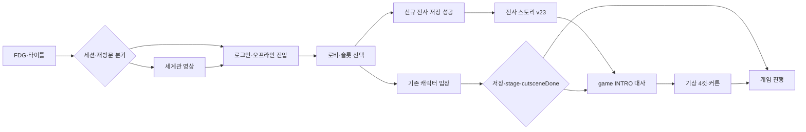

# 로비·내러티브 원본 추적·작은 이식 단위 — 2026-10-20

> 2026-10-27 갱신: 아래 로비 경로·캐시 행은 2026-10-20 추적 당시 스냅샷이다. 현재 웹 전사 영상은 `video/warrior_story_v23_clean.mp4?v=20261027-killu-bloodtears-v3`(SHA-256 `8b8248424b63d808dc225576fda44e39d459709963f97923ffaa38a51dba28ab`)다. `index.html` 스크립트 캐시도 같은 토큰이며 29언어 VTT·22큐는 유지한다.

## 0. 기준·소유·판정

| 항목 | 확인값 / 경계 |
|---|---|
| 작업 | `trace-lobby` / `codex/trace-lobby-20261020` / `~/exoduser-wt/trace-lobby` |
| 원본 기준 | 재개 시 `git fetch origin main` 및 원격 ref 대조로 고정한 최신 `origin/main=284d7faf49295b2f5061937a47ce96038032ed3c`. 기존 worktree의 시작점은 `f84e26ee0bbc929fb595b4c0af292b423588f325`, 보존된 문서 커밋은 `aac16bd1f7b518f55f2b5eb7e05e6b8507f8ae3e`. 두 HTML은 최신 main과 byte 동일. `index.html` 4,742행·`game.html` 65,692행이며 아래 행은 이 최신 main의 두 파일 기준 |
| 읽은 배정 기준 | `orders/WORK_BOARD.md` 전체와 최신 main 변경분(TRACE-LOBBY 진행 중 행77), `FDG_GAME_DEVELOPMENT_PLAN.md` 단계표33–45·작업표 P2-001i73/P4-00190, `FDG_FEATURE_INVENTORY_20261020.md:1203–1215`. FEATURE-INVENTORY의 과거 snapshot 판정과 이번 정적 관측을 구분 |
| 중복 소유 제외 | P2-001i 부팅→커튼, P2-007a 글꼴·키 가이드 패널은 이미 다른 담당의 이식. 재작성하지 않고 의존으로만 표시. 작업표의 인수 이력과 이번 실행 증거는 별개 |
| 기존 추적 참조 | [SETTINGS S10](FDG_SOURCE_TRACE_SETTINGS_20261020.md): 언어·장치 read-only 인계. [SAVE SV-LOBBY-VIEW](FDG_SOURCE_TRACE_SAVE_20261020.md): 슬롯 UI/메타/요청 수명·저장 전송. 이 문서는 화면·스토리·경로의 접점을 추적하며 그 모듈을 별도 중복 구현하지 않음 |
| 작성 범위 | 산출 추적 문서 1개를 기존 진행분에서 마감. 코드·테스트·기존 설계 docs·WORK_BOARD 변경 0. 사용자 재개 지시에 따라 `docs/CHANGELOG_SYNC.md` 맨 위에 기존 형식의 추적 절만 추가. 훅 우회 없음 |
| 보호 | `docs/2_3`·Q/E 의미/판정·세이브 형식 **보호**, 변경 제안 없음. 이름/charIdx/cutsceneDone/demo active 교환은 원본 참조만. DESIGN_LOCK 3개는 읽기만 |
| 기준 R | `/Users/fordeargamers/Projects/exoduser-migration-20261001`, HEAD `dd49171c5b88e211575a41f185395d6c0a14b184`. branch/INDEX/WORK 불변. R의 HTML은 원본 근거로 사용하지 않음 |
| 증거 수준 | 원본·Godot 파일/기존 테스트 정적 대조와 §6의 실제 Node 실행. Godot 새 실행·GUI·미디어 디코딩·로그인·실제 저장·실플레이·PC 실행은 **미확인**. 아직 이식하지 않은 계획을 구현 완료로 세지 않음 |

최신 main 재대조에서 기존 receipt의 소스·공용·설계 57개 파일은 모두 동일했다. 재부팅 이전 커밋/원격 브랜치를 보존하며 rebase·force·main push 없이 자기 브랜치에 후속 문서 커밋을 추가한다. 최신 main의 다른 변경을 이 worktree에 병합하지 않았으며, 새 의존 파일은 `git show <main SHA>:<path>`로 읽었다.

| 원본 파일 | 최신 main Git blob | SHA-256 |
|---|---|---|
| `index.html` | `88b4940cd5870793e509942224532e06a4a80bdb` | `36008f72723dbcbf1ae7b6af6b08dfe6299962e2445261139b6237082a24cf12` |
| `game.html` | `e755a2d98211ac2a6b4a53d8a1e3e7abe4714400` | `4d911cdd92fb55dc7c687ca7ed7146e6339687300f41e7585fe8e83dc685e5d4` |

최신 main에 있는 기존 추적 12종의 로비 접점도 재확인했다. SETTINGS S10·SAVE SV-LOBBY-VIEW가 각각 언어/장치와 슬롯/저장 수명의 권위다. INVENTORY §2.3·META §4/저장 접점·REVIVE-SHIELD U10/I01은 슬롯과 복귀, WEAPONS §4.5·ITEMS/CH1_ENEMIES의 index 행은 소개/간접 진행 표시다. SOUND §1.4는 로비 음원·영상 믹스를 담당한다. SKILLS·QUICKSLOT·BOSS_CH1은 공용 UI/입력 의존만 참조하며 이 문서에서 재설계하지 않는다.

기능 목록의 `LOBBY-prologue/story-intro/load`는 오래된 snapshot의 분류다. 최신 파일을 확인해 인게임 커튼/간이 선택/boot writer가 있다는 사실만 갱신 관측하고, 원본 로비·시네마틱 전체와 구분한다. 원본의 서로 다른 시네마틱은 다음과 같다.

| 계층 | 실제 생산자·소비자 | 다른 계층과의 경계 |
|---|---|---|
| 첫 화면 FDG·타이틀 | index578–622·4487–4716 | 계정/슬롯 생성 이전 splash. 세계관 영상 아님 |
| 로비 세계관 | index624–687·2354–2701 + `world-intro-player.js` | 문 열림 영상→영문 음성 clean movie+선택형 자막. CIN_LINES 정지화면 계통도 코드에 남아 있음 |
| 신규 전사 이야기 | index3402–3424 → `character-story-player.js` | 생성 저장 성공 후에만 v23 공통영상 재생. 완료/스킵/오류의 boolean을 입장 suffix에 전달 |
| 게임 PRO/INTRO | game62588–63204 | PRO 전쟁 정지화면은 강제 `cutscene=1`, 평상시 신규는 INTRO 네메시아·디로이·핵터. 생성 직후 영상과 별도 |
| 기상·키 가이드 | game63209·63276–63440 | 4컷 대사/조작 안내→커튼 오픈/첫 전투. Godot P2-001i/P2-007a가 이 부분 담당 |

도식은 대표 흐름이다. demo의 시네마틱 후 환영화면, preview, 오프라인 첫 방문, 강제 PRO·복원 완료 분기는 아래 표의 실제 조건을 따른다.

## 1. 화면·상태·함수·저장 연동 전수 추적

행 표기는 `I`=index.html, `G`=game.html. 외부 파일은 이름을 적는다. 부록 A/B는 index 전체의 named function/리터럴 UI id를, 부록 C는 직접 에셋 URL을 재현 가능한 행 인덱스로 보충한다. 함수 내부 익명 이벤트는 아래 해당 행 범위에 포함한다. 범위 밖 전투/맵/아이템 전체를 로비 이식으로 확대하지 않는다.

### 1.1 화면·진입 상태·요청 수명

| 화면·상태·동작 | 원본 행 | 정확 계약·데이터 |
|---|---|---|
| 외부 로드 | I4–9·496–500·1111–1119 | build-target/release/patch-notes, localization, 스타일4종, ancestor, Supabase CDN, lobby_i18n/stage-info, character story/world-intro/subtitles/logo. 외부 의존을 HTML 단독 기능으로 세지 않음 |
| 문서·favicon·공통 UI | I14–36·39–576 | 동적 favicon, 배경·반응형 CSS·로딩/키 표기. I875–1069는 외형 팝업 전용 CSS. 외부 CSS의 덮어쓰기도 필요 |
| splashOverlay | I578–602·4487–4716 | phase=1로 시작(경고0 기본 비활성), FDG1→title2→종료. click/keydown/패드 any just 즉시 다음. `?lobby=1`은 전체 skip |
| FDG | I604–622·4527–4582 | `FDG_DUR=3200`, `FDG_LOAD_TIMEOUT=12000`. 재생 시각3.2초 또는 ended로 완료. stall/error/play거절은 원본 poster로3.2초 fallback, watchdog 재설정/late event guard |
| 타이틀 | I580–599·4511–4525·4599–4658 | HD 20260929 영상→SD fallback→clean plate 정지이미지. 자동 다음 없음. 표시 1초 fade, 1200ms 뒤 안내. 24fps 동일 frame 재draw 생략, hidden pause, 종료 src/load 정리 |
| cinScene·문 | I624–687·2480–2525 | `cinVideo` muted preload, 클릭/Enter/Space/패드로 해제 및 volume .6. 진행<.2초/3초 경과 또는 error, 15초 stall 안전장치, 100ms 감시→world intro. 버튼 클릭1200ms dissolve |
| 로그인 | I698–735·2798–2825·2948–3004 | _goLogin은 creation/confirm/lang popup/hover/진동 정리, ++seq·선택 해제. demo는 Google/offline 숨김·demoEnter. Google OAuth session과 SIGNED_IN/OUT 상태 변경 분기 |
| 로비 기본 레이어 | I737–842·3195–3198·3657–3719 | crypt poster/ambient video+ancestor sprite+shadow. 미선택 이름 묘왕 바르칸, 부제 선대 소환체, 설명 표시; enter disabled. 선택 시 해당 외형 media/name/job, ancestor 숨김 |
| 로비 상단·중앙·하단 | I780–837·3722–3778 | build/version/offline-online, patch notes dialog, Steam wishlist, replay, quit. quotes3개 모두 '멘트 준비 중'. patch notes focus restore·Escape 닫기 |
| main state | I1273–1278·2276–2281·2793–2796 | selectedSlot/name/display·characterLoadSeq·localSlots/developerSlots·curBg/spriteOk; currentUser/gateOpened/cinDone/worldIntroPlayer/Subtitles/keyCleanup; URL lobby/cinematic/test 별도 값 |
| _goCinematic | I2826–2859 | creation·confirm·hover·pad/lang 정리, ++seq·선택해제, _cinReady=false/_cinDone=false, lobbyBGM fade, 영상/door/text/prompt 초기화→playCinematic |
| _goLobby | I2860–2894 | demo 강제 _testMode=true. cinematic audio/video 중지·lobby 표시→test는 loadLocalCharacters, online은 showLobby. await 뒤 request 일치·현재 screen인지 검사 후 loading hide |
| 초기 routing | I2948–2998 | cinematic=1 최우선 preview. NW는 test=true. Vercel에서 일반 offline 버튼 숨김. test demo+return/seen→login, test non-demo+return/seen→offline lobby; unseen test→cinema. no Supabase→offline. session 있으면 seen에 따라 lobby/cinema, 없으면 login. lobby=1은 session 없을 때도 offline lobby |
| online 화면 요청 | I3006–3060 | showLobby 계정 email/logout 생성→loadCharacters. 계정 id·요청 번호 동일성 검사, 목록 교체 시 선택해제/입장 비활성. 실제 인증/RLS 성공 여부 미확인 |
| 카드/스크롤/초점 | I3062–3189·3555–3656 | 카드 선택 컨트롤/키보드 nav·동적 언어 리프·스크롤. 온라인 id와 이름 분리. 로컬 카드2개 VIEW/일반5개/개발Infinity. 슬롯 생산·삭제·메타는 SAVE U01–U10/SV-LOBBY-VIEW 참조 |
| 선택 미디어 수명 | I3657–3706 | charIdx 잘못되면0, 같은 visual이면 video 재시작 안 함. poster→portrait/bust, video error/play거절→정적 이미지. 늦은 실패 callback은 현재 handler identity 검사. I3677/3678 같은 배경 대입2회도 원본 그대로 관측 |
| ancestor 실제 소비 | `lobby-ancestor-sprite.js:3–73` | 384×624·8열·96frame·24fps. frame=floor(max(0,seconds)*24)%96. selected/hidden/reduced-motion에 따라 RAF/ambient/preview pause 및 정적 표기, placement 계산. 독립 crypt 영상과 sprite를 한 영상으로 합치지 않음 |
| 이름 생성 modal | I843–857·2897–2944·3393–3477·3823–3837 | 외형→이름2–8자/특수문자금지→중복·잠금 확인→저장 성공 후 스토리. 취소 focus, IME229, Escape/Tab trapping. SAVE U02–U04의 두 생성 경로 참조 |
| 외형 선택 modal | I870–1107·3199–3391 | CHAR_VISUALS5개, 잠금은4개. 탭/화살표/Enter·좌우 정보 스크롤·포커스 복귀. request=_visualPreviewSeq로 늦은 video/timer 결과 차단 |
| 선택·닫기 | I3242–3339 | 닫으면 ++previewSeq·pause/src/poster/callback/timer 정리. selectVisual은 팝업 flex일 때만, .comingSoon→release-locked·생성 disabled. idle 우선, 5000ms readyState<2→static, 180ms swap |
| 외형 생성 확인 | I3350–3400 | open은 5아이콘을 새로 만들고 `_pendingVisualIdx\|\|0`을 preview한다. 이전 선택이 있으면 유지하며 첫 기본값은0. _visualConfirm은 comingSoon이면 즉시 return, 유효하면 이름창으로 전환 |
| 삭제·종료 dialog | I859–868·3839–3915 | _delConfirmCb/Busy/ReturnFocus/Idx. busy 중 중복 제출 방지·stale screen 응답 억제. quit은 NW→Electron→window.close 후150ms 같은 seq에서 수동종료 안내. 실제 삭제/quit 호출은 이번 미실행 |
| 가상키보드·IME | I3917–4064 | 한글 초·중·종성/겹받침 분해·조합, 8문자 제한, input event _fromVkb·외부 입력시 상태 동기화, OK→기존 create button. 이름 저장 정책은 보호 |
| 패드 내비게이션 | I1122–1250·4134–4338 | 글로벌 연결·DEAD .25·기존 handler dispatch. 화면별 로비/외형/이름/삭제/언어/스토리 nav, latch/반복·장치교체. 상세 언어/장치 포팅은 SETTINGS S10 참조, Q/E 보호 |
| 장치 선택화면 | I4727–4738 | _inputModeChosen=true, 별도 선택 UI 없음. 저장 inputMode 읽기→window._preferredInputMode. 언어/장치 쓰기는 보호/HOLD |
| 입장 버튼·로딩 | I2745–2790·3780–3820·4340–4349 | 입장 click은 선택 있을 때 showCharGate. showLoading의 실제 chapterGate 이미지는 logo_exoduser(무작위 rd picker와 구분). 아래 URL 행렬 참조 |
| 로비 장식 | I4352–4483 | 펫 말풍선 배열/랜덤·autotick, 배경 ember/smoke RAF. 본편 펫 행동/게임 clock과 다른 로비 장식. 기존 펫 추적/대사 SSOT 영역 재작성 없음 |

### 1.2 `_LOBBY_BUILD`의 전 분기와 진입 URL

`build-target.js:1–2`는 NW manifest `nw.App.manifest.exoduser?.target` 또는 `'demo'`. I1258은 다시 `window.EXODUSER_BUILD_TARGET||'demo'`다. URL `?demo=1`이나 `?test=1`만으로 `_LOBBY_BUILD`가 full/ea로 변하는 코드는 없다. 알 수 없는 truthy target을 강제로 demo로 정규화하는 코드도 없다. 아래 제한 문구는 로비 **표시값**이며 EA 게임 cap이 실제 적용된 증거가 아니다.

| 항목 | full | ea | demo | 원본 |
|---|---|---|---|---|
| 라벨 | OFFICIAL | EARLY ACCESS | DEMO | I1265 |
| 멘트 | 멘트 준비 중 | 멘트 준비 중 | 멘트 준비 중 | I1260–1264 |
| 제한 문구 | All Chapters · No Level Cap | Lv.500 · Chapter 1 (1-1~1-4) · 8~15h | Lv.1 START · Stage 1-1 Only · Lv.100 Cap · 1~2h | I1268–1272 |
| release 표시 | 공통 release-version.js version/date, 없으면 v0.6.0 · 20260521 | 동일 | 동일 | I1266–1267 |
| login·cin 완료 | currentUser/test→lobby, 그 외 login | full과 동일 | test이면 항상 login 환영화면 경유 | I2176·2473–2474·2719–2720·2818–2822·2964–2986 |
| 목록·생성·삭제 | test일 때 로컬API/브라우저 fallback, online일 때 Supabase | full과 동일 | 항상 test 로비·API 전에 browser 분기 | I2864·2917·3435·3523·3531·3598 |
| 개발 슬롯 | j.ok && development===true && test && !demo면 Infinity | 동일 | 개발 슬롯 false·일반5 | I3536·3555–3565 |
| 버전 표시 소비 | build별 label/limits 또는 빈문자열 | 동일 | 동일 | I2876–2879·3723–3729 |
| demo 활성화·URL | 아래 test/online | 아래 test/online | _demoActivateSlot 성공 필요·demo=1 추가 | I4346–4349 |

`_LOBBY_BUILD` 직접 참조 행 전체: **1258,2176,2473,2719,2818,2864,2876,2878,2917,2965,3435,3523,3531,3536,3598,3723,3724,3727,3729,4346,4347,4348**. 표 데이터 선언은1260–1272다.

| 입장 상황 | 예약 URL / 부수효과 | 근거 |
|---|---|---|
| demo | `game.html?test=1&slot=demo&demo=1` | I4345–4348; activation 실패는 hideLoading+오류 후예약0 |
| full/ea offline | `game.html?test=1&slot=` + encodeURIComponent(charId) | 위와 같음; offline charId는 slot 이름 |
| full/ea online | `game.html?char=` + charId + `&slot=` + `encodeURIComponent(_selectedSlotName\|\|charId)` | 위와 같음; online UUID와 표시이름 분리 |
| 신규 전사 영상 true | 위 URL + `&story=warrior-v21` | I3408–3423·4349; 실제 재생파일은v23; suffix 명칭은 원본 유지. game.html에서 story 쿼리 직접 소비는 검색상 없음, 외부 전체 소비는 미확인 |
| 취소·늦은 예약 | request=_characterLoadSeq 캡처 후1200ms, 변경됐으면 navigation 생략 | I4341·4349; 같은 seq의2예약을 한 번으로 합치는 새 debounce 없음 |
| 게임 복귀 | demo면 `/?lobby=1&demo=1`, 그 외 `/?lobby=1` | G63673–63684; 죽은 자원 회복→준비됐으면 await dbSave→이동. save 형식/쓰기 보호, SAVE T09 참조 |

### 1.3 캐릭터 외형과 실제 플레이 캐릭터 경계

I3199–3237의 각 항목은 id/name/cls/desc/folder/fw/fh/portrait/bust/emblemImg/aura/scene/(sceneVid)/idleVid/(idleRate)/poster/tab/job/traits/(emblem)/(comingSoon)다. data는 부록 C의 정확 URL도 참조한다. 게임 `CHAR_LIST`는 G10448–10451의 **2개**뿐이다. 5개 preview를 5종 플레이 구현으로 세지 않는다.

| index | id·이름 / 직업 | 원본 행 | 생성·미디어 |
|---|---|---|---|
| 0 | exoduser_warrior·엑소듀서 전사 / 전사 | I3200–3206 | comingSoon 키없음, 생성 가능. fw/fh48, folder img/exoduser_warrior, idle_warrior_cs3_4k.mp4?v=20260929-cs3, rate.75, 같은 버전 poster, portrait warrior_cut?v=3/bust portrait_warrior?v=20260930-eyefix |
| 1 | exoduser_silvertail·실버테일 / 블레이드 댄서 | I3207–3214 | comingSoon=true, 기존 슬롯 입장은 유지. folder img/exoduser_silvertail, idle_silvertail_4k/poster_idle_silvertail_4k?v=20260929-remaster, rate fallback1 |
| 2 | exoduser_hellgunner·헬거너 / 창포수 | I3216–3222 | comingSoon=true, folder 빈문자열, portrait/emblem/idle/poster _hellgunner, v20260929 |
| 3 | exoduser_transmuter·변성술사 / 사신 | I3223–3229 | comingSoon=true, folder 빈문자열, _transmuter 계열, v20260929 |
| 4 | exoduser_spearmage·창법사 / 공허 창술사 | I3230–3236 | comingSoon=true, folder 빈문자열, _spearmage 계열, v20260929 |

G10452–10500 `_charIdx` 캐시·_loadCharAtlas는 늦은 이전 캐릭터 로딩 가드가 있다. `dbRestore` G3603–3607은 player가 없어도 슬롯 charIdx 우선·유효 정수/게임 CHAR_LIST 범위 밖이면0이다. 해당 **저장 형식 보호**. 선택 팝업의5 preview와 Godot Main의 paused 시험용2선택 UI를 서로 대체하지 않는다.

| 별도 게임 내 선택 선언 | 원본 행 | 호출·완료 경계 |
|---|---|---|
| `_showCharCreate(onDone)` | G63211–63275 | `CHAR_LIST` 2카드, 현재 `_charIdx`/0 초기 선택, south.png 첫 프레임·실패색, 클릭 선택/더블클릭 확정·좌우/Enter. 중복 overlay 또는 1캐릭터 이하면 즉시 callback. confirm 1회만 `_loadCharAtlas(sel)`→키 리스너 해제→400ms 후 제거/callback. game.html 전수 검색에서 선언 외 직접 caller 없음. 정상 부트에서 실제 노출되는지는 **미확인**이며 index 생성 팝업이나 Godot 간이 picker의 live 연결 근거로 세지 않음 |

### 1.4 세계관·전사 영상·게임 대사 컷신·커튼

| 데이터·함수·입력 | 근거 | 정확 계약 |
|---|---|---|
| CIN_LINES | I2323–2344 | 20행(19scene+exit), v0→68.8초, text+다국어/dur/img/cls/shake 등. 그림19개(p01,p01b,p02~p17,logo). 현재 주 경로는 worldIntro movie, 배열이 자동 주 재생된다고 단정하지 않음 |
| CIN 정지화면 renderer | I2354–2459 | img 전환800ms, zoom4초, Date.now clock 또는 voice currentTime−.3, span40ms reveal. showLine은 sync/부분skip 경로에 남아 있으나 정상 startWorldIntro는 이 renderer를 시작하지 않음 |
| world movie | I632·2528–2551 / `world-intro-player.js:4–83` | video/world_intro_v15_clean_en.mp4, English VO. CUTS17개 `[0,4.041667,12.75,17.291667,27.791667,46.291667,56.291667,69.291667,76.291667,78.041667,80.291667,84.791667,87.791667,90.791667,95.791667,102.791667,109.291667]`. 다음은 >current+.05초, 없으면finish |
| world audio | I2244–2272·2535–2549 / world player6–31·52–81 | lobby loop.65, introVoice.7/rate.95이나 _CIN_VOICE=false. cinematic4곡 랜덤.6→world voice1/music.22, score는 seek clock과 독립·1초 duck/50ms tick. pause/ended/late play promise/사용자 mix 수명 |
| world 자막 | `world-intro-subtitles-data.js:2–1228(시간110–239/언어240–1228)`·`world-intro-subtitles.js:6–44` / I2534–2535 | 29언어×32 semantic cue. VTTCue align center/size84/line−3/position50, 언어alias·없는값en, track 재사용 WeakMap·다른track disabled. 재생 clock writer 없음. 언어 선택 우선순위/4select 동기는 SETTINGS S10 참조 |
| world 입력·종료 | I2572–2701·2703–2720 | overlay click/touch·Enter/Space·A/X/Y 다음. Esc/Space 또는 B/Start hold5000ms(월드), dt<=50. 완료/skip은 media 정리·cin_seen 기록→build/session 분기. preview는 _cinSeenSet no-op |
| 신규 전사 영상 진입 | I3402–3424 | 저장 성공 후 visualIdx0만 ExoduserCharacterStory.play, 전신 preview/hover/lobbyBGM 정지. 요청 번호가 변하면 입장 안 함. 실패catch는 lobbyBGM 재시작, 저장 성공을 재생성 요청으로 되돌리지 않음 |
| 전사영상 데이터·UI | `character-story-player.js:3–33` | CUES22개·HOLD_MS1200, video/warrior_story_v23_clean.mp4?v=20261008-killu-montage + video/subtitles/warrior_story_v23_<lang>.vtt. native controls=false/contain/volume1, dialog lang/dir. 같은 activePromise 재사용 |
| 전사영상 스킵·에러 | 해당 파일34–110 / I4134–4338 패드 연계 | >time+.05 다음cue, Space 첫누름 다음+hold, Enter/→ 다음, Esc/Space/B/Start/버튼 hold1200ms. source별 held Set, release/blur/visibility 취소. ended/완료skip=true, 재생실패false, NotAllowedError는 gesture retry. 3초 뒤 hint0.4초 fade·한번 숨김, 시간 seek로 재표시 안 함. 정리 후 focus 복귀 |
| PROLOGUE_LINES | G62598–62740 | ko/en/ja/zh 각34행·21 narrative text·12 unique images. id wa01–wa34, t/dur/img/speaker/narr/text/col/cam/vfx/fade/exit. 마지막t103000/dur1500. 실제 시퀀스는 단순 t clock만이 아니라 per-line dur 소비 |
| INTRO_CUTSCENE_LINES | G62746–62857 | ko27행(18 spoken), en/ja/zh26행(17 spoken), 각21unique images00.png~20.png. ko에id22b 추가(G62771), 원본raw차이 그대로. localization-runtime21–29는 src.ko id 기반 번역map·없으면원문으로 새 cue 생성, raw4언어 배열과 effective29언어를 구분 |
| speaker·voice | G62588–62593·62742–62745·63032–63038·63124–63129 | GODDESS #c084fc/네메시아, DIROY #e8d4b8, HECTOR #fb923c. speaker labelko/en/ja/zh+외부번역. _proVoice intro_voice .7/rate1·offset.3, PRO seek drift>1.2초만. voice_cut_<id pad2>, sfx safe. BGM cutscene_nemesis/prologue 별도 |
| cutscene state | G62859–62879 | INTRO_CUTSCENE/null, _cutSeq PRO/INTRO, lineIdx/start/WaitInput/SkipHold/Holding/LastT, img cache, overlay canvas. frame clock은 performance.now |
| 시작·분기 | G62909–62943 | force?PRO:INTRO, boss/plate skip, stage!=0 또는 cutsceneDone면 bypass. 첫2이미지 즉시·나머지400ms preload, G.on=false/HUD hide/BGM fade300→400ms 후선택. PRO만 voice 시작 |
| 다음·완료 | G62945–62982 | speaker text reveal 중 첫 advance는 전체표시, 다음은 다음cue. PRO 끝→INTRO로 전환·voice stop/hold reset; INTRO 끝→G._cutsceneDone=true·BGM→_startIntro |
| 렌더·스킵 | G62984–63204 / G13176–13182·13333·13379·13881–13890·61887 | Space/B hold2000ms, render dt<=100, key Enter/Z·click/A 부분진행; Escape/패드 Start 새 누름은 즉시 `_cutsceneEnd`(PRO 중이면 INTRO로 전환). Space keyup·blur/hidden은 hold와 누적값 초기화, 패드 B release 분기는 holding만 false(기존 누적값 유지). 무대사/무speaker는 dur 자동. 와이드16:9·극세로9:16 한계clip, vignette/colorGrade/shake/camera, SFX1회. G61887은 일반 render보다 우선 컷신 render |
| narrative·대화 자막 | G63080–63186 | narrative는 마지막줄ch*.88·font max14/ch*.031·행간1.5, title중앙 예외. 두 자막 모두 `ExoduserI18n.wrapText(text,cw*.84,measure,lang)` 사용. speaker창은 text_cfg.speed 또는50ms/문자로 visible chars·완료후입력대기, RTL speaker/name/텍스트위치 분기. 타입writer와 per-line duration은 별개 |
| 기상4컷 | G63209·63276–63440 | 눈을 떠/정신 차려/이제 진짜 지옥이야/야! 몬스터다!!!. _INTRO_KEY_STEPS4, 다음250ms debounce, Space2000ms/Esc/Start skip, 완료900ms cleanup·커튼 open·iframes600·500px safety·580px 5링·bonfire t300/r280. 이미 P2-001i/P2-007a 담당. Q/E/난이도저장 보호 |
| 게임 boot·복원 연결 | G62460–62585·63890–64160 | online/local-server/web branches saved metadata→dbRestore, ready/start stage/map loading→stage0 _startIntroCutscene. G64044–64048/G64159–64160가 로컬/web 대응. 별도 plate/boss/test 신규 경로는 보호된 원본 그대로 관측 |
| 장 전환·복귀 | G63534–63664·63673–63692 | random19 numeric loading, next-stage5초 후callback/900ms fade, boot pct clamp/8→100·hide. demo 마지막nextStage→demoEnd. 복귀는 save await/catch→로비, beforeunload는완료보장아닌시도. 저장 상세는 SAVE 참조 |

### 1.5 저장·인증·언어 접점 — 보호 / 참조만

| 필드·경계 | 원본 전 참조 행 또는 범위 | 소유·판정 |
|---|---|---|
| `hellLang` | I2159,2164,2242 | SETTINGS S10. URL→user→Steam→browser→en·4select. **보호**, 새 영속화 설계 없음 |
| `inputMode` | I1151,1242,4728 | SETTINGS S10. **보호**, 새 키·장치writer 제안 없음 |
| `_cinSeen`, `_cinSeen:<uid>`, user_metadata.cin_seen | I2302–2317·4711 | 계정metadata 우선·localcache, offline전역. preview쓰기0. 계정실행/동기화 **미확인**, 데이터정책변경제안 없음 |
| name/ts/charIdx·player/game/created_at/id/user_id | I2903–2944·3026–3060·3126–3189·3427–3477·3522–3656 | 슬롯명/UUID/외형/완전저장과 신규메타 구분. 전송·삭제·view는 SAVE U01–U11/SV-LOBBY-VIEW의 소유. **보호** |
| hellsave_demo_0..4 / hellsave_demo / hellsave_demo_active | I3488–3519, create2932–2936/3447–3450, list3543, delete3606 | slot prefix5·active교환·이관·메타merge의 기존 형식 **보호**. 변경·대체형식 제안 없음 |
| exoduser:tutorial-skipped:v2:slot:<encodedName> | I3405 | 신규test생성후기존레슨skip키제거. 레슨/QE **보호**·별도owner |
| `_charIdx` | G10452–10470·3603–3607 | 로컬cache와슬롯charIdx의우선순위구분. **보호** |
| `game.cutsceneDone` | G3555·3732·62144·63915·64072, initial/reset62483/63985/64121 | SAVE 부록C; 직렬화/복원모양 **보호**. LB 계획은 읽기완료신호만협의, 새 key나migration 제안없음 |
| 온라인 요청 | I1287–1289·2975–3004·3026–3060·3427–3477 | Supabase client/OAuth/session·characters CRUD. 공개키 문자열은 이 문서에 복사하지 않음. 인증/네트워크 실검수 **미확인** |

## 2. docs와 원본의 불일치·혼재·누락 표 — 수정 없음

계획·제작 이력을 현행 코드 결함으로 일괄 판정하지 않는다. 상단 현행/후속 SSOT로 대체된 부분도 표시한다. 아래는 수정 요청이 아니라 인수 때 확인할 차이표다. DESIGN_LOCK 위반 여부는 픽셀 검수 없이 추정하지 않는다.

| 문서·행 | 문서 내용 | 실제 원본 근거 | 차이 판정 |
|---|---|---|---|
| 11내러티브·로어디자인.md:1,36,46–66 | 상단v23공통+29언어22cue, 본문에 현재v21/v22·96.4초 표현 혼재 | character-story-player17–23 v23 clean+20261008-killu-montage·22cue | **이력/현행 혼재**. v23상단은경로와일치, 현재v21/v22라는후속문장은경로와불일치. 현행파일실제길이/편집후96.4초유지는이번미디어미검수→미확인 |
| 동일문서17 | 메인로비3종 preload/swap 20260913-lobby-detail2, rd picker20260930-loading-remaster5 | I3709–3718 crypt v2 고정, I2751/2758 rd 캐시20261006-rd13-grip | **현행 경로·캐시 불일치**, numeric19 캐시는20260930유지. 문서변경 0 |
| 동일문서29(다중 행) | 기존 명시적 개행 split 유지 | G63111 narrative·63135 speaker가 `ExoduserI18n.wrapText` 사용, 폭 `cw*.84`, 실제 폰트 measure와 언어를 전달 | **줄바꿈 설명이 현행보다 좁음**. 하단88% 앵커는 일치. 자동 줄바꿈·RTL 결과의 실화면 검수는 **미확인** |
| 캐릭터선택_리모델링_기획서.md:246 | 전사 idle_warrior_higgsfield_4k·133frame·rate.75 | I3200 cs3_4k?v20260929-cs3 | **후속 교체 이력**. LOBBY_ANCESTOR_ART25이후CS3기록으로대체. 코드현행영상규격의 실제프레임·길이는미확인 |
| LOBBY_ANCESTOR_ART_20260928.md:12 | 실버테일 idle_silvertail.mp4/poster_idle_silvertail.jpg,20260927-restored | I3207 *_4k.mp4/*_4k.jpg?v20260929-remaster | **현행 SELECTED_MEDIA 행 경로가 뒤처짐**. 캐릭터선택문서42–52의9/29리마스터기록과구분 |
| 캐릭터선택 기획서313–335 / LOBBY_ANCESTOR_ART11 / lobby_full_patch1265 | demo 고정1카드·신규칸없음 또는 slotname demo, 기존3종random배경 | I3488–3519·3555–3649 demo5슬롯/이름카드·생성; I3713 crypt고정 | **예전 설명이 남음**. 현재demo5/개발Infinity는SAVE U01–U09참조. 새 저장 정책 제안없음 |
| 캐릭터선택 기획서149–209 | 추천8슬롯·이름입력삭제확인·추가통계필드 제안 | I3555–3565 일반5/개발Infinity, I3860–3878 확인/취소, 저장필드별도 | **기획안과실제차이**. 추천/미구현제안이며 현행형식으로 채택하지않음. 세이브보호 |
| 스플래시_인트로_시퀀스.md:80–100,107–120 / TITLE_CLARITY8–16 | splash80–100의9/29 현행경로는일치. 뒤107–120·TITLE_CLARITY에는 title_motion_hd.mp4/clean_plate_20260910 기록 | I4513/4516 clean_plate_20260929, I4605 title_motion_hd_20260929, I4519 SD _20260929 | **후속 현행과 이전 규격 혼재**. 최신 splash 절은맞으며전체문서가틀렸다고판정하지않음. FDG3200/12000도일치 |
| INTRO_FOUR_CUTS_20260914.md:14–29 | 4컷·250ms·Space2000/Start·패드동적 표시·diff저장 | G63295–63440와일치. Godot패널/키보드있으나 native sequence461이후패드폴링·diff저장unported | 원본docs불일치없음. **Godot 이식공백**, P2-001i/P2-007a/SETTINGS 소유의존. 이 문서에서수정·보호동작변경제안없음 |
| 11내러티브·로어디자인.md:예정항목 | 주인공복수사연4택·장별로어비석·보스대사예정 | 현재신규생성스토리는I3408 visualIdx0 단일전사. CHAR_VISUALS5와복수사연4택은다름 | **기획예정/미구현**, 다른3개사연선택기능존재근거 없음. 외부전체내러티브존재는미확인 |
| WORLD_CORE.md:133–159·189–214 | 35보스사연·챕터7단계/각5보스서사·7장폭로 | lobby-stage-info4–12는장별4/6/4/7/5/6/3(35), G PRO/INTRO는도입부, I는35stage진행표시 | **서사설계와런타임분모대응미확인**. 챕터보스이식/플롯완료근거로사용불가. 숫자/서사를조정하지않음 |
| game INTRO raw4언어표 vs localization경로 | KO id22b만추가, rawen/ja/zh에는없음 | G62771·62746–62857, localization-runtime21–29 | **원본내부배열비대칭**(KO27/기타26). effective번역은KO기반이므로29언어가모두1cue빠진다고단정하면오류. 원문fallback/번역누락실화면은미확인 |
| DESIGN_LOCK 3개 | 네메시아문양·장신구/전사평범한눈·둥근견갑/두펫펜던트고정 | WARRIOR1–27/NEMESIA1–45/PETS1–15·원본img경로부록C | **보호/읽기 전용**. 경로대응만확인. 이번 이미지 픽셀·영상프레임검수없어디자인 일치/위반은미확인 |

## 3. Godot 실제 파일·기존 테스트로 확인한 현황

아래 테스트 파일은 존재·내용을 읽었다. **이번 Godot 실행 결과가 아니다.** 작업표에 적힌 과거 PASS를새 실측으로합산하지않는다. `.gd` 전수 검색(ignored test도 `--no-ignore`)에서 _LOBBY_BUILD/CHAR_VISUALS/ExoduserCharacterStory/WorldIntroPlayer/cin_seen/warrior_story/world_intro에 대응하는로비소비자는찾지못했다.

| 기능 | 실제 Godot 파일·행 | 기존 테스트/확인 경계 | 빠진 것·의존 |
|---|---|---|---|
| 직접부팅 | project.godot의 run/main_scene, scenes/main.tscn; scripts/main.gd:111–279 | test_p2001i_boot_intro.gd:1–110은실제Main·meta intro후8physics프레임확인 | native lobby scene/루트전환없음. 기존메인바로부팅을로비진입으로세지않음 |
| 간이캐릭터선택 | main.gd:1536–1602, player.gd:1109–1208 | paused OptionButton·실제Main reader identity·0/1profile·resource availability 검사. 테스트들에explicit character setup있음 | 원본5외형·comingSoon·생성·슬롯·story UI가아님. source_storage_restored=false. 기존player선택권위 재사용은총괄협의필수 |
| 커튼UI·shadow | main.gd:633–682, port_modules/character_clip/intro_curtain_view.gd·intro_curtain_source_finish.gd | test_native_main_intro_curtain.gd 및 timeout_failed_only.gd:bind/loss/closed/open/완료경계 | fullcanvas PRO/INTRO·영상재생없음. 주석의future/unported만으로현재배선부재로판정하지않음 |
| 부팅→4컷→커튼 | native_intro_curtain_sequence.gd:27–55,164–252,371–488; main.gd:279 | test_p2001i_boot_intro.gd / test_p2001h_curtain_spawn.gd. harness는휴면·meta intro로명시, 실제일반부트 auto | P2-001i 의존. 이경로는G.on·5링/bonfire·레슨까지실제구현; 로비cinema/네메시아대사앞부분은없음 |
| UI 마감·4컷패널 | native_intro_key_guide_panel.gd:1–90, native_ui_fonts.gd; sequence189–252 | test_p2007a_ui_polish.gd:8–29,139이후 font/가이드·Tab/Enter/skip/click | P2-007a 의존. legacyunported의HUD/ens문구는현재호출begin164–180과상충하므로실제호출우선. 패드폴링·OPT.diff저장은여전히공백 표시 |
| boot 로딩writer | hud.gd:125–218,369–385; main.gd:547–605 | native initialization/post-stage/asset-wait 계열기존 테스트가동일HUD writer/readback 사용 | source showBootLoading전체/19배경·chapter transition·tips·cinematic→load 통합없음 |
| 스토리asset | godot/assets/sfx/voice/voice_wakeup.mp3·fonts실파일 | 키가이드VOICE_PATH 및existingtest_resource존재검사 | 검색한godot/assets에는로비crypt/ancestor/charselect/cutscene/world/warrior/title영상대응없음. 원본파일 존재와Godotimport·디코드성공은별개 |
| 저장·메타 | SAVE §3의source_state/current readers·lifecycle·partialproviders· 최신 main에 `godot/tests/test_native_save_contract.gd` 존재 | SV-CONTRACT main 편입을 실제 파일과 작업판56행으로 확인. 3,023/0은 작업판의 PC 과거 결과이며 이번 재실행 아님 | SV-LOBBY-VIEW의목록UI·인증·IO/복원은선행/별도 담당. 저장 계약 테스트 존재를 로비 저장 구현으로 세지 않음. 여기서새saveformat/더미슬롯·기본복원값을만들지않음 |
| 설정 인계 | main.gd:547부근KO/EN boot subset, source_options_state.gd35current· 최신 main의 `godot/scripts/native_settings_read_view.gd:1–81`, `godot/tests/test_native_settings_read_view.gd` | SETTINGS-S01 main 편입을 실제 파일과 작업판58행으로 확인. owner weakref read view·default reference38개·누락 시 NOT_READY. 현재35/누락3(textScale/panelFit/diffV2)은 작업판 기록과 기존 source 대조, 이번 Godot 미실행 | SETTINGS S10의hellLang/inputMode·29언어·로비언어popup consumer는 별도 공백. default reference를 live 설정으로 채우거나 UI전역locale를설정권위로대체하지않음 |
| 로비·시네마틱전체 | scripts/port_modules/scenes/tests 정적 검색 결과 | Node원본테스트§6만실행 | 계정·splash·캐릭터생성·v23/world영상·subtitle·speaker canvas·로비복귀전체E2E는미이식/실플레이미확인 |

## 4. 작은 이식 단위 순서안 — 아직 구현 안 함

모든 파일명은 **소유 예정 후보**, 이번 생성0. 단위별 배정·원본 계약인수 뒤만착수한다. SAVE SV-LOBBY-VIEW/SETTINGS S10와중복파일을만들지않으며공용writer는각owner합의전HOLD. unit테스트더블과실Main·실화면을분리한다.

### 4.1 1번/LB-01: 원본 build 표시 카탈로그 (즉시 배정 가능한 최소 단위)

**신규 제품 1개와 신규 테스트 1개만 만듭니다. 공용·기존 제품·기존 테스트 수정은 0줄입니다.** active build 선택·routing·UI·저장·인증·제한 집행은 이 단위의 결과물에 포함하지 않습니다.

| 항목 | 구현 지시 |
|---|---|
| 만들 파일 | `godot/scripts/native_lobby_build_catalog.gd` (`extends RefCounted`)와 `godot/tests/test_native_lobby_build_catalog.gd` (`extends SceneTree`). 착수 직전 최신 main에서 두 경로가 비어 있는지 확인하고 해당 경로만 소유 |
| 옮길 원본 | **I1260–1272**의 3개 표. id 순서는 full, ea, demo. 각 entry는 quote=`멘트 준비 중`, label=OFFICIAL/EARLY ACCESS/DEMO, limits=§1.2의 문자열을 공백·점·물결·대소문자까지 동일하게 옮김. I1258의 active fallback과 I1267의 release version 수식은 LB-03으로 유보 |
| API 1 | `read_source_build_catalog() -> Dictionary`: `{full:{quote,label,limits},ea:{…},demo:{…}}`를 매번 새 deep 사본으로 반환. 3개 build와 entry별 3개 필드만 포함 |
| API 2 | `read_source_build_entry(build_id: String) -> Dictionary`: 알려진 3개 id면 해당 3필드의 새 사본, 미등록 id면 `{}`. 빈 결과는 카탈로그 조회 실패이며 실제 active build를 demo로 바꾸는 정책이 아님 |
| 부작용 경계 | current scene, Engine.max_fps/physics, InputMap, TranslationServer/ProjectSettings, AudioServer, 저장소·network에 쓰기 없음. Main/State/Player/Services preload 없음. 실제 설정·저장 owner를 카탈로그로 대체하지 않음 |
| 새 테스트 격리 | `USERDIR="EXODUSER-lobby-lb01-Isolated-20261020"`. 실행 동안 자기 WT override의 use_custom_user_dir=true/custom_user_dir_name을 설정. ProjectSettings와 OS.get_user_data_dir의 마지막 경로가 모두 일치하는지 확인하고 불일치면 exit2. 종료 시 override를 0byte로 비우고 커밋하지 않음 |
| 원본 값 단정 | 3개 id와 순서·각 3필드의 정확한 집합 검사. **9개 문자열을 독립 기대값으로 개별 비교**. full limits=`All Chapters · No Level Cap`, ea limits=`Lv.500 · Chapter 1 (1-1~1-4) · 8~15h`, demo limits=`Lv.1 START · Stage 1-1 Only · Lv.100 Cap · 1~2h`. quote 3개는 모두 `멘트 준비 중` |
| 수명·경계 단정 | entry API 3개가 catalog와 일치. 두 번 조회한 Dictionary identity가 다름. 반환 사본의 nested label 변경·extra 추가가 다음 조회에 영향을 주지 않음. unknown·대문자·빈 id는 `{}`이며 정상 3개 entry는 불변. read 전후 InputMap actions/events·Engine cap/physics·locale·ProjectSettings 불변 |
| 독립 oracle | 테스트는 최신 WT의 `res://../index.html` 1260–1272 블록도 읽어 원본 표와 대조. 제품 상수를 그대로 expected로 재사용하지 않음. Node acorn 의존을 추가하지 않음. 행 이동·문자열 차이는 실패로 보고하고 기준을 재확인하며 R HTML로 대체하지 않음 |
| 실행 명령 | 후속 구현을 배정받았을 때만 실행. 직전 `pgrep -f "Godot.app/Contents/MacOS/Godot" \| wc -l` 결과가2 이상이면30초씩 대기 후 재확인. 지정 원앱 Godot `/Users/fordeargamers/.codex/tools/godot-4.7.2/Godot.app/Contents/MacOS/Godot --headless --path <WT>/godot --script res://tests/test_native_lobby_build_catalog.gd`. 단정 수는 실제 실행 후 기록. 기존 `test_contracts.gd`는 해당 테스트의 격리 정책에 따라 실행. 이 pure module은 Main을 부팅하지 않음. 이번 추적 작업에서는 실행하지 않음 |
| 선행·충돌 | 총괄의 LB-01 배정과 snapshot 행 재확인. SAVE/SETTINGS/P2-001i/P2-007a 소유 파일 수정 0·persist0. 기존 owner 수정이 필요해지면 범위를 확장하지 않고 BLOCKED로 보고 |
| 인수·남는 것 | 9개 원본 문자열 일치·사본 독립성·부작용0의 실제 실행 로그와 보고서를 제출. 카탈로그가 게임에 배선됐다고 보고하지 않으며 후속 UI·routing은 미배선으로 남김 |

### 4.2 후속 단위별 파일·검증·선행

각 테스트의격리는표이름`EXODUSER-<단위>-Isolated-20261020`; 실제 공용 줄 수는지점협의전**미확인**이며아래수치는후속요청의예상 최소 규모(구현 완료 수치아님)다. 공용 0인단위는먼저독립 배정 가능하다.

| 순서·단위 | 원본 행/상수·공식 | 만들/수정할 파일 후보·공용 줄 | 새 테스트명·핵심단정·격리 | 선행·타담당 충돌 |
|---|---|---|---|---|
| 2/LB-02 외형표 read view | I3199–3237·G10448–10451, 5preview/4locked/1creatable,rate.75/fallback1 | 신규 `scripts/native_lobby_character_catalog.gd`, 기존 제품0·공용 0. 경로문자열카탈로그만, 미디어이송은다음단위 | `test_native_lobby_character_catalog.gd`:5id·모든scalar/traits3행·locked4·빈folder3·원본URL/query보존·사본독립/없는index. `EXODUSER-lobby-lb02-Isolated-20261020` | LB-01; DESIGN_LOCK읽기 전용. 기존player0/1개방상태를comingSoon해제근거로쓰지않음 |
| 3/LB-03 부트·화면 routing 순수모델 | I1258/1267·2302–2317·2793–2998. fallback은JS truthy `\|\|demo`, fromGame/test/session/seen/preview/NW분기 | 신규 `scripts/native_lobby_route_model.gd`; 공용 0. 입력snapshot→결정만, 인증/seen쓰기없음. live값미제공이면미확인/NR, fallback모조계정금지 | `test_native_lobby_route_model.gd`:full/ea/demo×seen/return/session/test·preview최우선·NWtest·unknown target원본 lookup빈값·releasefallback. `EXODUSER-lobby-lb03-Isolated-20261020` | LB-01/02, SETTINGS S10은language/device source, SAVE가선택snapshot소유. 원본같은 seq2예약허용을보존할모델범위인수 |
| 4/LB-04 로비shell·미선택/선택표시 | I737–842·3657–3719, ancestor-sprite3–73의96/24/384×624·selected media fallback | 신규 `scenes/lobby.tscn`·`scripts/native_lobby_screen.gd`·`native_lobby_media_view.gd` 및승인된원본 byte에셋사본. 공용 0/프로젝트 부팅 변경 0, standalone scene부터 | `test_native_lobby_screen.gd`:미선택enterdisabled·선택caption·동일visualclock유지·oldcallback무시·posterfallback·hidden/reducedpause; 실창1920/1280/초광폭원본비교별도. `EXODUSER-lobby-lb04-Isolated-20261020` | LB-02/03·SV-LOBBY-VIEW완료시reader연결. 슬롯목록중복구현/더미저장목록금지. H264 MP4지정Godot재생가능성미확인; 임의 변환/대체 생성없이선행기술 검증 |
| 5/LB-05 splash 순수timeline→독립view | I4487–4716, FDG3200/load12000/titleinput-only,1200prompt/1000fade, phase0비활성 | 신규 `native_lobby_splash_model.gd`·`native_lobby_splash_view.gd`, LB-04 scene에만2–4연결줄예상·공용 0 | `test_native_lobby_splash.gd`:로드대기시간재생시간제외·watchdogfallback한번·lateended무시·manualskipcleanup·lobby=1 skip·title무자동진행. `EXODUSER-lobby-lb05-Isolated-20261020` | LB-04 및원본미디어재생/디코드검증. P2-001i는게임내부커튼이므로소유겹침없음 |
| 6/LB-06 world cinema·자막 | I2354–2720·world-intro-player4–84/subtitles6–45/data110이후.17CUTS/32cue/29lang/+.05/hold5000·dt50·mix1/.22 | 신규 `native_lobby_world_movie.gd`·`native_lobby_world_subtitles.gd`·독립scene,공용 0. subtitle데이터원본동일 byte/명시변환승인필요 | `test_native_lobby_world_movie.gd`:seekcue17경계·BGMclock불변·staleplay/stop·subtitle32×29/aliases·hold취소/5000·previewseen쓰기0. `EXODUSER-lobby-lb06-Isolated-20261020` | LB-03/05·SETTINGS S10 reader·영상codec확인. 19scene legacy배열과실제movie를동시재생하는새정책금지. cin_seen쓰기승인/owner없으면마지막 쓰기배선HOLD |
| 7/LB-07 신규전사story player | I3402–3424·character-story-player3–110,22CUES/1200hold/+.05/hint3초 | 신규 `native_lobby_warrior_story.gd`·subtitleview. LB-04screen의 생성 완료callback에3–6줄예상·공용 0 | `test_native_lobby_warrior_story.gd`:동일activepromise·Spaceadvance/hold·source별release·blurcancel·endedtrue/errorfalse/gesture retry·seq변경후진입0. `EXODUSER-lobby-lb07-Isolated-20261020` | SV-LOBBY-VIEW/생성 성공권위에서이벤트수신·LB-06media/subtitle수명. 저장 POST재실행/slot변경제안없음 |
| 8/LB-08 네메시아/PRO 데이터·canvas대화 | G62588–63204:34PRO/KO27INTRO/18spoken·speaker색·hold2000·narr88%·per-line reveal | 우선신규 `native_story_cue_catalog.gd`+`native_story_dialogue_director.gd`·`scenes/story_dialogue.tscn`,공용 0; 실제cutsceneDonewriter배선은다음단위 | `test_native_story_dialogue.gd`:KO27/rawEN26차이·KOidlocalizationfallback·speakerfirstadvance전체표시→다음·무대사dur·PRO→INTRO·2000dt100·88%/RTL/title예외. `EXODUSER-lobby-lb08-Isolated-20261020` | LB-07·localization/sourceaudio reader·승인된LOCK그림원본 byte. caption/speaker를P2키가이드로대체하지않음. 저장flag는SAVEowner의존 |
| 9/LB-09 입장·복귀 coordinator접점 | I4340–4349/G3450–3460·3603–3607·62460–62585·63890–64160·63673–63692 | 신규 `native_lobby_entry_coordinator.gd`; LB-04 scene접점. main getter/intro install 등 예상8–15줄이상·확정미확인(§5); project.godot run/main_scene1줄은총괄승인후만 | `test_native_lobby_entry_flow.gd`:3URLfixture/slotencoding/storysuffix·1200ms/seqcancel/동seq2건·selectedidx권위·newmetadata→INTRO→기존curtain·completedrestoreskip·복귀saveACK/실패차이. `EXODUSER-lobby-lb09-Isolated-20261020` | SV-LOBBY-VIEW 및SAVErestore/read/write허용범위·SETTINGS S10·P2-001i소유자합의필수. 보호saveformat수정없음, 부재 시더미로진행금지 |
| 10/LB-10 접근성·실화면·플랫폼 인수 | I언어4select/RTL/modal/가상IME·패드·quit·patchnotes·Steam | LB-04/05/06/07각소유모듈 마감,새전역writer없음. 공용요청줄수미확인 | `test_native_lobby_navigation.gd` + 실창별도로그:IME/repeat·focusreturn·pad교체·cancelbusy·작은창·ultrawide·미디어실패·저장선택후자연진입. `EXODUSER-lobby-lb10-Isolated-20261020` | 앞 단위 인수와기존QA동시측정조정. 플랫폼로그인/실물pad/Steam연결은실제 검증 전미확인 |

## 5. 공용 파일 접점 — 이번 수정 0줄

아래는목록/협의대상이다. 보호영역은변경제안이아니다. LB-01~08의독립모듈/scene는공용 0으로검수하고, 상시배선은LB-09배정에서exactdiff를다시정한다.

| 파일·현재 지점 | 연결이 필요한 이유 | 최소 규모·선행·소유 |
|---|---|---|
| `godot/scripts/main.gd:111–279` 특히279 | 현재일반 ready에서P2-001i installer가바로intro시작. 로비→신규story/dialogue→커튼의순서권위가필요 | standalone단위0줄. 실제 bootstrap gate 3–6줄후보이나현재auto/harness해석과state 복원까지합의전**미확인**. P2-001i 담당/총괄만배선 |
| `main.gd:1536–1602` | pause시험picker와실제lobby선택은다름. `read_native_character_selection`은live UI/부모검증·picker selected만권위로봄 | getter분기/readercohort연결5–9줄이상예상·확정미확인. 새 scene의가짜 콜러/메서드이름으로player guard 우회금지 |
| `main.gd:547–605`·`hud.gd:125–218,369–385` | 현재boot-label subset/actualUI writer와전체lobby전이로딩의순서·화면수명이만나는곳 | 로비standalone0줄; coordinator→기존APICallable이확보되면새 모듈에서소비우선. shared수정필요시정확줄수미확인·HUD/P2-007a협의 |
| `main.gd:633–682` | 기존curtain view/finish/service를dialogue완료뒤정상소비 | 기존 owner재사용, LB-08 독립preview0줄. live완료접점2–4줄후보·확정미확인. 커튼재작성없음 |
| `godot/scripts/hud.gd:75–83` | cinematic동안HUD숨김과다시표시의기존수명API | 직접 UI 필드덮기없이기존API사용검토, 현단계0줄. 원본mini-map전체완료와구분 |
| `godot/scripts/player.gd:1109–1208` | 기존선택reader는get_parent의method/id0/1만허용. lobbycharIdx복원과actorprofile동일성확인필요 | 신규 외형 해금/스탯 변경제안없음. 기존authority가불충분하면합의전HOLD, 수정최소 줄 수**미확인** |
| `godot/scripts/native_source_new_run_state.gd:175,257,581` current G/P/intro writers | intro flag/on/완료 상태·복원순서를새coordinator가관측할경계 | **세이브형식 보호**. cutsceneDone직렬화/새 key변경제안없음. 현재 API는 read_current_g/read_current_p와 apply_native_intro_curtain_g_writes(begin/open/dispose). 마지막 API는 _intro/on만 쓰며 cutsceneDone 쓰기 경로가 아님. story 완료 writer 권한은 후속 인수 전 미확인, 이번 0줄 |
| `godot/scripts/world.gd:2878,2899` clear/register intro APIs | 기존curtain의적제거·5링·bonfire를story앞단에서중복기동하지않아야함 | world는로비renderer가아님. P2-001i APIs재사용선행, 신규writer제안없음·0줄 |
| `godot/scripts/native_normal_enemy_hurte.gd` | 로비·story만으로피해경로를고칠필요없음 | **접점없음/0줄**, 전투·Q/E·2_3 보호 |
| `godot/project.godot` run/main_scene·`scenes/main.tscn` | standalone lobby인수 뒤실제첫scene전환 | project1줄후보, main씬필요변경미확인. 자동부팅경로변경은총괄통합범위이며이번0줄 |

## 6. 이번 검증·한계·재현 자료

| 확인 | 실제 결과 |
|---|---|
| 소스 고정·보존 | 기존 worktree와 `aac16bd1` 커밋에서 재개. 최신 main `284d7faf`와 원본 두 HTML·기존 receipt 57파일 모두 byte 동일. 재개 전후 소스/설계 hash와 R HEAD/branch/INDEX/WORK 대조. 원본 두 HTML·DESIGN_LOCK·기존 제품/테스트수정 0 |
| 정적 전수 | index named 선언145개·UI id141개·직접 경로119개의 부록, `_LOBBY_BUILD`전체 참조、스토리지경계, game대상컷신/boot/input caller대조. `.gd/.tscn` 및ignoredtests도검색 |
| 데이터 산출 | Node vm의새빈context에서원본data declaration리터럴만읽어CHAR_VISUALS5/CIN20/PRO34×4/INTRO27·26·26·26 count확인. 브라우저app·인증·저장·영상실행아님 |
| 기존 원본 Node12파일(재부팅 이전 실행) | `node --test test/lobbyStageInfo.test.js test/lobbyCharacterSelectionInfo.test.js test/lobbySelectedScene.test.js test/characterStoryCreation.test.js test/characterStoryControls.test.js test/worldIntroPlayer.test.js test/worldIntroSubtitles.test.js test/worldIntroHandoff.test.js test/fdgIntroDuration.test.js test/releaseTarget.test.js test/lobbyCreationResponse.test.js test/lobbyConfirmTransition.test.js` |
| Node 보존 원로그 실제결과 | **exit1 / tests80 / pass77 / fail3 / skipped0**. fail3는characterStoryCreation/lobbyCreationResponse/releaseTarget 파일의 `ERR_MODULE_NOT_FOUND: Cannot find package 'acorn'`로본문 미실행. **해당3파일검증 BLOCKED(환경 의존)**. 전체 PASS아님. 의존설치·다른WTnode_modules차용·테스트수정등우회없음 |
| Node 통과범위 | 실제77건은FDGwatchdog/fallback·selectedscene/언어·stageformat·worldplayer/subtitle29×32·storycontrol·confirmstale 등 격리원본 계약. 테스트파일오류3건을제품불일치3건으로세지않음. 원로그/명령JSON은아래출력경로. 재개 시 원본 동일성을 확인했으며 같은 테스트를 재실행하지 않음 |
| Godot | 실제 파일·기존 테스트내용읽기만. Godot컴파일/실행·P2-001i/P2-007a독립재검수·video codec·시각품질은이번**미실행/미확인**. 문서-only추적 완료와플레이인수를구분 |
| Git 인계 | 자기 branch에 추적 문서와 사용자 허용 `docs/CHANGELOG_SYNC.md` 두 경로만 명시 stage→docs-sync-check --staged 직접 실행→정상 pre-commit·commit/push→원격 SHA 대조. main push·force·git add -A·훅 우회 없음. WORK_BOARD는 읽기만 하고 DONE으로 검수 인계 |
| 로그·DONE | `/Users/fordeargamers/exoduser-wt/_out/trace-lobby/`: 이전 source-contract-tests.log/command.json, source-and-design-receipt.json, verification.json을 보존. 재개 결과는 resume-baseline.json/resume-verification.json/resume-docs-sync-check-staged.log와 DONE.txt에 분리 |

미확인 항목이기능 공백/후속 선행인경우해당 단위 HOLD이며추적 문서 자체를구현으로승격하지않는다. 현재문서 작성·Git제출의장애와선택 검증3파일의환경 BLOCKED를구분해 인계한다.

## 부록 A. index 전체 named 함수·콜백 선언 인덱스

원본 텍스트의 `function name(`과 단일 행 `const/let/var name=...=>` 선언을 검색했다. 익명 handler는 §1 범위표에 포함한다. AST 전체 해석·호출 성공 증거가 아니며 동일 nested helper는 행으로 구별한다.

| 선언명 | index.html 행 |
|---|---|
| `applyFavicon (arrow)` | 19 |
| `_clearGamepadFeedback` | 1142 |
| `_leaveGamepadInput` | 1149 |
| `_resetDisconnectedPadState` | 1153 |
| `_handoffConnectedPadState` | 1158 |
| `_gpDot` | 1202 |
| `_gpGlobalPoll` | 1213 |
| `_tryLoadSprite` | 1279 |
| `getUserSelectedLanguage` | 2159 |
| `detectSteamLanguage` | 2160 |
| `detectBrowserLanguage` | 2161 |
| `getCurrentLanguage` | 2163 |
| `setUserLanguage` | 2164 |
| `_lobbyLang` | 2165 |
| `_TL` | 2166 |
| `_applyLobbyLang` | 2168 |
| `_syncAllLangSelects` | 2232 |
| `startCinBgm` | 2253 |
| `stopLobbyBgm` | 2254 |
| `stopCinBgm` | 2258 |
| `_tryBGM` | 2260 |
| `_rmBGMListeners` | 2268 |
| `startBGM` | 2270 |
| `$ (arrow)` | 2275 |
| `stopWorldIntro` | 2282 |
| `stopMediaVideo` | 2289 |
| `stopIntroVoice` | 2295 |
| `_cinSeenChk` | 2302 |
| `_cinSeenSet` | 2310 |
| `_clearVidTimers` | 2350 |
| `playCinematic` | 2354 |
| `showImg (arrow)` | 2361 |
| `hideAll (arrow)` | 2374 |
| `updateVoiceSync (arrow)` | 2380 |
| `showLine` | 2418 |
| `finishCin` | 2461 |
| `onVidClick` | 2489 |
| `startWorldIntro` | 2528 |
| `applyMix (arrow)` | 2543 |
| `onSubSkip` | 2572 |
| `keyHandler (arrow)` | 2599 |
| `_chk` | 2646 |
| `_chu` | 2650 |
| `_hgLoop` | 2666 |
| `skipToGate` | 2703 |
| `pickRandomLoadingImage` | 2750 |
| `_preloadLoadingImgs` | 2757 |
| `showLoading` | 2762 |
| `hideLoading` | 2782 |
| `_goLogin` | 2798 |
| `_goCinematic` | 2826 |
| `_goLobby` | 2860 |
| `_showCreateFailure` | 2897 |
| `_enterOffline` | 2903 |
| `showLobby` | 3006 |
| `loadCharacters` | 3026 |
| `message (arrow)` | 3033 |
| `_addLobbyCardControl` | 3062 |
| `_refreshLobbyCardsLanguage` | 3085 |
| `_lobbyCardLeaf` | 3089 |
| `_lobbyCharacterCardLabel` | 3092 |
| `_lobbyDemoCardLabel` | 3099 |
| `_lobbyNewCardLabel` | 3105 |
| `_bindLobbyListNavigation` | 3112 |
| `_renderOnlineSlots` | 3126 |
| `_lobbyAncestorName` | 3195 |
| `_lobbyAncestorCaption` | 3196 |
| `_lobbyAncestorDetail` | 3197 |
| `_lobbyDemoCharacterName` | 3198 |
| `_closeVisualSelect` | 3242 |
| `_closeCreationOverlays` | 3255 |
| `_resetVisualInfoScroll` | 3267 |
| `_visualInfoLayoutChanged` | 3271 |
| `selectVisual` | 3278 |
| `_showStatic (arrow)` | 3291 |
| `_spawnEmbers` | 3342 |
| `openVisualSelect` | 3350 |
| `_visualSelectKeydown` | 3370 |
| `_visualConfirm` | 3393 |
| `_afterCharacterCreated` | 3402 |
| `doCreateChar` | 3427 |
| `setStatus` | 3478 |
| `_refreshStatusLanguage` | 3479 |
| `escHtml` | 3480 |
| `_demoSlotRead` | 3489 |
| `_demoSyncActiveSave` | 3490 |
| `_demoActivateSlot` | 3512 |
| `loadLocalCharacters` | 3522 |
| `_renderSlotList` | 3555 |
| `_selectSlot` | 3650 |
| `_updateCharDisplay` | 3657 |
| `imageFallback (arrow)` | 3686 |
| `videoFallback (arrow)` | 3695 |
| `_preloadLobbyBgs` | 3709 |
| `_swapLobbyBg` | 3713 |
| `_initLobbyMid` | 3722 |
| `_initPatchNotes` | 3735 |
| `_render` | 3741 |
| `_open` | 3765 |
| `_close` | 3766 |
| `playEnterSFX` | 3780 |
| `_startHover` | 3791 |
| `_stopHover` | 3804 |
| `_showLobbyQuit` | 3839 |
| `_lobbyQuitKeydown` | 3852 |
| `_showDelConfirm` | 3860 |
| `_hideDelConfirm` | 3871 |
| `_delHighlight` | 3879 |
| `_hgCompose` | 3925 |
| `_isJamo` | 3930 |
| `_isCho` | 3931 |
| `_isJung` | 3932 |
| `_isJong` | 3933 |
| `_vkbShow` | 3936 |
| `_vkbHide` | 3951 |
| `_vkbHighlight` | 3952 |
| `_vkbDispatchInput` | 3969 |
| `_vkbInput` | 3973 |
| `_openLangPop` | 4067 |
| `_positionLangPop` | 4096 |
| `_closeLangPop` | 4107 |
| `_langPopKeydown` | 4108 |
| `_hlLangPop` | 4118 |
| `showCharGate` | 4340 |
| `pickLine` | 4357 |
| `showBubble` | 4360 |
| `autoTick` | 4378 |
| `resize` | 4408 |
| `loop` | 4431 |
| `resizeCanvas` | 4495 |
| `syncTitlePlayback` | 4521 |
| `finishFDG` | 4536 |
| `showFDGFallback` | 4539 |
| `watchFDGLoading` | 4547 |
| `showFDGScreen` | 4559 |
| `hideFDGScreen` | 4569 |
| `startPhase` | 4586 |
| `titleLoop` | 4612 |
| `nextPhase` | 4660 |
| `endSplash` | 4673 |
| `skip` | 4684 |
| `splashKey` | 4693 |
| `openWishlist` | 4725 |
| `_showInputModeScreen` | 4731 |
| `_applyInputMode` | 4736 |

## 부록 B. index UI id 리터럴 전수 인덱스

정적 HTML 및 JS template 문자열의 id= 리터럴이다. helper가 런타임 생성하는 가변 id·패드 dot·언어 popup은 해당 함수 범위도 참조한다. DOM 렌더 증거가 아니다.

| id | index.html 행 |
|---|---|
| `b` | 73 |
| `lobby-layout-20261016` | 502 |
| `splashOverlay` | 578 |
| `splashCanvas` | 579 |
| `splashTitleVideo` | 580 |
| `splashTitleBrand` | 581 |
| `titlePlateFeather` | 583 |
| `titlePlateMask` | 584 |
| `titleRule` | 585 |
| `splashTitlePrompt` | 598 |
| `splashContent` | 599 |
| `fdgScreen` | 604 |
| `fdgIntroVideo` | 605 |
| `fdgTitle` | 613 |
| `fdgAF` | 614 |
| `fdgXOR` | 614 |
| `fdgAD` | 615 |
| `fdgXEAR` | 615 |
| `fdgAG` | 616 |
| `fdgXAMERS` | 616 |
| `fdgPresents` | 618 |
| `fdgSubtitle` | 619 |
| `fdgPrompt` | 620 |
| `cinScene` | 624 |
| `cinVideo` | 629 |
| `worldIntroVideo` | 632 |
| `worldIntroMix` | 633 |
| `worldIntroToggle` | 634 |
| `worldIntroMusicGain` | 635 |
| `worldIntroMusicValue` | 635 |
| `worldIntroVoiceGain` | 636 |
| `worldIntroVoiceValue` | 636 |
| `worldIntroStatus` | 637 |
| `cinClickPrompt` | 640 |
| `cinGate` | 648 |
| `cinImg1` | 654 |
| `cinImg2` | 655 |
| `cinImg3` | 656 |
| `cinImg4` | 657 |
| `cinImg5` | 658 |
| `cinImg6` | 659 |
| `cinImg7` | 660 |
| `cinImg8` | 661 |
| `cinImg9` | 662 |
| `cinImg10` | 663 |
| `cinImg11` | 664 |
| `cinImg12` | 665 |
| `cinImg13` | 666 |
| `cinImg14` | 667 |
| `cinImg15` | 668 |
| `cinImg16` | 669 |
| `cinImg17` | 670 |
| `cinImg18` | 671 |
| `cinImg19` | 672 |
| `cinText` | 675 |
| `cinTextInner` | 676 |
| `skipBtn` | 682 |
| `cinHoldGauge` | 683 |
| `cinLang` | 684 |
| `chapterGate` | 690 |
| `chGateImg` | 691 |
| `mainWrap` | 698 |
| `langSelect` | 702 |
| `loading` | 707 |
| `loginSection` | 708 |
| `loginLangSelect` | 713 |
| `googleBtn` | 718 |
| `offlineBtn` | 722 |
| `demoEnterBtn` | 726 |
| `lobby` | 737 |
| `lobbyBgImg` | 739 |
| `lobbyAmbientVideo` | 740 |
| `lobbyAncestorShadow` | 741 |
| `lobbyAncestorSprite` | 742 |
| `lobbyCharPreview` | 743 |
| `lobbyCharKeyart` | 744 |
| `patchNotesBackdrop` | 780 |
| `patchNotesPanel` | 781 |
| `pnTitle` | 782 |
| `pnBody` | 784 |
| `pnClose` | 785 |
| `lobbyParticles` | 788 |
| `lobbyVerOverlay` | 789 |
| `charDispEmpty` | 790 |
| `charDispTitle` | 791 |
| `charDispSub` | 792 |
| `charDispDetail` | 793 |
| `lobbyLangSelect` | 801 |
| `lobbyMode` | 804 |
| `developerSaveNotice` | 808 |
| `charList` | 809 |
| `lobbyMidArea` | 815 |
| `lobbyWishlistBtn` | 823 |
| `enterGameBtn` | 832 |
| `lobbyStatus` | 834 |
| `replayCinBtn` | 836 |
| `lobbyCornerActions` | 837 |
| `lobbyVersionTxt` | 837 |
| `lobbyQuitBtn` | 837 |
| `createModal` | 843 |
| `createModalTitle` | 845 |
| `charNameLabel` | 847 |
| `charName` | 848 |
| `status` | 849 |
| `vkbWrap` | 850 |
| `createCancelBtn` | 852 |
| `createBtn` | 853 |
| `delConfirmModal` | 859 |
| `delConfirmMsg` | 861 |
| `delConfirmYes` | 863 |
| `delConfirmNo` | 864 |
| `charVisualPop` | 870 |
| `csScene` | 1071 |
| `csSceneVid` | 1071 |
| `csIdleVid` | 1071 |
| `csAura` | 1073 |
| `csEmbers` | 1075 |
| `charVisualTitle` | 1078 |
| `csLeft` | 1082 |
| `csClsName` | 1083 |
| `csCharName` | 1084 |
| `csCharDesc` | 1085 |
| `csThumb` | 1088 |
| `csPortrait` | 1091 |
| `csReleaseLock` | 1091 |
| `csReleaseLabel` | 1091 |
| `csRight` | 1092 |
| `csPlaystyleTitle` | 1096 |
| `csTraits` | 1097 |
| `visualGrid` | 1102 |
| `visualCancelBtn` | 1104 |
| `visualCreateBtn` | 1105 |
| `gpDot` | 1205 |
| `lobbyLogout` | 3017 |
| `charNavUpOn` | 3133 |
| `charNavDnOn` | 3133 |
| `charNavUp` | 3571 |
| `charNavDn` | 3571 |
| `_langPop` | 4074 |
| `_langOption` | 4085 |
| `splashBlink` | 4509 |

## 부록 C. 에셋·외부 스크립트/스타일 경로 전수

I 전체 src/href/data-src/poster 및 assets/img/video/bgm/sfx/sprites 상대 경로 리터럴, movie/ancestor 모듈의 직접 경로를 수집했다. 로드된 공통/로비 CSS의 url() 리터럴도 포함한다. 미디어 내부 embedded 자산·가변 조합 경로는 별도 확인 대상이다. `있음`은 이 main worktree 파일 존재만, 디코딩·품질·실행은 **미확인**이다. query는 보존했다.

| 경로 | 선언 파일:행 | WT 파일 |
|---|---|---|
| `video/warrior_story_v23_clean.mp4?v=20261008-killu-montage` | character-story-player.js:21 | 있음 |
| `video/subtitles/warrior_story_v23_` | character-story-player.js:25 | 동적 경로 접두사(C.1) |
| `output/fdg_reference_1280x720.png` | index.html:1033 | 있음 |
| `https://cdn.jsdelivr.net/npm/@supabase/supabase-js@2/dist/umd/supabase.min.js` | index.html:1111 | 외부 URL·미확인 |
| `lobby_i18n.js` | index.html:1112 | 있음 |
| `lobby-stage-info.js` | index.html:1113 | 있음 |
| `character-story-player.js?v=20261008-killu-montage` | index.html:1114 | 있음 |
| `world-intro-player.js?v=20260907-v12-fullscene-newvoice` | index.html:1115 | 있음 |
| `world-intro-subtitles-data.js?v=20260907-v13-exodus-ko-escape` | index.html:1116 | 있음 |
| `world-intro-subtitles.js?v=20260907-v6-cinema-size` | index.html:1117 | 있음 |
| `cin-enter-engraved.css?v=20260907-enter-4` | index.html:1118 | 있음 |
| `cin-logo-art.js?v=20260907-enter-2` | index.html:1119 | 있음 |
| `/favicon.ico?v=20260414-iconfix` | index.html:12, index.html:13 | 있음 |
| `img/hellgate.png` | index.html:121, index.html:649 | 있음 |
| `img/cin_nemesia_hd.png` | index.html:140 | 있음 |
| `img/icon-256.png?v=` | index.html:18 | 있음 |
| `bgm/공통/lobby.mp3` | index.html:2244 | 있음 |
| `bgm/공통/intro_voice.mp3` | index.html:2246 | 있음 |
| `bgm/cutscene/prologue_theme.mp3` | index.html:2251 | 있음 |
| `bgm/cutscene/prologue_theme_abyssal_fracture.mp3` | index.html:2251 | 있음 |
| `bgm/cutscene/prologue_theme_rebirth_gate_1.mp3` | index.html:2251 | 있음 |
| `bgm/cutscene/prologue_theme_rebirth_gate_2.mp3` | index.html:2251 | 있음 |
| `assets/lobby/lobby_ancestor_portrait_v4.webp?v=20260928-shoulder-v4` | index.html:3147, index.html:3588 | 있음 |
| `assets/charselect/bg_scene1.png?v=1` | index.html:3200 | 있음 |
| `assets/charselect/bg_scene1_loop.mp4?v=2` | index.html:3200 | 있음 |
| `assets/charselect/emblem_warrior.png?v=1` | index.html:3200 | 있음 |
| `assets/charselect/idle_warrior_cs3_4k.mp4?v=20260929-cs3` | index.html:3200 | 있음 |
| `assets/charselect/portrait_warrior.png?v=20260930-eyefix` | index.html:3200 | 있음 |
| `assets/charselect/poster_idle_warrior_cs3_4k.jpg?v=20260929-cs3` | index.html:3200 | 있음 |
| `assets/charselect/warrior_cut.png?v=3` | index.html:3200 | 있음 |
| `img/exoduser_warrior` | index.html:3200 | 있음(디렉터리) |
| `assets/charselect/bg_scene2.png?v=1` | index.html:3207 | 있음 |
| `assets/charselect/bg_scene2_loop.mp4?v=1` | index.html:3207 | 있음 |
| `assets/charselect/emblem_silvertail.png?v=1` | index.html:3207 | 있음 |
| `assets/charselect/idle_silvertail_4k.mp4?v=20260929-remaster` | index.html:3207 | 있음 |
| `assets/charselect/portrait_silvertail.png?v=20260927-restored` | index.html:3207 | 있음 |
| `assets/charselect/poster_idle_silvertail_4k.jpg?v=20260929-remaster` | index.html:3207 | 있음 |
| `assets/charselect/silvertail_cut.png?v=20260927-restored` | index.html:3207 | 있음 |
| `img/exoduser_silvertail` | index.html:3207 | 있음(디렉터리) |
| `assets/charselect/emblem_hellgunner.png?v=20260929` | index.html:3216 | 있음 |
| `assets/charselect/idle_hellgunner.mp4?v=20260929` | index.html:3216 | 있음 |
| `assets/charselect/portrait_hellgunner.jpg?v=20260929` | index.html:3216 | 있음 |
| `assets/charselect/poster_idle_hellgunner.jpg?v=20260929` | index.html:3216 | 있음 |
| `assets/charselect/emblem_transmuter.png?v=20260929` | index.html:3223 | 있음 |
| `assets/charselect/idle_transmuter.mp4?v=20260929` | index.html:3223 | 있음 |
| `assets/charselect/portrait_transmuter.jpg?v=20260929` | index.html:3223 | 있음 |
| `assets/charselect/poster_idle_transmuter.jpg?v=20260929` | index.html:3223 | 있음 |
| `assets/charselect/emblem_spearmage.png?v=20260929` | index.html:3230 | 있음 |
| `assets/charselect/idle_spearmage.mp4?v=20260929` | index.html:3230 | 있음 |
| `assets/charselect/portrait_spearmage.jpg?v=20260929` | index.html:3230 | 있음 |
| `assets/charselect/poster_idle_spearmage.jpg?v=20260929` | index.html:3230 | 있음 |
| `assets/lobby/login_frame.png` | index.html:333 | 있음 |
| `assets/lobby/btn_normal.png` | index.html:343 | 있음 |
| `assets/lobby/btn_hover.png` | index.html:350 | 있음 |
| `assets/lobby/btn_pressed.png` | index.html:354 | 있음 |
| `assets/lobby/lobby_enter_sfx.mp3` | index.html:3776 | 있음 |
| `assets/lobby/11_loop.wav` | index.html:3787 | 있음 |
| `build-target.js` | index.html:4 | 있음 |
| `https://fonts.googleapis.com/css2?family=Noto+Sans+KR:wght@400;700;900&family=Cinzel+Decorative:wght@400;700&family=Cinzel:wght@500;600;700&display=swap` | index.html:40 | 외부 URL·미확인 |
| `https://fonts.googleapis.com/css2?family=Noto+Serif:ital,wght@0,400;0,500&family=Noto+Serif+KR:wght@400;500&family=Noto+Serif+JP:wght@400;500&family=Noto+Serif+SC:wght@400;500&family=Noto+Serif+TC:wght@400;500&family=Noto+Naskh+Arabic:wght@400;500&family=Noto+Serif+Thai:wght@400;500&display=swap` | index.html:41 | 외부 URL·미확인 |
| `img/fdg_intro/fdg_reference.png` | index.html:412, index.html:605 | 있음 |
| `img/cursors/cursor_dark_hover_css.png` | index.html:43 | 있음 |
| `img/cursors/cursor_dark_css.png` | index.html:44, index.html:51, index.html:52 | 있음 |
| `video/title_motion_20260929.mp4?v=20260929-cs3` | index.html:4519 | 있음 |
| `video/title_motion_hd_20260929.mp4?v=20260929-cs3` | index.html:4605 | 있음 |
| `localization.css?v=20260909` | index.html:496 | 있음 |
| `ui-foundation.css?v=20260927-enter-responsive` | index.html:497 | 있음 |
| `ui-refinement.css?v=20261002-title-sizes` | index.html:498 | 있음 |
| `lobby-ancestor-art.css?v=20260929-slotart3` | index.html:499 | 있음 |
| `release-version.js` | index.html:5 | 있음 |
| `lobby-ancestor-sprite.js?v=20260929-slotart2` | index.html:500 | 있음 |
| `img/title_clean_plate_20260929.png` | index.html:587, index.html:4513, index.html:4516 | 있음 |
| `patch-notes.js` | index.html:6 | 있음 |
| `video/fdg_intro.mp4` | index.html:606 | 있음 |
| `img/fdg_wolf/fdg_wolf_emblem.png` | index.html:609 | 있음 |
| `video/intro.mp4` | index.html:630 | 있음 |
| `video/world_intro_v15_clean_en.mp4` | index.html:632 | 있음 |
| `output/imagegen/exoduser-hell-lord-logo-api-v1.png` | index.html:642 | 있음 |
| `output/imagegen/enter-gothic-api-v1.png` | index.html:643 | 있음 |
| `assets/cutscene/prologue/p01.jpg` | index.html:654 | 있음 |
| `assets/cutscene/prologue/p01b.jpg` | index.html:655 | 있음 |
| `assets/cutscene/prologue/p02.jpg` | index.html:656 | 있음 |
| `assets/cutscene/prologue/p03.jpg` | index.html:657 | 있음 |
| `assets/cutscene/prologue/p04.jpg` | index.html:658 | 있음 |
| `assets/cutscene/prologue/p05.jpg` | index.html:659 | 있음 |
| `assets/cutscene/prologue/p06.jpg` | index.html:660 | 있음 |
| `assets/cutscene/prologue/p07.jpg` | index.html:661 | 있음 |
| `assets/cutscene/prologue/p08.jpg` | index.html:662 | 있음 |
| `assets/cutscene/prologue/p09.jpg` | index.html:663 | 있음 |
| `assets/cutscene/prologue/p10.jpg` | index.html:664 | 있음 |
| `assets/cutscene/prologue/p11.jpg?v=20260730` | index.html:665 | 있음 |
| `assets/cutscene/prologue/p12.jpg` | index.html:666 | 있음 |
| `assets/cutscene/prologue/p13.jpg` | index.html:667 | 있음 |
| `assets/cutscene/prologue/p14.jpg` | index.html:668 | 있음 |
| `assets/cutscene/prologue/p15.jpg` | index.html:669 | 있음 |
| `assets/cutscene/prologue/p16.jpg` | index.html:670 | 있음 |
| `assets/cutscene/prologue/p17.jpg` | index.html:671 | 있음 |
| `img/logo_exoduser.png` | index.html:672, index.html:691, index.html:700, index.html:710, index.html:807, index.html:2775, index.html:4344 | 있음 |
| `assets/lobby/lobby_varkan_crypt_loop_v2.mp4?v=20260928-stable2` | index.html:740 | 있음 |
| `assets/lobby/lobby_varkan_crypt_poster_v2.webp?v=20260928-stable2` | index.html:740, index.html:3710, index.html:3715, lobby-ancestor-art.css:4 | 있음 |
| `localization-runtime.js` | index.html:8 | 있음 |
| `assets/lobby/lobby_banner_btn.png` | index.html:824 | 있음 |
| `assets/lobby/lobby_enter_btn.png` | index.html:832 | 있음 |
| `localization-data.js` | index.html:9 | 있음 |
| `assets/charselect/coming_soon_chains_v2.png` | index.html:971, index.html:1091 | 있음 |
| `assets/lobby/varkan_idle_first_v3.png?v=20260928-idle3` | lobby-ancestor-art.css:7 | 있음 |
| `assets/lobby/varkan_idle_v3.png?v=20260928-idle3` | lobby-ancestor-sprite.js:62 | 있음 |
| `https://fonts.googleapis.com/css2?family=Noto+Sans+Arabic:wght@400;500;700&display=swap` | localization.css:2 | 외부 URL·미확인 |
| `img/ui/hell_gothic/frame.png` | ui-foundation.css:7 | 있음 |
| `img/ui/hell_gothic/crest.png` | ui-foundation.css:8 | 있음 |
| `img/ui/hell_gothic/iron.png` | ui-refinement.css:2 | 있음 |
| `img/ui/blackiron/skull2.png` | ui-refinement.css:324 | 있음 |
| `img/ui/blackiron/frame.png` | ui-refinement.css:325 | 있음 |
| `img/ui/iron_covenant_20260924/button.webp` | ui-refinement.css:357, ui-refinement.css:474, ui-refinement.css:525, ui-refinement.css:597, ui-refinement.css:1370 | 있음 |
| `img/ui/iron_covenant_20260924/frame.webp` | ui-refinement.css:358, ui-refinement.css:475, ui-refinement.css:524, ui-refinement.css:597 | 있음 |
| `img/ui/blackiron/header.png` | ui-refinement.css:523, ui-refinement.css:597, ui-refinement.css:1363 | 있음 |
| `img/ui/blackiron/sigil.png` | ui-refinement.css:590, ui-refinement.css:597 | 있음 |
| `img/ui/ossuary_altar_hf_v2.png` | ui-refinement.css:767 | 있음 |
| `img/ui/ossuary_socket_hf_v2.png` | ui-refinement.css:771, ui-refinement.css:776 | 있음 |

### C.1 계산·조합된 경로(리터럴 표 보충)

| 패턴 | 전체 집합·근거 | 확인 경계 |
|---|---|---|
| img/lording/rd* | I2745–2759: rd1,rd2,rd4~rd17 총16개(rd11.jpg, 나머지png), query20261006-rd13-grip | picker/preload 동일. showLoading 실제 표시는 logo이며 picker를 gate 이미지로 오인하지 않음 |
| img/lording/1..19.png | I1254·2759 / G63545 | query20260930-loading-remaster5, numeric19개 |
| `video/subtitles/warrior_story_v23_<code>.vtt` | character-story-player.js25, localization-runtime 언어29개 | 선택언어별22cue. worldsubtitle export 검사와 warrior 전체 VTT/청취 검증 구분 |
| `assets/cutscene/<warintro/...>?v=20261001-warstills2` | G62885·PRO34행 | D의12 unique 이미지, byte 이송/픽셀 검수 미실행 |
| `assets/cutscene/images/<00..20.png>?v=20261004-intro-lock8` | G62885·INTRO KO27행 | 21 unique 참조. DESIGN_LOCK 불변. 미참조 이미지 수와 사용 cue 수 구분 |
| `<CHAR_VISUALS.folder>/south.png` | I1279–1285 / G63235 별도 game 선택 | folder 있는 전사/실버테일. 신규3외형 folder는 빈 값이며 comingSoon |
| `voice_cut_<String(id).padStart(2,'0')>` | G63037 | sample key만, 실제 파일은 _sampleFiles/audio owner 의존. 10c/18b/22b도 원본 가공 그대로. 실제 보이스 존재·청취 미확인 |

## 부록 D. 모든 원본 cue의 행·타이밍·이미지 인덱스

번역 전문 대신 언어별 원본 행을 직접 가리킨다. raw t는 선언값이고 INTRO 실제 진행은 per-line duration/reveal/input이므로 t 중첩을 보정하지 않는다. effective 언어는 G62958–62964·localization-runtime21–29의 KO id 기반 번역이 우선이다.

### D.1 index CIN_LINES (현재 movie와 별도 정지화면 계통)

| cue | I행 | v초 | dur ms | img | 종료 |
|---|---|---|---|---|---|
| 0 | 2324 | 0 | 3400 | 0 | false |
| 1 | 2325 | 3.4 | 3000 | 1 | false |
| 2 | 2326 | 6.4 | 3600 | 2 | false |
| 3 | 2327 | 10 | 3400 | 3 | false |
| 4 | 2328 | 13.4 | 3600 | 4 | false |
| 5 | 2329 | 17 | 3000 | 5 | false |
| 6 | 2330 | 20 | 3800 | 6 | false |
| 7 | 2331 | 23.8 | 3000 | 7 | false |
| 8 | 2332 | 26.8 | 3600 | 8 | false |
| 9 | 2333 | 30.4 | 4000 | 9 | false |
| 10 | 2334 | 34.4 | 3200 | 10 | false |
| 11 | 2335 | 37.6 | 3600 | 11 | false |
| 12 | 2336 | 41.2 | 3400 | 12 | false |
| 13 | 2337 | 44.6 | 4000 | 13 | false |
| 14 | 2338 | 48.6 | 3600 | 14 | false |
| 15 | 2339 | 52.2 | 3600 | 15 | false |
| 16 | 2340 | 55.8 | 3800 | 16 | false |
| 17 | 2341 | 59.6 | 4200 | 17 | false |
| 18 | 2342 | 63.8 | 5000 | 18 | false |
| 19 | 2343 | 68.8 | — | — | true |

### D.2 PROLOGUE_LINES

| id | KO/en/ja/zh 원본 행 | t/dur ms | img (C.1 prefix) | speaker·narr/exit |
|---|---|---|---|---|
| `wa01` | 62600/62635/62670/62705 | 0/2500 | `warintro/cin_war.jpg` | —/narr |
| `wa02` | 62601/62636/62671/62706 | 2500/2500 | `warintro/cin_war.jpg` | —/narr |
| `wa03` | 62602/62637/62672/62707 | 5000/500 | `warintro/cin_war.jpg` | —/narr |
| `wa04` | 62603/62638/62673/62708 | 5500/5000 | `warintro/cin_ruins.jpg` | —/narr |
| `wa05` | 62604/62639/62674/62709 | 10500/2500 | `warintro/cin_ruins.jpg` | —/narr |
| `wa06` | 62605/62640/62675/62710 | 13000/4500 | `warintro/cin_throne.jpg` | —/narr |
| `wa07` | 62606/62641/62676/62711 | 17500/2200 | `warintro/cin_throne.jpg` | —/narr |
| `wa08` | 62607/62642/62677/62712 | 19700/4200 | `warintro/cin_throne.jpg` | —/narr |
| `wa09` | 62608/62643/62678/62713 | 23900/3100 | `warintro/cin_throne.jpg` | —/narr |
| `wa10` | 62609/62644/62679/62714 | 27000/1600 | `warintro/cin_throne.jpg` | —/narr |
| `wa11` | 62610/62645/62680/62715 | 28600/4400 | `warintro/cin_throne.jpg` | —/narr |
| `wa12` | 62611/62646/62681/62716 | 33000/4000 | `warintro/cin_throne.jpg` | —/narr |
| `wa13` | 62612/62647/62682/62717 | 37000/1800 | `null` | —/narr |
| `wa14` | 62613/62648/62683/62718 | 38800/4500 | `warintro/cin_bystanders.jpg` | —/narr |
| `wa15` | 62614/62649/62684/62719 | 43300/2700 | `warintro/cin_bystanders.jpg` | —/narr |
| `wa16` | 62615/62650/62685/62720 | 46000/1900 | `null` | —/narr |
| `wa17` | 62616/62651/62686/62721 | 47900/3100 | `warintro/cin_bloodbath.jpg` | —/narr |
| `wa18` | 62617/62652/62687/62722 | 51000/2600 | `warintro/cin_bloodbath.jpg` | —/narr |
| `wa19` | 62618/62653/62688/62723 | 53600/3000 | `warintro/cin_torture.jpg` | —/narr |
| `wa20` | 62619/62654/62689/62724 | 56600/2600 | `warintro/cin_torture.jpg` | —/narr |
| `wa21` | 62620/62655/62690/62725 | 59200/6000 | `warintro/cin_torture.jpg` | —/narr |
| `wa22` | 62621/62656/62691/62726 | 65200/3000 | `warintro/cin_remember.jpg` | —/narr |
| `wa23` | 62622/62657/62692/62727 | 68200/5400 | `warintro/cin_remember.jpg` | —/narr |
| `wa24` | 62623/62658/62693/62728 | 73600/2400 | `warintro/cin_fallhell_custom.jpg` | —/narr |
| `wa25` | 62624/62659/62694/62729 | 76000/2900 | `null` | —/narr |
| `wa26` | 62625/62660/62695/62730 | 78900/3600 | `warintro/emg1.jpg` | —/narr |
| `wa27` | 62626/62661/62696/62731 | 82500/2300 | `warintro/emg1.jpg` | —/narr |
| `wa28` | 62627/62662/62697/62732 | 84800/4100 | `warintro/cin_demonbattle.jpg` | —/narr |
| `wa29` | 62628/62663/62698/62733 | 88900/5100 | `warintro/cin_demonfight.jpg` | —/narr |
| `wa30` | 62629/62664/62699/62734 | 94000/800 | `null` | —/narr |
| `wa31` | 62630/62665/62700/62735 | 94800/2200 | `warintro/cin_nemesia_hd.jpg` | —/narr |
| `wa32` | 62631/62666/62701/62736 | 97000/2000 | `warintro/cin_nemesia_hd.jpg` | —/narr |
| `wa33` | 62632/62667/62702/62737 | 99000/4000 | `warintro/cin_nemesia_hd.jpg` | —/narr |
| `wa34` | 62633/62668/62703/62738 | 103000/1500 | `null` | —/exit |

### D.3 INTRO_CUTSCENE_LINES

| id | KO/en/ja/zh 원본 행 | t/dur ms | img (C.1 prefix) | speaker·narr/exit |
|---|---|---|---|---|
| `1` | 62748/62776/62803/62830 | 0/2500 | `00.png` | — |
| `2` | 62749/62777/62804/62831 | 2500/1500 | `01.png` | — |
| `3` | 62750/62778/62805/62832 | 4000/4500 | `02.png` | GODDESS |
| `5` | 62751/62779/62806/62833 | 8500/5000 | `03.png` | GODDESS |
| `6` | 62752/62780/62807/62834 | 13500/1500 | `04.png` | — |
| `7` | 62753/62781/62808/62835 | 15000/2500 | `05.png` | — |
| `8` | 62754/62782/62809/62836 | 17500/3000 | `06.png` | GODDESS |
| `9` | 62755/62783/62810/62837 | 20500/2500 | `07.png` | — |
| `10` | 62756/62784/62811/62838 | 25000/4500 | `08.png` | GODDESS |
| `10c` | 62757/62785/62812/62839 | 29500/2500 | `09.png` | GODDESS |
| `11` | 62758/62786/62813/62840 | 32000/3000 | `10.png` | DIROY |
| `12` | 62759/62787/62814/62841 | 33000/3500 | `11.png` | HECTOR |
| `13` | 62760/62788/62815/62842 | 36500/4000 | `12.png` | DIROY |
| `14` | 62761/62789/62816/62843 | 40500/5500 | `13.png` | HECTOR |
| `15` | 62762/62790/62817/62844 | 46000/3500 | `14.png` | DIROY |
| `16` | 62763/62791/62818/62845 | 49500/5000 | `15.png` | DIROY |
| `17` | 62764/62792/62819/62846 | 54500/5500 | `16.png` | HECTOR |
| `18` | 62765/62793/62820/62847 | 60000/2500 | `17.png` | — |
| `18b` | 62766/62794/62821/62848 | 62500/5500 | `18.png` | DIROY |
| `19` | 62767/62795/62822/62849 | 65500/2500 | `19.png` | — |
| `20` | 62768/62796/62823/62850 | 68000/2000 | `20.png` | — |
| `21` | 62769/62797/62824/62851 | 70000/3500 | `20.png` | HECTOR |
| `22` | 62770/62798/62825/62852 | 73500/4000 | `20.png` | DIROY |
| `22b` | 62771/없음/없음/없음 | 77500/2500 | `20.png` | DIROY |
| `23` | 62772/62799/62826/62853 | 80000/2500 | `20.png` | HECTOR |
| `24` | 62773/62800/62827/62854 | 80000/2500 | `12.png` | DIROY |
| `25` | 62774/62801/62828/62855 | 82500/1500 | `null` | —/exit |

## 부록 E. 정적 확인 재현·한계

- `rg -n '_LOBBY_BUILD|function |localStorage\.' index.html`로 선언·분기·저장 접점을 확인했다. 인증키 값은 산출물에 복사하지 않는다.
- `rg --files --no-ignore godot/tests`로 ignore된 실제 테스트도 확인했다. 기본 검색에 안 보인다는 이유로 테스트 부재 판정하지 않는다.
- cue 데이터는 새 빈 Node vm context에서 선언 리터럴만 읽고 행의 id로 대조했다. 앱·VTT 렌더·영상 디코딩 증거가 아니다.
- URL 파일 존재는 query 제거 상대 경로 기준이며 API/CDN·동적 fallback·누락 파일은 미확인이다. 외부 CSS 장식 texture와 동적 audio sample은 별도 의존 모듈 범위다.

## 부록 F. 게임 측 선언·실제 진입 caller·외부 전사 cue 보충

### F.1 게임 측 named 함수 선언

아래는 원본 game.html에서 컷신·기상·전환/로딩 범위의 선언을 전수 재추출한 행 색인이다. 기상/키 안내는 P2-001i·P2-007a 의존이며 이 표가 해당 파일의 소유권을 뜻하지 않는다. 중첩 함수는 부모 범위와 함께 해석한다.

| 함수 | game.html 행 |
|---|---|
| `_proVoiceStop` | 62745 |
| `_playSfxSafe` | 62871 |
| `_playVoiceSafe` | 62872 |
| `_getCutsceneImg` | 62881 |
| `_cutVignette` | 62892 |
| `_cutColorGrade` | 62898 |
| `_cutShake` | 62907 |
| `_startIntroCutscene` | 62910 |
| `_cutsceneAdvance` | 62945 |
| `_cutsceneGetLines` | 62958 |
| `_cutsceneEnd` | 62966 |
| `_renderIntroCutscene` | 62984 |
| `_showCharCreate` | 63211 |
| `paint` | 63227 |
| `confirm` | 63257 |
| `onKey` | 63265 |
| `_startIntro` | 63276 |
| `_introGuideText` | 63302 |
| `_introGuidePad` | 63303 |
| `_introGuideKeys` | 63308 |
| `_renderIntroGuide` | 63311 |
| `_disposeIntroGuide` | 63330 |
| `_finishIntroGuide` | 63342 |
| `_advanceIntroGuide` | 63351 |
| `_startIntroGuide` | 63357 |
| `poll` | 63388 |
| `_openIntroCurtain` | 63410 |
| `_pickTransitionRd` | 63537 |
| `showStageTransition` | 63547 |
| `_bootPerfMark` | 63575 |
| `_bootPerfReport` | 63581 |
| `showBootLoading` | 63588 |
| `setBootLoading` | 63609 |
| `hideBootLoading` | 63616 |

### F.2 `_startIntroCutscene` 실제 호출과 전후 권위

| caller / 원본 행 | 호출 조건·진입 경계 |
|---|---|
| `_startDemoNew` G62112–62219 / 호출62214 | 맵·미니맵/100% 로딩 완료·`_dbReady=true`·autosave 시작 뒤 stage0이고 cutsceneDone이 false면 컷신, 아니면 G.on/무적/모닥불. demo 저장 형식은 SAVE 참조 |
| `_startTestChar` G62349–62441 / 호출62438 | 기본 로딩 최소3000ms의 남은 시간+200ms 뒤, stage0·미완이면 컷신. 그 밖에는 G.on 및 MAP QA 무적 분기. 실험용 전투·스킬 초기화는 추적 소유 범위 밖 |
| `startGameFromDB` G62443–62585 / 호출62575 | 세션/캐릭터·저장 복원·맵 준비 후 최소5000ms의 남은 시간+400ms 뒤 stage0·plate test 아님이면 호출. 함수 내부가 완료 flag·강제 PRO 여부를 다시 검사. 인증 실패 시 로비 이동도 이 범위. 저장 포맷·인증 동작 변경 없음 |
| `_boot` G63791 이후 로컬 서버 경로 / 호출64046 | `/api/load`·초기 상태/복원·stage 준비 후 stage0이고 boss test가 아니면 호출. story 쿼리만으로 완료 flag를 만드는 코드 없음 |
| `_boot` 브라우저 경로 / 호출64160 | localStorage 복원·기본 상태·맵 로딩 후 boss 분기 우선, 그 다음 stage0이면 호출(plate 우회는 호출된 함수 내부). stage가 다르면 G.on·무적300·모닥불 |
| 컷신 자체의 마지막 gate G62910–62943 | boss/plate test 우선 우회. 강제 `cutscene=1`이 아니면서 stage≠0 또는 완료이면 우회; 나머지는 PRO/INTRO 선택. 위 caller의 조건 때문에 강제 쿼리만으로 모든 stage에서 호출된다고 단정하지 않음 |

### F.3 신규 전사 영상의 모든 부분 스킵 시각

`character-story-player.js:3`의 CUES22개다. 비교식은 `cue > video.currentTime + .05`이고 값은 초 단위다. subtitle의 시작/끝 시간 전체나 실제 미디어 길이를 이 배열로 대신하지 않는다.

| 순번 | 원본 cue 초 |
|---|---|
| 1 | 1 |
| 2 | 5.5 |
| 3 | 10 |
| 4 | 16 |
| 5 | 22.5 |
| 6 | 28 |
| 7 | 33.5 |
| 8 | 39 |
| 9 | 42.24 |
| 10 | 46.5 |
| 11 | 51 |
| 12 | 53.48 |
| 13 | 56.019999999999996 |
| 14 | 59.5 |
| 15 | 59.98 |
| 16 | 65 |
| 17 | 70.67 |
| 18 | 76 |
| 19 | 81.5 |
| 20 | 88 |
| 21 | 90.33333333333333 |
| 22 | 92.9 |

원본 불일치는 §2 표에만 보고하며 코드·설계 문서는 수정하지 않았다. 위 함수/시각은 정적 추적이며 영상 디코딩·실제 입력·E2E 인수는 **미확인**이다.

## 2026-10-31 전체 화면 원화 확장 적용

이 문서의 과거 이미지·영상 제작 및 판정은 당시 이력이다. 현행 웹은 `fullscreen-art.js`의 경로 등록으로 64종의 원본/21:9/32:9 판을 선택한다. 화면비 2 이하의 원본 경로와 MP4 파일은 보존하고, 초광폭에서는 중앙 원본 픽셀을 보존한 확장 정지판을 쓴다. 출력·사용 위치·규격·생성 정보·검수 근거는 `docs/3.1 ui hud 디자인/FULLSCREEN_ART_ULTRAWIDE_20261031.md` 및 `assets/fullscreen-wide/20261031/manifest.json`이 현행 기준이다. 로딩35장은 별도 담당이며 Unity 반영·실행 검수는 이 웹 적용으로 완료되지 않는다.
