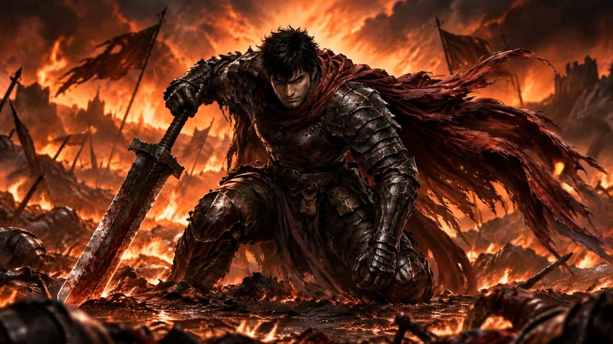
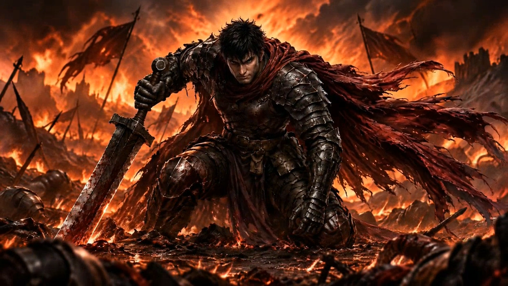

# A firmer grip — refining the Warrior's opening cinematic

*October 1 public version — cinematic still, not gameplay.*

*October 8 production revision — cinematic still, not gameplay.*

A warrior rises from hell. We started by refining a small detail in his opening shot.

For EXODUSER: HELL LORD, we revised the hand-to-hilt contact in the first five seconds of the Warrior's story cinematic. The images compare the October 1 public version with the October 8 production revision at the same two-second mark. Look at the fingers around the grip and the visible pommel.

This is a production note for a story cinematic made with AI-assisted artwork, video and audio. These are cinematic stills, not gameplay screenshots or a public demo patch announcement.

Does the hand-to-hilt contact read more naturally?

Curious about our bullet-pattern, parry and hack-and-slash ARPG? Try the free demo on Steam.
https://store.steampowered.com/app/4749590/?utm_source=itchio&utm_campaign=warrior_grip_20261013

---

# 대검을 쥔 손부터 다시 — 전사 인트로 제작 기록

지옥에서 다시 일어선 전사. 첫 장면의 작은 어색함부터 다듬었습니다.

EXODUSER: HELL LORD 전사 인트로의 첫 5초에서 손과 칼자루의 접촉을 수정했습니다. 위 비교는 10월 1일 공개본과 10월 8일 제작 수정본의 같은 2초 시점입니다. 손잡이를 감싼 손과 드러난 폼멜을 확인해 주세요.

이번 글은 AI 보조 원화·영상·음향을 활용한 스토리 컷씬 제작 기록입니다. 플레이 화면이나 Steam 공개 데모 패치 안내는 아닙니다.

손과 칼자루가 닿는 모습이 더 자연스럽게 읽히나요?

탄막·패링·핵앤슬래시 ARPG가 궁금하다면 Steam에서 무료 데모를 확인해 주세요.
https://store.steampowered.com/app/4749590/?utm_source=itchio&utm_campaign=warrior_grip_20261013
